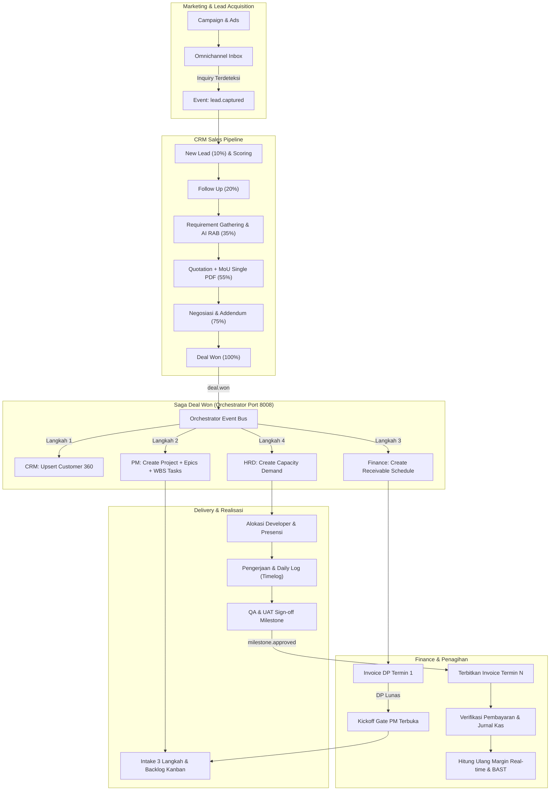

# ASTACODE ERP — ANALISIS & AUDIT SISTEM MENDALAM (ANALYSIS & AUDIT)

**Dokumen:** `docs/ANALYSIS.md`  
**Sumber Kebenaran:** `docs/MASTER PRD.md` (PRD-ASTA-ERP-001 v1.1)  
**Dokumen Acuan:** `docs/MASTER_PROMPT.md`, `docs/EVENT-CATALOG.md`, `docs/PROTOTYPE-MAP.md`, `docs/DESIGN-TOKENS.md`  
**Tanggal:** 2026-11-03  
**Status:** COMPLETE (Hasil Audit Task T00)

---

## 1. Ringkasan Eksekutif & Arsitektur Bisnis

### 1.1 Visi Produk
ASTACODE ERP Orchestrator adalah platform ERP otomasi menyeluruh yang dirancang khusus untuk operasional **Software House** berskala modern. Platform ini mengintegrasikan seluruh siklus bisnis mulai dari hulu pemasaran hingga hilir keuangan: **Marketing → CRM → Project Management (Delivery) → Finance**, yang ditopang oleh fondasi kapasitas talenta di **HRD**. 

Tujuan sentral sistem adalah menjadi **satu sumber kebenaran (single source of truth)** yang mengeliminasi input ganda (*zero double-entry*), menegakkan integritas finansial berbasis akrual, dan memangkas jeda birokrasi melalui orkestrasi event asinkron.

### 1.2 Ringkasan Modul Bisnis
1. **Modul 1 — CRM (Customer Relationship Management):**
   Hulu dari rantai nilai bisnis software house. Mengelola *Lead capture* otomatis (web, WhatsApp, Instagram), kualifikasi lead (*Lead Scoring*), riwayat aktivitas & penjadwalan presales, perumusan spesifikasi kebutuhan teknis dibantu AI (*Requirement Generator*), penyusunan *RAB Mandays* dinamis dengan tampilan ganda (*Internal HPP vs Client Price*), penetapan termin pembayaran (*Terms of Payment / TOP*), penerbitan berkas gabungan *Quotation + 22 Pasal Baku MoU* dalam 1 dokumen PDF ber-watermark/e-Sign, repositori rekaman suara presales (*Voice Note Recorder & AI Transcriber*), repositori dokumen per tahapan (*Stage Docs*), hingga *Delivery Readiness Check & Kickoff Gate*.
2. **Modul 2 — Marketing & AI Content Engine:**
   Pemasok utama corong prospek (*lead generation*). Memuat *Trend Hunter* otomatis (GitHub Trending, Dev.to, Reddit), perencanaan sprint konten berbobot pilar (40% tren, 30% edukasi, 15% serial, 10% interaktif, 5% promosi), *AI Content Studio* untuk produksi otomatis draf carousel Instagram, video pendek, dan artikel SEO, *Approval Queue* berjenjang, *Editorial Calendar & Smart Scheduler*, *Distribution Hub* omnichannel, *Omnichannel Inbox* terpadu dengan *AI Intent Detection* untuk transfer prospek ke CRM, serta pelacak anggaran iklan (*Ad Spend*) terhubung ke Finance.
3. **Modul 3 — HRD & Workload Management:**
   Fondasi kapasitas teknis dan biaya tenaga kerja. Mengelola *Master Data Pegawai* (Tetap, Kontrak, Freelance, PKL), presensi satu klik dengan validasi BSSID WiFi onsite atau geofencing WFH (tanpa menyimpan GPS permanen demi UU PDP), *Daily Log Progress-Driven* yang terhubung ke task PM, *Night Workload Engine* (pilihan kompensasi *Carryover* jam kerja siang atau insentif lembur payroll), manajemen cuti, *Capacity & Workload Matrix* (rekomendasi talenta saat Deal Won), *ATS Rekrutmen* dengan resume parser AI, portal pendaftaran PKL/magang berkuota divisi dengan e-sertifikat QR, serta *Multi-Model Payroll* (gaji tetap, honor freelance per jam riil, uang saku PKL) dengan perhitungan PPh 21 TER dan slip gaji PDF terenkripsi.
4. **Modul 4 — Project Management (Delivery):**
   Hilir eksekusi teknis dari kesepakatan penjualan. Menerima *Deal Won Intake (3 Langkah)*: (1) verifikasi spesifikasi & WBS, (2) pembagian modul ke developer berdasarkan matriks kapasitas, (3) penerbitan backlog dan koordinasi termin ke Finance. Memuat *Workspace Proyek* 10 sub-tab, *Kanban Board 7 Kolom* dengan WIP limit dan validasi transisi, *Sprint Backlog & Roadmap/Gantt*, *Modal Detail Task 70/30*, modul *QA & UAT Sign-Off* (pemicu penagihan milestone), pelacakan jam kerja (*Time Tracking*), pemantauan margin laba proyek *real-time* (peringatan margin < 30%), integrasi cabang GitHub (aturan protected branch), *Service Desk* omnichannel (Telegram, Web Portal, WhatsApp) dengan hitung mundur SLA garansi, serta *AI Diagnostic Bug Fix Engine* (pembuatan branch fix dan draf PR tanpa hak merge langsung ke production).
5. **Modul 5 — Finance & Cashflow Management:**
   Penjaga tata kelola keuangan dan kepatuhan akuntansi. Mengimplementasikan standar akuntansi akrual berpasangan (*double-entry*) dengan Chart of Accounts (COA) 23 akun. Mengelola *Invoicing & Termin AR* (otomatis dari Deal Won & persetujuan milestone PM) dengan kalkulator PPN/PPh 23 dan pengingat jatuh tempo bertingkat (H-3, H+1, H+7, H+14), *Klaim Struk AI OCR* (deteksi duplikasi hash gambar), verifikasi tagihan vendor server/cloud (alokasi ke akun 5030 proyek atau 6030 internal), kontrol pembayaran *SPK Freelancer* (maksimal pagu SPK), pencatatan beban payroll, mutasi antar-rekening internal (non-P&L), *Jurnal Umum Otomatis* anti-edit/anti-delete (hanya jurnal pembalik), laporan laba rugi (*Consolidated P&L*), laporan laba rugi per proyek (*Project P&L Margin Bar*), analisa portofolio klien & DSO, serta proyeksi arus kas.

### 1.3 Alur End-to-End "Lead-to-Cash-to-Delivery"



---

## 2. Matriks Keterlacakan Lengkap ID PRD (Traceability Matrix)

Berikut adalah pemetaan seluruh ID Kebutuhan Fungsional (FR), Aturan Bisnis (BR), Kriteria Penerimaan (AC), dan Kriteria End-to-End (E2E) dari PRD ke service pemilik dan task implementasi pada `docs/MASTER_PROMPT.md`.

### 2.1 Functional Requirements (FR)

| ID PRD | Modul | Judul Fitur PRD | Service Pemilik | Task Backend | Task Frontend |
|---|---|---|---|---|---|
| **FR-CRM-01** | CRM | Input Lead & Auto-Master Customer | `crm-service` | `CRM-BE-01`, `CRM-BE-02` | `CRM-FE-01` |
| **FR-CRM-02** | CRM | Sales Pipeline (Kanban + Tabel) | `crm-service` | `CRM-BE-03` | `CRM-FE-02` |
| **FR-CRM-03** | CRM | Detail Lead Workspace & Sub-tabs | `crm-service` | `CRM-BE-03` | `CRM-FE-03`, `CRM-FE-06` |
| **FR-CRM-04** | CRM | Tab Activity & Penjadwalan Kalender | `crm-service` | `CRM-BE-04` | `CRM-FE-03` |
| **FR-CRM-05** | CRM | Tab Requirement + AI Generate RAB | `crm-service`, `ai-service` | `CRM-BE-05` | `CRM-FE-03` |
| **FR-CRM-06** | CRM | Tab RAB Mandays (Dual-View Internal vs Client) | `crm-service` | `CRM-BE-06` | `CRM-FE-04` |
| **FR-CRM-07** | CRM | Setting TOP (Terms of Payment, Validasi 100%) | `crm-service` | `CRM-BE-07` | `CRM-FE-05` |
| **FR-CRM-08** | CRM | Generate Quotation + MoU dalam Satu PDF | `crm-service` | `CRM-BE-08` | `CRM-FE-05` |
| **FR-CRM-09** | CRM | Deal Won, Saga & Handover Otomatis | `crm-service`, `orchestrator-service` | `CRM-BE-09`, `T03` | `CRM-FE-06`, `CRM-FE-08` |
| **FR-CRM-10** | CRM | Reject / Lost dengan Alasan Wajib | `crm-service` | `CRM-BE-03`, `CRM-BE-09` | `CRM-FE-02` |
| **FR-CRM-11** | CRM | WhatsApp Client Care Inbox (Terintegrasi AI) | `crm-service`, `ai-service` | `CRM-BE-14` | `CRM-FE-07` |
| **FR-CRM-12** | CRM | Lead Scoring & Prioritisasi Otomatis | `crm-service` | `CRM-BE-02` | `CRM-FE-01` |
| **FR-CRM-13** | CRM | Master Customer 360° (Akun & Kontak) | `crm-service` | `CRM-BE-01` | `CRM-FE-01` |
| **FR-CRM-14** | CRM | Contracts, SLA & Renewal Monitoring | `crm-service` | `CRM-BE-13` | `CRM-FE-08` |
| **FR-CRM-15** | CRM | Forecast, Target & Pipeline Analytics | `crm-service` | `CRM-BE-15` | `CRM-FE-09` |
| **FR-CRM-16** | CRM | Rate Card, Katalog Modul & Template Library | `crm-service` | `CRM-BE-16` | `CRM-FE-09` |
| **FR-CRM-17** | CRM | Approval Engine CRM (Diskon & Quotation) | `core-service`, `crm-service` | `CRM-BE-06`, `CRM-BE-08`, `T02` | `CRM-FE-05` |
| **FR-CRM-18** | CRM | Pengaturan Parameter CRM | `crm-service`, `core-service` | `CRM-BE-16`, `T02` | `CRM-FE-09` |
| **FR-CRM-19** | CRM | Voice Note Recorder & AI Transcriber Presales | `crm-service`, `ai-service` | `CRM-BE-10` | `CRM-FE-06`, `CRM-FE-09` |
| **FR-CRM-20** | CRM | Files & Stage Docs (Repositori Berkas Lead) | `crm-service`, `core-service` | `CRM-BE-11` | `CRM-FE-06` |
| **FR-CRM-21** | CRM | Contracts & Legal Studio (22 Pasal MoU & Addendum)| `crm-service` | `CRM-BE-08`, `CRM-BE-12` | `CRM-FE-08` |
| **FR-CRM-22** | CRM | Project Transition Hub & Kalender Penagihan AR | `crm-service`, `finance-service` | `CRM-BE-09` | `CRM-FE-08` |
| **FR-CRM-23** | CRM | Delivery Readiness Check & Kickoff Gate | `crm-service`, `pm-service` | `CRM-BE-09`, `PM-BE-01` | `CRM-FE-06` |
| **FR-CRM-24** | CRM | Pipeline Guard & Audit Trail | `crm-service` | `CRM-BE-03` | `CRM-FE-02` |
| **FR-MKT-01** | Marketing | Riset Tren (GitHub, Reddit, HackerNews) | `marketing-service`, `ai-service` | `MKT-BE-01` | `MKT-FE-01` |
| **FR-MKT-02** | Marketing | Pilar Konten & Sprint Planner Mingguan | `marketing-service` | `MKT-BE-01` | `MKT-FE-01` |
| **FR-MKT-03** | Marketing | AI Content Studio (Carousel, Video, Blog SEO) | `marketing-service`, `ai-service` | `MKT-BE-01` | `MKT-FE-01` |
| **FR-MKT-04** | Marketing | Preview Studio & Kontras Syntax Highlight | `marketing-service` | `MKT-BE-01` | `MKT-FE-01` |
| **FR-MKT-05** | Marketing | Approval Queue Konten Pemasaran | `marketing-service` | `MKT-BE-01` | `MKT-FE-01` |
| **FR-MKT-06** | Marketing | Editorial Calendar & Smart Scheduler | `marketing-service` | `MKT-BE-02` | `MKT-FE-01` |
| **FR-MKT-07** | Marketing | Distribution Hub (Instagram, TikTok, LinkedIn) | `marketing-service` | `MKT-BE-02` | `MKT-FE-01` |
| **FR-MKT-08** | Marketing | Omnichannel Inbox & AI Transfer to CRM Lead | `marketing-service` | `MKT-BE-02` | `MKT-FE-01` |
| **FR-MKT-09** | Marketing | Social Listening & Analisa Kompetitor | `marketing-service`, `ai-service` | `MKT-BE-02` | `MKT-FE-01` |
| **FR-MKT-10** | Marketing | Analytics & Feedback Learning Loop | `marketing-service` | `MKT-BE-02` | `MKT-FE-01` |
| **FR-MKT-11** | Marketing | Campaign & Ads Budget Tracking | `marketing-service` | `MKT-BE-02` | `MKT-FE-01` |
| **FR-MKT-12** | Marketing | Atribusi Sumber Lead (CPL, CAC, ROAS) | `marketing-service` | `MKT-BE-02` | `MKT-FE-01` |
| **FR-HRD-01** | HRD | Master Data Pegawai & Struktur Upah | `hrd-service` | `HRD-BE-01` | `HRD-FE-01` |
| **FR-HRD-02** | HRD | Presensi Onsite BSSID / Geofence WFH | `hrd-service` | `HRD-BE-02` | `HRD-FE-01` |
| **FR-HRD-03** | HRD | Daily Log Progress-Driven (Koneksi Task PM) | `hrd-service` | `HRD-BE-02` | `HRD-FE-01` |
| **FR-HRD-04** | HRD | Night Workload Engine (Carryover vs Insentif) | `hrd-service` | `HRD-BE-02` | `HRD-FE-01` |
| **FR-HRD-05** | HRD | Pengelolaan Cuti & Izin Berjenjang | `hrd-service` | `HRD-BE-03` | `HRD-FE-01` |
| **FR-HRD-06** | HRD | Matriks Kapasitas, Utilisasi & Capacity Demand | `hrd-service` | `HRD-BE-03` | `HRD-FE-01` |
| **FR-HRD-07** | HRD | Rekrutmen (ATS) & AI Resume Parser | `hrd-service`, `ai-service` | `HRD-BE-04` | `HRD-FE-01` |
| **FR-HRD-08** | HRD | Manajemen PKL/Magang & E-Sertifikat QR | `hrd-service` | `HRD-BE-04` | `HRD-FE-01` |
| **FR-HRD-09** | HRD | Multi-Model Payroll & Perhitungan PPh 21 TER | `hrd-service` | `HRD-BE-05` | `HRD-FE-01` |
| **FR-HRD-10** | HRD | Penilaian Kinerja & Evaluasi 360° | `hrd-service` | `HRD-BE-05` | `HRD-FE-01` |
| **FR-HRD-11** | HRD | Dokumen & Surat Menyurat Resmi Kepegawaian | `hrd-service` | `HRD-BE-01` | `HRD-FE-01` |
| **FR-HRD-12** | HRD | Rekapitulasi Laporan SDM & Headcount | `hrd-service` | `HRD-BE-05` | `HRD-FE-01` |
| **FR-PM-01** | PM | Intake Deal Won 3 Langkah & Backlog Publishing | `pm-service` | `PM-BE-01` | `PM-FE-01` |
| **FR-PM-02** | PM | Workspace Proyek (10 Sub-tab Kerja) | `pm-service` | `PM-BE-02` | `PM-FE-01` |
| **FR-PM-03** | PM | Board Kanban 7 Kolom & WIP Limits | `pm-service` | `PM-BE-02` | `PM-FE-01` |
| **FR-PM-04** | PM | Backlog, Epics, Sprints & Burndown Mandays | `pm-service` | `PM-BE-02` | `PM-FE-01` |
| **FR-PM-05** | PM | Roadmap / Gantt Chart Interaktif | `pm-service` | `PM-BE-02` | `PM-FE-01` |
| **FR-PM-06** | PM | Daftar Pekerjaan (JQL Filter & Ekspor) | `pm-service` | `PM-BE-02` | `PM-FE-01` |
| **FR-PM-07** | PM | Task Detail Modal 70/30 | `pm-service` | `PM-BE-02` | `PM-FE-01` |
| **FR-PM-08** | PM | QA, Testing Matrix & Sign-off UAT Milestone | `pm-service` | `PM-BE-03` | `PM-FE-01` |
| **FR-PM-09** | PM | Docs, Wiki & Technical Specification | `pm-service` | `PM-BE-03` | `PM-FE-01` |
| **FR-PM-10** | PM | Time Tracking & Alert Over-Budget Mandays | `pm-service` | `PM-BE-03` | `PM-FE-01` |
| **FR-PM-11** | PM | Finance & Budget Proyek (Real-time Margin Bar) | `pm-service`, `finance-service` | `PM-BE-03` | `PM-FE-01` |
| **FR-PM-12** | PM | GitHub Branching & Protected Branch Integration | `pm-service` | `PM-BE-04` | `PM-FE-01` |
| **FR-PM-13** | PM | Service Desk Omnichannel & Hitung Mundur SLA | `pm-service` | `PM-BE-04` | `PM-FE-01`, `X-01` |
| **FR-PM-14** | PM | AI Diagnostic Engine & Bug Fixing Patch PR | `pm-service`, `ai-service` | `PM-BE-04` | `PM-FE-01` |
| **FR-PM-15** | PM | Management Team & Matriks Beban Kerja | `pm-service`, `hrd-service` | `PM-BE-03` | `PM-FE-01` |
| **FR-PM-16** | PM | Automation Rules Proyek | `pm-service` | `PM-BE-02` | `PM-FE-01` |
| **FR-PM-17** | PM | Change Request & Addendum Scope Trigger | `pm-service`, `crm-service` | `PM-BE-04`, `CRM-BE-12` | `PM-FE-01` |
| **FR-FIN-01** | Finance | Invoicing & Termin AR (Kalkulator Pajak, Net-N) | `finance-service` | `FIN-BE-02` | `FIN-FE-01` |
| **FR-FIN-02** | Finance | Klaim Struk AI OCR & Verifikasi Pengeluaran | `finance-service`, `ai-service` | `FIN-BE-03` | `FIN-FE-01` |
| **FR-FIN-03** | Finance | Tagihan Vendor Cloud & SaaS (Akun 5030 vs 6030) | `finance-service` | `FIN-BE-03` | `FIN-FE-01` |
| **FR-FIN-04** | Finance | SPK Freelancer / Subkontraktor & Pagu Kontrak | `finance-service` | `FIN-BE-03` | `FIN-FE-01` |
| **FR-FIN-05** | Finance | Jurnal Payroll Staf Tetap (Akun 6010) | `finance-service` | `FIN-BE-03` | `FIN-FE-01` |
| **FR-FIN-06** | Finance | Biaya Operasional Kantor HQ (OPEX 6xxx) | `finance-service` | `FIN-BE-03` | `FIN-FE-01` |
| **FR-FIN-07** | Finance | Rekening Bank & Buku Kas (Saldo Berjalan) | `finance-service` | `FIN-BE-04` | `FIN-FE-01` |
| **FR-FIN-08** | Finance | Mutasi Antar-Rekening Internal (Non-P&L) | `finance-service` | `FIN-BE-04` | `FIN-FE-01` |
| **FR-FIN-09** | Finance | Chart of Accounts (COA 23 Akun Hierarkis) | `finance-service` | `FIN-BE-01` | `FIN-FE-01` |
| **FR-FIN-10** | Finance | Jurnal Umum Otomatis (Validasi Debit=Kredit) | `finance-service` | `FIN-BE-01` | `FIN-FE-01` |
| **FR-FIN-11** | Finance | Consolidated P&L (Laba Kotor, OPEX, EBITDA) | `finance-service` | `FIN-BE-04` | `FIN-FE-01` |
| **FR-FIN-12** | Finance | P&L per Proyek & Visual Margin Bar | `finance-service` | `FIN-BE-04` | `FIN-FE-01` |
| **FR-FIN-13** | Finance | Analisis Portofolio Customer, Aging AR & DSO | `finance-service` | `FIN-BE-04` | `FIN-FE-01` |
| **FR-FIN-14** | Finance | Executive Dashboard Keuangan & Runway | `finance-service` | `FIN-BE-04` | `FIN-FE-01` |
| **FR-FIN-15** | Finance | Arus Kas & Proyeksi Inflow/Outflow 14 Hari | `finance-service` | `FIN-BE-04` | `FIN-FE-01` |

---

### 2.2 Aturan Bisnis (Business Rules / BR)

| ID Aturan Bisnis | Intisari Aturan Bisnis Server-Side | Task Penguji / Penegak |
|---|---|---|
| **BR-CRM-01** | Lead wajib memiliki minimal nama kontak dan salah satu kontak (HP/WA atau Email valid). | `CRM-BE-01`, `CRM-BE-02` |
| **BR-CRM-02** | Deduplikasi lead berbasis normalisasi nomor HP E.164 dan email case-insensitive. | `CRM-BE-02` |
| **BR-CRM-03** | Lead yang tidak dihubungi dalam 30 menit (SLA follow-up) mendapat status breached. | `CRM-BE-02`, `T03` |
| **BR-CRM-04** | Perpindahan stage pipeline hanya boleh maju bertahap atau mundur ke stage sebelumnya (kecuali Reject). | `CRM-BE-03` |
| **BR-CRM-05** | Stage Quotation wajib memiliki minimal 1 draf RAB yang valid dan bernilai > 0. | `CRM-BE-03`, `CRM-BE-06` |
| **BR-CRM-06** | Stage Deal Won wajib memiliki skema TOP dengan total persentase persis 100%. | `CRM-BE-03`, `CRM-BE-07` |
| **BR-CRM-07** | Diskon > 10% wajib persetujuan Sales Manager; diskon > 15% wajib persetujuan Direktur. | `CRM-BE-06`, `CRM-BE-08`, `T02` |
| **BR-CRM-08** | Perpindahan stage ke Reject wajib menyertakan kode alasan penolakan dan catatan. | `CRM-BE-03` |
| **BR-CRM-09** | Nomor dokumen (`LD-*`, `QT-*`, `MOU-*`, `ADD-*`) wajib atomic, berurutan, dan tidak loncat. | `T02` (Numbering Service) |
| **BR-CRM-10** | Draf Quotation + MoU yang sudah dikirim ke klien dikunci menjadi versi read-only immutable. | `CRM-BE-08` |
| **BR-CRM-11** | Customer yang dibuat dari Deal Won otomatis aktif dan terhubung ke proyek baru. | `CRM-BE-09`, `T03` |
| **BR-CRM-12** | Voice note presales wajib ditranskripsi ke teks dan diekstrak action item teknisnya oleh AI. | `CRM-BE-10`, `T04` |
| **BR-CRM-13** | Handover Deal Won wajib idempoten: duplikasi event tidak boleh membuat proyek ganda di PM. | `T03`, `PM-BE-01` |
| **BR-CRM-14** | Dokumen lampiran lead divalidasi MIME type, ekstensi, dan lolos pemindaian antivirus. | `T02` (Files & Scanner) |
| **BR-CRM-15** | Quotation baru pada lead yang sama menaikkan nomor revisi (`-R1`, `-R2`) tanpa menghapus riwayat lama. | `CRM-BE-08` |
| **BR-CRM-16** | Margin RAB yang dihitung di bawah batas aman (30%) wajib memunculkan peringatan resiko margin. | `CRM-BE-06` |
| **BR-CRM-17** | Modul WBS dalam RAB wajib memiliki estimasi mandays per role teknis yang terdefinisi di Rate Card. | `CRM-BE-06` |
| **BR-CRM-18** | Nilai kontrak pada Quotation wajib ditampilkan lengkap dengan representasi teks terbilang Rupiah. | `T01`, `T06`, `CRM-BE-08` |
| **BR-CRM-19** | Kontrak atau MoU yang mengalami perubahan klausul dari 22 pasal baku ditandai "Perlu Review Legal". | `CRM-BE-12` |
| **BR-CRM-20** | Addendum scope proyek otomatis menghasilkan draf revisi nilai RAB dan revisi invoice. | `CRM-BE-12`, `PM-BE-04` |
| **BR-CRM-21** | Data sensitif (HPP, margin kotor, hourly rate staf) hanya boleh diakses peran tertentu dan disaring server. | `T01`, `T02`, `CRM-BE-06` |
| **BR-WA-01** | Pesan WhatsApp masuk yang mengandung inquiry proyek diarahkan ke antrean verifikasi lead. | `CRM-BE-14` |
| **BR-WA-02** | Draf balasan AI pada WhatsApp tidak pernah dikirim otomatis tanpa review manusia (Human-in-the-loop). | `CRM-BE-14`, `T04` |
| **BR-WA-03** | Webhook WhatsApp wajib memverifikasi signature HMAC sebelum memproses muatan pesan. | `T02`, `CRM-BE-14` |
| **BR-WA-04** | Nomor telepon WhatsApp wajib distandarisasi ke format internasional E.164 (+62). | `CRM-BE-14` |
| **BR-MKT-01** | Konten yang di-generate AI wajib berstatus draf (`planned`/`in_review`) sebelum disetujui. | `MKT-BE-01` |
| **BR-MKT-02** | Alokasi pilar konten default mengikuti rasio 40:30:15:10:5 dan dapat dikonfigurasi. | `MKT-BE-01` |
| **BR-MKT-03** | Publikasi konten ke media sosial mencatat log waktu riil dan status respons API eksternal. | `MKT-BE-02` |
| **BR-MKT-04** | Realisasi ad spend harian dicatat sebagai beban pemasaran akun 6050 di Finance. | `MKT-BE-02`, `FIN-BE-03` |
| **BR-MKT-05** | Atribusi lead mengaitkan parameter UTM saat capture pertama kali dan tidak boleh ditimpa. | `MKT-BE-02`, `CRM-BE-02` |
| **BR-MKT-06** | Konten yang di-reject pada antrean approval wajib memuat catatan feedback perbaikan. | `MKT-BE-01` |
| **BR-HRD-01** | Koordinat GPS presensi WFH hanya diverifikasi saat radius check dan tidak disimpan permanen di DB. | `HRD-BE-02` |
| **BR-HRD-02** | Daily log pegawai wajib mereferensikan minimal 1 task aktif PM atau URL commit GitHub yang valid. | `HRD-BE-02` |
| **BR-HRD-03** | Pengajuan magang/PKL otomatis ditolak sistem bila kuota divisi pada periode tersebut telah penuh. | `HRD-BE-04` |
| **BR-HRD-04** | Kerja malam (> 22:00) yang disetujui hanya boleh memilih salah satu: Carryover jam atau Insentif lembur. | `HRD-BE-02` |
| **BR-HRD-05** | Perhitungan PPh 21 menggunakan tarif efektif rata-rata (TER) sesuai regulasi yang berlaku di Indonesia. | `HRD-BE-05` |
| **BR-HRD-06** | Slip gaji PDF yang dikirimkan wajib dienkripsi kata sandi berbasis tanggal lahir pegawai. | `HRD-BE-05` |
| **BR-HRD-07** | Total beban kerja pegawai tidak boleh melebihi kapasitas jam normal tanpa peringatan utilisasi. | `HRD-BE-03` |
| **BR-PM-01** | Proyek baru dari Deal Won wajib melalui proses intake 3 langkah sebelum backlog aktif. | `PM-BE-01` |
| **BR-PM-02** | Transisi task ke kolom "Done" pada board Kanban wajib memenuhi kriteria QA pass & PR merge. | `PM-BE-02` |
| **BR-PM-03** | Sprint aktif tidak dapat dimulai sebelum Kickoff Gate terpenuhi (pembayaran DP lunas atau waiver). | `PM-BE-01`, `CRM-BE-09` |
| **BR-PM-04** | Milestone UAT yang disetujui klien memicu pembuatan draf invoice termin di Finance secara otomatis. | `PM-BE-03`, `FIN-BE-02` |
| **BR-PM-05** | AI Diagnostic Bug Fix Engine dilarang melakukan merge langsung ke branch produksi (`main`). | `PM-BE-04` |
| **BR-PM-06** | Tiket service desk yang melewati batas SLA otomatis dieskalasi ke Project Manager & Tech Lead. | `PM-BE-04` |
| **BR-PM-07** | Pengeluaran jam kerja proyek (timelog) yang mencapai 80% dan 100% pagu wajib memicu alert peringatan. | `PM-BE-03` |
| **BR-FIN-01** | Setiap posting jurnal umum wajib tervalidasi seimbang (total debit = total kredit). | `FIN-BE-01` |
| **BR-FIN-02** | Jurnal akuntansi yang sudah diposting dilarang diedit atau dihapus; hanya boleh dibatalkan via jurnal pembalik. | `FIN-BE-01` |
| **BR-FIN-03** | Pembayaran DP termin 1 diakui pada akun 2040 (Pendapatan Diterima di Muka) sebelum diakui bertahap. | `FIN-BE-01`, `FIN-BE-02` |
| **BR-FIN-04** | Mutasi dana antar rekening kas/bank internal tidak boleh mempengaruhi akun laba rugi (P&L 4xxx/5xxx/6xxx). | `FIN-BE-04` |
| **BR-FIN-05** | Klaim struk pengeluaran mendeteksi duplikasi berdasarkan kombinasi hash gambar dan vendor+tanggal+nominal. | `FIN-BE-03` |
| **BR-FIN-06** | Total pembayaran bertahap ke SPK Freelancer tidak boleh melebihi nilai pagu kontrak yang disepakati. | `FIN-BE-03` |
| **BR-FIN-07** | Penomoran invoice (`INV/YYYY/MM/NNNN`) bersifat urut waktu dan unik dalam satu tahun kalender. | `T02`, `FIN-BE-02` |
| **BR-FIN-08** | Invoice berstatus Lunas tidak dapat dibatalkan (void) sebelum dilakukan pembatalan transaksi penerimaan kas. | `FIN-BE-02` |
| **BR-FIN-09** | Seluruh perhitungan moneter menggunakan ketepatan desimal `DECIMAL(18,2)` dan pembulatan akuntansi standar. | `T01`, `T06`, `FIN-BE-01` |

---

### 2.3 Acceptance Criteria (AC) & Skenario End-to-End (E2E)

| ID AC / E2E | Deskripsi Skenario Pengujian | Task Penanggung Jawab |
|---|---|---|
| **AC-CRM-01** | Lead baru berhasil dibuat dari form manual dan auto-create customer draft. | `CRM-BE-01`, `CRM-FE-01` |
| **AC-CRM-02** | Lead dari form website masuk ke CRM dengan atribusi UTM lengkap. | `CRM-BE-02`, `MKT-BE-02` |
| **AC-CRM-03** | SLA timer follow-up aktif dan memberi peringatan saat melewati 30 menit. | `CRM-BE-02`, `T03` |
| **AC-CRM-04** | Drag-and-drop kartu di Kanban memperbarui stage dan persentase probabilitas. | `CRM-FE-02`, `CRM-BE-03` |
| **AC-CRM-05** | Percakapan WhatsApp dapat dilihat di inbox CRM dan AI memberikan draf balasan. | `CRM-FE-07`, `CRM-BE-14` |
| **AC-CRM-06** | File rekaman suara presales berhasil diunggah, ditranskripsi, dan menghasilkan dokumen rangkuman AI. | `CRM-FE-06`, `CRM-BE-10` |
| **AC-CRM-07** | Requirement generator AI menghasilkan draf breakdown WBS dan mandays per role. | `CRM-FE-03`, `CRM-BE-05` |
| **AC-CRM-08** | RAB spreadsheet mendukung pengeditan sel mandays, rate card, dan toggle dual-view margin. | `CRM-FE-04`, `CRM-BE-06` |
| **AC-CRM-09** | Validasi TOP menolak penyimpanan jika total persentase termin kurang atau lebih dari 100%. | `CRM-FE-05`, `CRM-BE-07` |
| **AC-CRM-10** | Draf Quotation + MoU berhasil diekspor menjadi 1 file PDF A4 dengan layout baku dan teks terbilang benar. | `CRM-FE-05`, `CRM-BE-08` |
| **AC-CRM-11** | Sistem memblokir transisi ke stage Quotation bila draf RAB belum diisi item pekerjaan. | `CRM-BE-03`, `CRM-FE-02` |
| **AC-CRM-12** | Sistem memblokir penandatanganan deal bila skema TOP belum valid 100%. | `CRM-BE-03`, `CRM-FE-05` |
| **AC-CRM-13** | Penolakan lead mewajibkan pengisian alasan penolakan dan memindahkan kartu ke stage Reject. | `CRM-FE-02`, `CRM-BE-03` |
| **AC-CRM-14** | Handover otomatis Deal Won mengeksekusi pembuatan proyek di PM, jadwal invoice di Finance, dan alokasi di HRD. | `CRM-BE-09`, `T03`, `X-05` |
| **AC-CRM-15** | Voice note presales dapat diputar kembali dari pemutar audio bawaan dan transkrip tersimpan rapi. | `CRM-FE-06`, `CRM-BE-10` |
| **AC-CRM-16** | Addendum kontrak menghasilkan penyesuaian nilai RAB dan klausul amandemen resmi. | `CRM-FE-08`, `CRM-BE-12` |
| **AC-CRM-17** | Modifikasi 22 pasal baku terdeteksi dan tercatat pada log deviasi klausul legal. | `CRM-FE-08`, `CRM-BE-12` |
| **AC-MKT-01** | Riset tren berhasil menarik topik tren mingguan dan mengelompokkannya ke pilar konten. | `MKT-BE-01`, `MKT-FE-01` |
| **AC-MKT-02** | Konten carousel dan naskah video berhasil digenerate AI sesuai Brand Kit Astacode. | `MKT-BE-01`, `MKT-FE-01` |
| **AC-MKT-03** | Omnichannel inbox mendeteksi pesan penawaran proyek dan menyediakan tombol transfer ke CRM. | `MKT-BE-02`, `MKT-FE-01` |
| **AC-HRD-01** | Presensi WFH di luar radius 50 meter geofence ditolak sistem dengan pesan informatif. | `HRD-BE-02`, `HRD-FE-01` |
| **AC-HRD-02** | Daily log yang tidak mencantumkan task aktif PM ditolak saat submit. | `HRD-BE-02`, `HRD-FE-01` |
| **AC-HRD-03** | Pengajuan magang saat kuota divisi penuh otomatis menerima surat penolakan sopan ber-template. | `HRD-BE-04`, `HRD-FE-01` |
| **AC-HRD-04** | Slip gaji yang diunduh meminta kata sandi tanggal lahir (DDMMYYYY) sebelum dapat dibuka. | `HRD-BE-05`, `HRD-FE-01` |
| **AC-PM-01** | Proyek baru dari Deal Won menampilkan daftar epics dan modul yang sesuai dengan RAB Quotation. | `PM-BE-01`, `PM-FE-01` |
| **AC-PM-02** | Task Kanban tidak dapat dipindahkan ke "Done" tanpa link PR GitHub yang sudah di-merge. | `PM-BE-02`, `PM-FE-01` |
| **AC-PM-03** | UAT sign-off oleh klien memicu pembuatan draf invoice termin milestone di Finance. | `PM-BE-03`, `FIN-BE-02` |
| **AC-PM-04** | AI diagnostic engine menghasilkan usulan patch git dan membuat branch perbaikan otomatis. | `PM-BE-04`, `PM-FE-01` |
| **AC-FIN-01** | Invoice diterbitkan dengan nomor resmi, perhitungan PPN benar, dan draf terkirim ke email klien. | `FIN-BE-02`, `FIN-FE-01` |
| **AC-FIN-02** | OCR struk berhasil mengekstrak nilai nominal dan mendeteksi foto struk duplikat. | `FIN-BE-03`, `FIN-FE-01` |
| **AC-FIN-03** | Jurnal umum otomatis menghasilkan sepasang debet dan kredit yang seimbang untuk setiap transaksi invoice. | `FIN-BE-01`, `FIN-FE-01` |
| **AC-FIN-04** | Laporan P&L per proyek menampilkan margin bar dengan visual serapan biaya riil (freelance + cloud + timelog). | `FIN-BE-04`, `FIN-FE-01` |
| **AC-FIN-05** | Mutasi antar-rekening internal hanya memindahkan saldo kas/bank tanpa mengubah angka laba rugi. | `FIN-BE-04`, `FIN-FE-01` |
| **E2E-01** | Alur lengkap Lead Capture → Quotation → MoU disetujui → Deal Won → Proyek PM terbentuk dalam ≤ 2 menit. | `X-05` |
| **E2E-02** | UAT milestone disetujui PM → Invoice termin terbit di Finance → Pembayaran diverifikasi → Jurnal kas posted. | `X-05` |
| **E2E-03** | Absensi harian + timelog engineer langsung mengikis budget mandays proyek dan mengupdate margin P&L proyek. | `X-05` |
| **E2E-04** | Klaim struk reimbursemen di-submit staf → OCR lolos → diverifikasi Finance → kas kecil berkurang & jurnal beban tercatat. | `X-05` |
| **E2E-05** | Penggajian bulanan di-approve Direktur → slip gaji terkirim terenkripsi → jurnal utang gaji terposting otomatis. | `X-05` |
| **E2E-06** | Klien melaporkan tiket via Telegram → tiket masuk Service Desk → SLA timer berjalan → engineer fix bug via AI PR. | `X-05` |
| **E2E-07** | Simulasi kegagalan langkah pada Saga Deal Won (mis. PM service timeout) mengaktifkan retry dan tombol "Retry Handover". | `T03`, `X-05` |
| **E2E-08** | Verifikasi isolasi keamanan: Akun Sales mencoba mengakses endpoint slip gaji / margin Finance via API → 403 Forbidden dan insiden tercatat di audit log. | `T02`, `J-01`, `X-05` |

---

## 3. Daftar Inkonsistensi / Ambiguitas PRD & Keputusan Default

Mengacu pada PRD Lampiran F (Penyelarasan) dan Lampiran G (Open Questions), berikut adalah daftar ambiguitas serta **keputusan arsitektur default** yang diadopsi dalam master prompt:

| # | Butir Ambiguitas / Pertanyaan Terbuka | Situasi di PRD | Keputusan Default yang Diterapkan di Proyek Ini |
|:---:|---|---|---|
| **01** | **Ambang Diskon & Approval** (Lampiran G #13) | Teks PRD v2.0 menyebut persetujuan diskon > 15%, tetapi matriks wewenang melarang Sales diskon > 10%. | **Pola Berjenjang:**<br>• Diskon `≤ 10%`: Wewenang mandiri Sales.<br>• Diskon `> 10% s.d. 15%`: Wajib Approval Sales Manager.<br>• Diskon `> 15%`: Wajib Approval Direktur Utama. |
| **02** | **Jatuh Tempo Invoice (Due Date)** (Lampiran G #18) | Pasal 6 draf kontrak menyebut maksimal 14 hari, sedangkan modul TOP mendukung termin dinamis Net-N (Net-7, Net-14, Net-30). | **Net-14 sebagai Default Sistem:** Nilai bawaan jatuh tempo adalah 14 hari kalender sejak penerbitan invoice, namun field `due_date` dapat disesuaikan per termin pada setting TOP dengan batas validasi 7 s.d. 60 hari. |
| **03** | **Jalur Integrasi WhatsApp** (Lampiran G #17) | PRD menyebut interaktivitas ala WhatsApp Web, sementara PRD terpadu menyarankan Cloud API resmi. | **Arsitektur Adapter Dual-Driver (`WhatsAppChannelInterface`):**<br>• Driver `cloud_api`: WhatsApp Cloud API resmi (target utama produksi).<br>• Driver `waha_gateway`: WAHA / QR-based gateway lokal (cocok untuk pengujian dev tanpa biaya sesi). |
| **04** | **Readiness Check PM** (Lampiran G #14) | Apakah Delivery Readiness Check wajib untuk seluruh deal atau hanya nilai tertentu? | **Wajib untuk Semua Proyek:** Semua deal won wajib melalui verifikasi kesiapan (kelengkapan KAK, persetujuan scope WBS, dan ketersediaan lead engineer) guna mencegah proyek macet sebelum kickoff. |
| **05** | **Kickoff Gate & DP** (Lampiran G #15) | Apakah sprint baru boleh aktif setelah DP lunas atau langsung saat Deal Won? | **Default Wajib DP Lunas:** Sprint Kanban berstatus terkunci (*Locked*) sampai termin DP (Termin 1) berstatus `PAID` di Finance, kecuali ada otorisasi khusus *Waiver Kickoff* dari Direktur. |
| **06** | **Tinjauan Legalitas 22 Pasal MoU** (Lampiran G #16) | • Pasal 11: Pengalihan hak cipta.<br>• Pasal 22: Penggunaan e-Meterai mengaitkan UU ITE.<br>• Pasal 7: Pajak PPN flat 11%. | **Penyesuaian Klausul Template:**<br>• Hak cipta source code beralih penuh kepada Pihak Pertama **hanya setelah seluruh termin pelunasan (100%) lunas**.<br>• Dasar hukum e-Meterai merujuk pada **UU Bea Meterai (UU No. 10/2020)**, sedangkan Tanda Tangan Elektronik merujuk pada **UU ITE (UU No. 1/2024)**.<br>• Parameter pajak PPN dan PPh bersifat variabel dinamis di tabel `settings`. |
| **07** | **Pengakuan Pendapatan (Revenue Recognition)** (Lampiran G #01) | Pembukuan akrual vs kas pada pembayaran termin DP. | **Akrual Murni Berbasis Milestone:**<br>• Pembayaran termin DP diakui sebagai **Utang / Pendapatan Diterima di Muka (Akun 2040)**.<br>• Pendapatan jasa (`Akun 4010`) baru diakui saat milestone pekerjaan selesai diverifikasi (BAST/UAT). |
| **08** | **Penyelarasan Format Penomoran** (Lampiran C & F) | Variasi format penomoran di berbagai lampiran. | **Format Standar Terpusat via Core Numbering Service:**<br>• Lead: `LD-YYYY-NNNN`<br>• Quotation: `QT/YYYY/MM/NNNN-Rn`<br>• Perjanjian/MoU: `MOU/ASTA/YYYY/MM/NNNN`<br>• Addendum: `ADD/ASTA/YYYY/MM/NNNN`<br>• Customer: `CUS-NNNN`<br>• Proyek: `PRJ-YYYY-NNNN`<br>• Invoice: `INV/YYYY/MM/NNNN`<br>• Tiket Support: `TICKET-YYYY-NNNN`<br>• Jurnal: `JRN-{AR|AP|HR|OPEX|TRF|MNL}/YYYY/MM/NNNN`<br>• Payroll: `PAY/YYYY/MM` |

---

## 4. Analisis Dampak Perubahan Topologi: Modular Monolith → Microservice

Keputusan arsitektur proyek beralih dari *modular monolith* ke **microservice** (1 gateway + 8 service terisolasi + shared kernel). Berikut adalah evaluasi dampak teknis serta strategi mitigasinya:

| Aspek Arsitektur | Implementasi Monolith Asli PRD | Implementasi Microservice ASTACODE | Mitigasi Teknis yang Diterapkan |
|---|---|---|---|
| **Batas Data (Data Isolation)** | Semua modul berbagi satu database MySQL dengan relasi foreign key langsung antar tabel. | **Database per service:** `astacode_core`, `astacode_crm`, `astacode_marketing`, `astacode_hrd`, `astacode_pm`, `astacode_finance`, `astacode_ai`, `astacode_orchestrator`. | **Dilarang keras melakukan SQL JOIN lintas database.** Relasi lintas batas modul hanya menyimpan ID referensi (mis. `customer_id`, `project_id`) ditambah *snapshot* kolom yang sering dibaca (mis. `customer_name`, `project_title`). |
| **Integritas Transaksi** | Transaksi atomik database tunggal (`DB::transaction`). | Transaksi terdistribusi lintas database mandiri. | Menggunakan **Transactional Outbox Pattern** di setiap service produsen dan **Saga State Machine** di `orchestrator-service` dengan langkah idempoten dan kompensasi manual. |
| **Komunikasi Antar Service** | Pemanggilan kelas PHP langsung (`app(Action::class)->execute()`). | Komunikasi jaringan: (1) REST internal bertanda tangan HMAC untuk query sinkron, (2) Outbox Relay untuk event asinkron. | Paket `shared/astacode-kernel` menyediakan trait `InternalRequestSigner`, middleware `VerifyServiceToken`, dan klien HTTP internal dengan timeout pendek dan retry terkontrol. |
| **Konsistensi Laporan Konsolidasi** | Query SQL agregasi langsung lintas tabel (JOIN CRM, Finance, PM, HRD). | Tabel terpisah di database yang berbeda. | `orchestrator-service` mengonsumsi event domain untuk membangun **Read-Model / Summary Projection Tables** (tabel ringkasan denormalisasi) khusus untuk Executive Dashboard. |
| **Satu Pintu Akses Frontend** | Frontend memanggil berbagai controller dalam satu aplikasi monolith. | Frontend hanya memanggil port BFF/Gateway (port 8000). | `gateway` memverifikasi sesi, memvalidasi rate-limit, menyuntikkan JWT internal (memuat user ID, role, permission Spatie), lalu mem-proxy request ke service backend terkait. |

---

## 5. Audit Fondasi Frontend (`frontend/`)

### 5.1 Kondisi Saat Ini
- **Lokasi:** `/run/media/asisyahs/New Volume/PROJECT/LARE/erp-crm/frontend`
- **Konfigurasi `package.json`:**
  ```json
  {
    "dependencies": {
      "react": "^19.2.8",
      "react-dom": "^19.2.8",
      "@tailwindcss/vite": "^4.3.3",
      "tailwindcss": "^4.3.3"
    },
    "devDependencies": {
      "typescript": "~6.0.2",
      "vite": "^8.3.0",
      "@vitejs/plugin-react": "^6.1.1"
    }
  }
  ```
- **Struktur Folder `src/`:** Masih berupa template kosong Vite (`App.tsx`, `App.css`, `index.css`, `main.tsx`). Direktori `src/features/leads` sudah ada namun belum memuat file logika.

### 5.2 Kesenjangan (Gap) terhadap Stack PRD (§4.2) & Rekomendasi
Untuk memenuhi spesifikasi aplikasi ERP modern sesuai PRD, **direkomendasikan menambahkan dependency berikut (tanpa menghapus file yang ada):**
1. **Server State & Routing:**
   - `@tanstack/react-query`: Pengelolaan caching data server, invalidation, dan optimistic update.
   - `react-router-dom`: Navigasi halaman, nested routes, route permission guard.
2. **Client State & Utility UI:**
   - `zustand`: Pengelolaan UI state ringan (sidebar toggle, filter modal, dark mode).
   - `lucide-react`: Seluruh pustaka ikon SVG standar prototipe.
   - `clsx`, `tailwind-merge`: Helper penggabungan kelas styling dinamis.
3. **Komponen Data & Drag-and-Drop:**
   - `@tanstack/react-table` & `@tanstack/react-virtual`: Rendering tabel data padat ribuan baris dengan virtual scrolling.
   - `@dnd-kit/core`, `@dnd-kit/sortable`, `@dnd-kit/utilities`: Interaksi drag-and-drop kartu Kanban Pipeline dan sprint backlog.
4. **Validasi Formulir:**
   - `react-hook-form`: Performa form reaktif tanpa re-render berlebih.
   - `zod`, `@hookform/resolvers`: Validasi skema input form di sisi client selaras dengan Form Request backend.
5. **Visualisasi Data & Editor Dokumen:**
   - `recharts`: Rendering grafik analitik funnel, trend revenue, dan radar chart utilisasi tim.
   - `@tiptap/react`, `@tiptap/starter-kit`: Editor rich-text untuk penyusunan proposal, notulen, dan artikel marketing.

---

## 6. Audit Backend (`backend/`)

### 6.1 Kondisi Saat Ini
- **Lokasi:** `/run/media/asisyahs/New Volume/PROJECT/LARE/erp-crm/backend`
- **Isi Saat Ini:** Kerangka aplikasi Laravel tunggal (versi framework ~12/13 dev) dengan database SQLite lokal default (`database.sqlite`), model bawaan `User` dan migrasi awal `Lead` (`2026_10_05_152636_create_leads_table.php`).
- **Dependencies Terpasang:** `laravel/framework`, `laravel/sanctum`, `laravel/tinker`.

### 6.2 Strategi Adaptasi ke Monorepo Microservice
Tanpa menghapus histori yang ada, struktur `backend/` pada task **T01** akan diorganisasi ulang menjadi arsitektur monorepo service mandiri:
```
backend/
├── gateway/                        # Laravel Stateless API Gateway (Port 8000)
├── services/
│   ├── core/                       # Auth, RBAC, Notif, Files, Numbering, Settings (Port 8001)
│   ├── crm/                        # CRM, Leads, RAB, Quotation, Contracts (Port 8002)
│   ├── marketing/                  # Content Studio, Ads, Omnichannel (Port 8003)
│   ├── hrd/                        # Pegawai, Presensi, Payroll, ATS (Port 8004)
│   ├── pm/                         # Proyek, Kanban, QA, SLA, Bug Fix (Port 8005)
│   ├── finance/                    # COA, Jurnal, AR, AP, Kas, P&L (Port 8006)
│   ├── ai/                         # LLM Gateway, Prompt Registry, Guardrails (Port 8007)
│   └── orchestrator/               # Event Bus, Saga Deal-Won, Rule Engine (Port 8008)
├── shared/
│   └── astacode-kernel/            # Composer Path Repository (Enums, Money, Signer, Outbox)
└── scripts/                        # Skrip orkestrasi dev-up, dev-down, migrate, seed, status
```
*Catatan:* Model `Lead` yang sudah ada akan dipindahkan dan disempurnakan ke dalam `services/crm/`, sedangkan model `User` dan autentikasi Sanctum akan diadaptasi ke `services/core/`.

---

## 7. Analisis Kesenjangan (Gap List)

### 7.1 Fitur di PRD yang Tidak Ada di Prototipe
Prototipe CRM adalah prototipe frontend Vanilla JS berfokus pada visualisasi pipeline. Fitur-fitur PRD berikut belum memiliki padanan tampilan di prototipe dan akan diwujudkan pada task implementasi terkait:
1. **Penerbitan Berkas PDF Vektor Server-side:** PRD mensyaratkan satu file PDF gabungan Quotation + 22 Pasal MoU A4 resmi; di prototipe baru berupa pratinjau teks HTML.
2. **Integrasi WhatsApp Asli:** Prototipe menggunakan data mock array; PRD mewajibkan penanganan webhook pesan masuk dan integrasi pengiriman status riil.
3. **Mesin Akuntansi Jurnal Berpasangan:** Prototipe baru menampilkan daftar termin invoice; PRD mewajibkan posting otomatis 2 jurnal akrual (terbit & bayar) dengan validasi debit = kredit.
4. **AI Background Processing:** Transkripsi suara presales dan generate RAB mandays di PRD berjalan asinkron via antrean job; di prototipe masih menggunakan timer simulasi client-side.

### 7.2 Fitur di Prototipe yang Memperkaya PRD
Elemen visual dan interaksi pada prototipe yang menjadi acuan pengayaan antarmuka React:
1. **Modal Analisis Rekaman Suara Presales:** Dialog pemutar audio interaktif dengan tab transkrip, daftar kebutuhan teknis, dan item tindakan (*action items*).
2. **Visual Workflow Tracker Tab:** Tampilan indikator tahapan berbentuk badge visual dengan rincian *entry gate rules* dan repositori file terasosiasi per tahap.
3. **Panel Spreadsheet RAB Interaktif:** Tombol toggle instan *Internal View* (menampilkan mandays & HPP internal) vs *Client View* (menampilkan nilai penawaran bersih).

### 7.3 Fitur Tambahan Standar Industri Software House (BAGIAN I Master Prompt)
Fitur industri yang belum tercakup di PRD awal dan prototipe, yang disediakan rancangannya pada BAGIAN I master prompt:
1. **Matrix Deviasi Klausul Legal:** Pelacak deviasi otomatis antara klausul negosiasi klien dengan 22 pasal baku standar Astacode.
2. **Early-Warning Margin Deterioration:** Algoritma peringatan otomatis saat rasio konsumsi mandays aktual developer mulai mengikis batas margin laba kotor 30%.
3. **Portal Klien Terpadu (Client Portal):** Akses terbatas klien untuk meninjau status proyek, menyetujui UAT secara digital, mengunduh salinan invoice, dan memantau hitung mundur garansi SLA.

