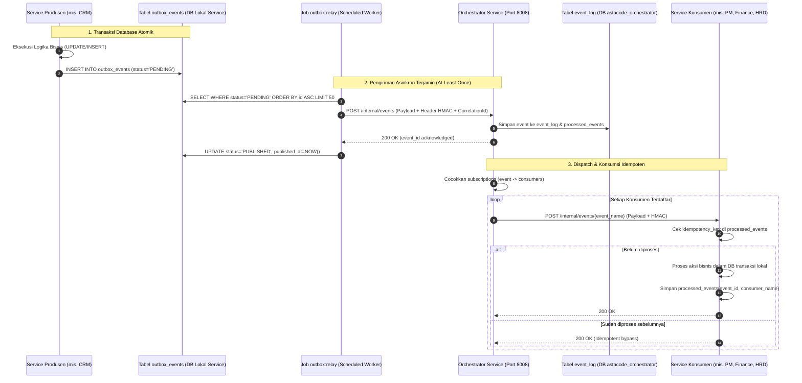

# ASTACODE ERP — KATALOG EVENT DOMAIN (EVENT CATALOG)

Dokumen ini mendefinisikan seluruh event lintas modul pada sistem ASTACODE ERP Orchestrator. Komunikasi asinkron antar service menggunakan arsitektur **Transactional Outbox Pattern → Outbox Relay → Orchestrator Service → Webhook Konsumen Internal**.

---

## 1. Arsitektur Komunikasi Event Terdistribusi



### 1.1 Struktur Tabel `outbox_events` (Di Setiap Service)
- `id`: ULID string (terurut waktu, primary key)
- `event_name`: string (contoh: `deal.won`)
- `aggregate_type`: string (contoh: `deal`, `quotation`, `invoice`)
- `aggregate_id`: string (contoh: `deal-01HQ7...`)
- `payload`: JSON
- `idempotency_key`: string (hash unik `event_name + aggregate_id + version`)
- `status`: enum (`PENDING`, `PROCESSING`, `PUBLISHED`, `FAILED`)
- `attempts`: unsigned integer (default: 0)
- `error_message`: text nullable
- `available_at`: timestamp (untuk backoff delay)
- `created_at`, `updated_at`: timestamps

### 1.2 Kebijakan Retry & Dead-Letter (DLQ)
- Pengiriman event ke Orchestrator dan pengiriman dari Orchestrator ke service konsumen menggunakan **Exponential Backoff**:
  - Percobaan 1: langsung
  - Percobaan 2: +5 detik
  - Percobaan 3: +25 detik
  - Percobaan 4: +2 menit
  - Percobaan 5: +10 menit
- Jika setelah 5 kali gagal: status event diubah menjadi `DEAD_LETTER`.
- Disediakan endpoint admin di Orchestrator: `POST /internal/events/{id}/replay` untuk memicu pengiriman ulang manual setelah perbaikan bug/jaringan.

---

## 2. Katalog Event Domain Lengkap

---

### EVT-01: `lead.captured`
- **Produsen:** `marketing-service` (Web Form / Omnichannel Inbox) atau Gateway WhatsApp
- **Konsumen:** `crm-service`
- **Trigger:** Pengunjung website mengisi formulir konsultasi, prospek mengirim DM/WhatsApp baru, atau leads diimpor dari ad campaign.
- **Aksi Otomatis:**
  1. Melakukan deduplikasi nomor HP / email di CRM.
  2. Membuat entitas Lead baru dengan status `new_lead`.
  3. Memicu rule auto-assign sales (round-robin / spesialisasi industri).
  4. Membuat entitas Customer draft di master Customer jika belum terdaftar.
- **Idempotency Key:** `lead.captured:{source}:{external_inquiry_id_or_hash}`
- **Payload Schema:**
```json
{
  "$schema": "http://json-schema.org/draft-07/schema#",
  "type": "object",
  "required": ["inquiry_id", "name", "contact_channel", "contact_value", "source"],
  "properties": {
    "inquiry_id": { "type": "string" },
    "name": { "type": "string" },
    "company_name": { "type": ["string", "null"] },
    "contact_channel": { "type": "string", "enum": ["whatsapp", "email", "web_form", "instagram_dm", "linkedin"] },
    "contact_value": { "type": "string" },
    "source": { "type": "string" },
    "utm_campaign": { "type": ["string", "null"] },
    "utm_medium": { "type": ["string", "null"] },
    "utm_source": { "type": ["string", "null"] },
    "initial_notes": { "type": "string" },
    "captured_at": { "type": "string", "format": "date-time" }
  }
}
```

---

### EVT-02: `lead.stage_changed`
- **Produsen:** `crm-service`
- **Konsumen:** `crm-service` (Activity log), `core-service` (Notifikasi), `orchestrator-service` (Rule Engine)
- **Trigger:** Kartu lead digeser di Kanban atau status stage diubah via form/API.
- **Aksi Otomatis:**
  1. Memperbarui persentase probabilitas closing lead.
  2. Memicu timer SLA follow-up (contoh: New Lead -> Follow Up wajib follow up pertama dalam 30 menit).
  3. Mengirimkan notifikasi in-app ke Sales Manager jika ada stage rollback atau perpindahan bernilai tinggi.
- **Idempotency Key:** `lead.stage_changed:{lead_id}:{to_stage}:{timestamp_minute}`
- **Payload Schema:**
```json
{
  "lead_id": "01HQ7N01AB23CD45EF67GH8901",
  "lead_code": "LD-2026-0042",
  "customer_id": "01HQ7N00XYZ...",
  "from_stage": "new_lead",
  "to_stage": "follow_up",
  "probability_pct": 20,
  "sales_id": "01HQ7USER123...",
  "est_value": "185000000.00",
  "changed_by": "01HQ7USER123...",
  "reason": "Klien merespons via WhatsApp dan meminta jadwal meeting daring.",
  "occurred_at": "2026-11-03T10:15:30Z"
}
```

---

### EVT-03: `quotation.sent` / `quotation.approved`
- **Produsen:** `crm-service`
- **Konsumen:** `core-service` (Notifikasi, File Storage), `crm-service` (Audit Trail)
- **Trigger:** Quotation + MoU diverifikasi dan disetujui (approval internal) atau dikirimkan ke kontak klien.
- **Aksi Otomatis:**
  1. Mengunci versi draft Quotation + RAB menjadi snapshot immutable berversi (`v1`, `v2-R1`, dsb.).
  2. Menyimpan salinan PDF tergenerasi ke storage privat terenkripsi.
  3. Mengirim email / WA pemberitahuan ke klien dengan tautan unduh bertanda tangan (signed URL berkedaluwarsa).
- **Idempotency Key:** `quotation.approved:{quotation_id}:{version}`
- **Payload Schema:**
```json
{
  "quotation_id": "01HQ7Q123...",
  "quotation_number": "QT/2026/11/0088-R0",
  "lead_id": "01HQ7N01AB23CD45EF67GH8901",
  "customer_id": "01HQ7N00XYZ...",
  "version": 1,
  "subtotal": "210000000.00",
  "discount_pct": 5.0000,
  "discount_amount": "10500000.00",
  "tax_rate_pct": 11.0000,
  "tax_amount": "21945000.00",
  "grand_total": "221445000.00",
  "approved_by": "01HQ7MGR456...",
  "file_url": "https://storage.astacode.local/signed/quotations/QT-2026-11-0088-R0.pdf",
  "approved_at": "2026-11-03T11:00:00Z"
}
```

---

### EVT-04: `deal.won` (Pemicu Utama Saga Transaksi Terdistribusi)
- **Produsen:** `crm-service`
- **Konsumen:** `orchestrator-service` (Menjalankan Saga Deal-Won)
- **Target Partisipan Saga:**
  1. `crm-service`: Upsert profil Customer 360 & kunci status deal.
  2. `pm-service`: Inisialisasi Project baru, Epics, Tasks WBS dari RAB yang disetujui.
  3. `finance-service`: Buat Receivable Schedule (jadwal piutang per termin TOP) & draf invoice DP.
  4. `hrd-service`: Buat Capacity Demand (alokasi mandays per role developer/QA/DevOps).
- **Trigger:** Status Lead diubah ke `deal` setelah seluruh syarat terpenuhi (RAB valid, TOP = 100%, MoU disepakati).
- **Idempotency Key:** `saga.deal.won:{deal_id}:{quotation_id}`
- **Payload Schema:**
```json
{
  "deal_id": "01HQ7DEAL890...",
  "deal_code": "AST-2026-0042",
  "title": "Pengembangan Sistem Enterprise HRIS & Absensi GPS",
  "customer": {
    "id": "01HQ7CUST111...",
    "legal_name": "PT Maju Sejahtera Industri",
    "brand_name": "Maju Group",
    "npwp": "01.234.567.8-901.000",
    "pic_name": "Budi Santoso",
    "pic_phone": "+6281234567890",
    "pic_email": "budi@majusejahtera.co.id",
    "billing_address": "Kawasan Industri MM2100 Blok B-12, Cikarang Barat, Bekasi"
  },
  "quotation_id": "01HQ7Q123...",
  "quotation_number": "QT/2026/11/0088-R0",
  "contract_value": "221445000.00",
  "base_amount_excl_tax": "199500000.00",
  "tax_amount": "21945000.00",
  "total_mandays": 142.0,
  "top_scheme": [
    { "term_no": 1, "name": "Termin 1 (DP 30%)", "percentage": 30.0, "amount": "66433500.00", "trigger_type": "signing", "due_days": 14 },
    { "term_no": 2, "name": "Termin 2 (Progress 40%)", "percentage": 40.0, "amount": "88578000.00", "trigger_type": "milestone", "milestone_name": "UAT Fase 1 Backend & Frontend", "due_days": 14 },
    { "term_no": 3, "name": "Termin 3 (Pelunasan 30%)", "percentage": 30.0, "amount": "66433500.00", "trigger_type": "milestone", "milestone_name": "BAST & Deployment Production", "due_days": 14 }
  ],
  "wbs_modules": [
    { "epic_name": "Autentikasi & RBAC", "role": "Backend", "mandays": 12.0, "rate_per_day": "1200000.00" },
    { "epic_name": "Absensi Geofencing GPS", "role": "Mobile", "mandays": 18.0, "rate_per_day": "1400000.00" },
    { "epic_name": "Engine Payroll & Slip Gaji", "role": "Backend", "mandays": 24.0, "rate_per_day": "1200000.00" },
    { "epic_name": "Testing & QA Otomasi", "role": "QA", "mandays": 15.0, "rate_per_day": "950000.00" }
  ],
  "target_kickoff_date": "2026-11-15",
  "target_delivery_date": "2027-03-31",
  "won_at": "2026-11-03T11:30:00Z"
}
```

---

### EVT-05: `deal.lost`
- **Produsen:** `crm-service`
- **Konsumen:** `marketing-service` (Lead Retargeting), `core-service` (Analytics)
- **Trigger:** Lead dipindahkan ke status `reject` dengan alasan wajib.
- **Aksi Otomatis:**
  1. Mencatat kode alasan penolakan (mis. `budget_too_low`, `competitor_win`, `project_cancelled`).
  2. Mendaftarkan kontak ke kampanye email nurture pemasaran pasif (bila klien memberikan izin komunikasi).
  3. Memperbarui agregasi Win/Loss Ratio di dashboard eksekutif.
- **Idempotency Key:** `deal.lost:{lead_id}`
- **Payload Schema:**
```json
{
  "lead_id": "01HQ7N01AB23CD45EF67GH8901",
  "lead_code": "LD-2026-0042",
  "customer_id": "01HQ7N00XYZ...",
  "reason_code": "competitor_win",
  "competitor_name": "Vendor Solusi X",
  "lost_notes": "Klien memilih solusi off-the-shelf karena membutuhkan go-live dalam 2 minggu.",
  "est_value": "185000000.00",
  "lost_at": "2026-11-03T12:00:00Z"
}
```

---

### EVT-06: `project.created`
- **Produsen:** `pm-service`
- **Konsumen:** `hrd-service` (Resource Planner), `finance-service` (P&L Tracking)
- **Trigger:** PM menyelesaikan intake proyek Deal Won atau membuat proyek baru.
- **Aksi Otomatis:**
  1. Menyiapkan kartu P&L proyek di Finance (Akun HPP Proyek 5010/5020/5030).
  2. Mengunci total pagu anggaran mandays per posisi di HRD.
- **Idempotency Key:** `project.created:{project_id}`
- **Payload Schema:**
```json
{
  "project_id": "01HQ7PRJ555...",
  "project_code": "PRJ-2026-0012",
  "deal_id": "01HQ7DEAL890...",
  "customer_id": "01HQ7CUST111...",
  "title": "Pengembangan Sistem Enterprise HRIS & Absensi GPS",
  "budget_mandays": 142.0,
  "contract_value": "221445000.00",
  "created_at": "2026-11-03T12:15:00Z"
}
```

---

### EVT-07: `milestone.approved`
- **Produsen:** `pm-service`
- **Konsumen:** `finance-service`, `core-service` (Notifikasi)
- **Trigger:** Dokumen UAT ditandatangani klien dan milestone deliverable disetujui Tech Lead / PM.
- **Aksi Otomatis:**
  1. Mengubah status termin terkait di Finance dari `WAITING_MILESTONE` menjadi `READY_TO_INVOICE`.
  2. Mengirim alert ke tim Finance untuk menerbitkan faktur penagihan.
- **Idempotency Key:** `milestone.approved:{project_id}:{termin_no}`
- **Payload Schema:**
```json
{
  "project_id": "01HQ7PRJ555...",
  "project_code": "PRJ-2026-0012",
  "termin_no": 2,
  "milestone_name": "UAT Fase 1 Backend & Frontend",
  "uat_document_url": "https://storage.astacode.local/signed/uat/UAT-PRJ-2026-0012-M2.pdf",
  "approved_by_client": "Budi Santoso",
  "approved_by_pm": "01HQ7PMUSER...",
  "approved_at": "2026-12-20T09:00:00Z"
}
```

---

### EVT-08: `invoice.issued`
- **Produsen:** `finance-service`
- **Konsumen:** `finance-service` (Jurnal Akrual), `crm-service` (Kalender AR), `core-service` (Notifikasi Klien)
- **Trigger:** Finance menekan tombol "Terbitkan Invoice" setelah verifikasi termin/pajak.
- **Aksi Otomatis:**
  1. Memposting Jurnal Akrual Piutang:
     - `(D) 1030 Piutang Usaha` = Grand Total
     - `(K) 4010 Pendapatan Jasa Pengembangan` = DPP
     - `(K) 2030 Utang PPN Keluaran` = Nilai PPN (jika ada)
     *(Jika DP termin 1: dikreditkan ke `2040 Pendapatan Diterima di Muka`)*
  2. Mengirim invoice PDF resmi ke email/WA kontak penagihan klien.
  3. Memperbarui status kalender penagihan di CRM.
- **Idempotency Key:** `invoice.issued:{invoice_id}`
- **Payload Schema:**
```json
{
  "invoice_id": "01HQ7INV999...",
  "invoice_number": "INV/2026/11/0054",
  "project_id": "01HQ7PRJ555...",
  "customer_id": "01HQ7CUST111...",
  "term_no": 1,
  "subtotal": "59850000.00",
  "tax_amount": "6583500.00",
  "grand_total": "66433500.00",
  "issue_date": "2026-11-03",
  "due_date": "2026-11-17",
  "pdf_url": "https://storage.astacode.local/signed/invoices/INV-2026-11-0054.pdf",
  "issued_by": "01HQ7FINUSER...",
  "issued_at": "2026-11-03T13:00:00Z"
}
```

---

### EVT-09: `invoice.paid`
- **Produsen:** `finance-service`
- **Konsumen:** `finance-service` (Jurnal Kas), `pm-service` (Kickoff Gate Check), `crm-service` (Customer 360 Update)
- **Trigger:** Finance memverifikasi mutasi bank dan menandai invoice sebagai `PAID`.
- **Aksi Otomatis:**
  1. Memposting Jurnal Penerimaan Kas:
     - `(D) 1010 Bank BCA` = Nominal Bersih Diterima
     - `(D) 1040 Uang Muka PPh 23` = Potongan PPh 23 Klien (jika ada bukti potong)
     - `(K) 1030 Piutang Usaha` = Pelunasan Piutang
  2. Jika pembayaran termin DP: memicu `kickoff_gate.passed` di PM sehingga sprint pengembangan dapat dimulai.
  3. Menghitung ulang Days Sales Outstanding (DSO) dan margin aktual proyek.
- **Idempotency Key:** `invoice.paid:{invoice_id}:{payment_reference}`
- **Payload Schema:**
```json
{
  "invoice_id": "01HQ7INV999...",
  "invoice_number": "INV/2026/11/0054",
  "project_id": "01HQ7PRJ555...",
  "customer_id": "01HQ7CUST111...",
  "term_no": 1,
  "payment_date": "2026-11-05",
  "bank_account_id": "1010-BCA-CORP",
  "amount_paid": "66433500.00",
  "payment_proof_url": "https://storage.astacode.local/private/receipts/TRF-BCA-8921.jpg",
  "verified_by": "01HQ7FINUSER...",
  "paid_at": "2026-11-05T14:20:00Z"
}
```

---

### EVT-10: `timelog.recorded`
- **Produsen:** `pm-service` (Manual Task Timer) atau `hrd-service` (Daily Log Approval)
- **Konsumen:** `pm-service` (Mandays Budget Burn), `finance-service` (HPP Tenaga Kerja Langsung)
- **Trigger:** Engineer mengisi timesheet harian yang disetujui atasan.
- **Aksi Otomatis:**
  1. Menambah akumulasi jam kerja riil pada task dan proyek terkait.
  2. Jika pengembang berstatus Freelance: mencatat akrual beban honorer (`5020 Subkon & Freelance`).
  3. Memeriksa ambang serapan anggaran: jika >80% atau >100%, memicu alert early-warning ke PM.
- **Idempotency Key:** `timelog.recorded:{timelog_id}`
- **Payload Schema:**
```json
{
  "timelog_id": "01HQ7TIME444...",
  "project_id": "01HQ7PRJ555...",
  "task_id": "01HQ7TASK123...",
  "employee_id": "01HQ7EMP789...",
  "employee_type": "FREELANCE",
  "hours": 7.5,
  "hourly_rate": "150000.00",
  "cost_amount": "1125000.00",
  "work_date": "2026-11-03",
  "description": "Implementasi endpoint validasi lokasi geofence GPS di Laravel backend.",
  "recorded_at": "2026-11-03T17:30:00Z"
}
```

---

### EVT-11: `payroll.approved`
- **Produsen:** `hrd-service`
- **Konsumen:** `finance-service`
- **Trigger:** Direktur menyetujui penggajian bulanan (Batch Payroll Run).
- **Aksi Otomatis:**
  1. Finance memposting jurnal beban gaji:
     - `(D) 6010 Gaji & Tunjangan Staf Tetap` (Beban OPEX kantor)
     - `(D) 5020 Subkontrak & Freelance` (Porsi pengerjaan proyek langsung)
     - `(K) 2010 Utang Gaji & Honor`
     - `(K) 2020 Utang PPh 21`
  2. Memicu pengiriman slip gaji ber-password tanggal lahir ke email masing-masing pegawai.
- **Idempotency Key:** `payroll.approved:{payroll_run_id}`
- **Payload Schema:**
```json
{
  "payroll_run_id": "PAY/2026/11",
  "period": "2026-11",
  "total_gross": "145000000.00",
  "total_fixed_salaries": "95000000.00",
  "total_freelance_fees": "50000000.00",
  "total_pph21_deducted": "7250000.00",
  "total_bpjs_deducted": "4350000.00",
  "total_net_payable": "133400000.00",
  "approved_by": "01HQ7DIR001...",
  "approved_at": "2026-11-25T10:00:00Z"
}
```

---

### EVT-12: `expense.claimed`
- **Produsen:** Seluruh Service (diajukan staf via modul masing-masing)
- **Konsumen:** `finance-service`
- **Trigger:** Karyawan mengunggah struk pengeluaran (reimbursement / kas kecil).
- **Aksi Otomatis:**
  1. OCR memverifikasi teks struk (vendor, tanggal, total).
  2. Memasukkan ke antrean verifikasi Finance.
  3. Setelah disetujui, diposting ke jurnal kas keluar terkait akun beban yang dipilih.
- **Idempotency Key:** `expense.claimed:{claim_id}`
- **Payload Schema:**
```json
{
  "claim_id": "01HQ7CLM111...",
  "employee_id": "01HQ7EMP789...",
  "project_id": "01HQ7PRJ555...",
  "expense_type": "PROJECT_TRAVEL",
  "account_code": "5040",
  "amount": "385000.00",
  "vendor_name": "SPBU Pertamina Rest Area KM 19",
  "receipt_url": "https://storage.astacode.local/private/receipts/REC-385.jpg",
  "notes": "Transport kunjungan on-site instalasi fingerprint server",
  "submitted_at": "2026-11-03T16:00:00Z"
}
```

---

### EVT-13: `ads.spent`
- **Produsen:** `marketing-service`
- **Konsumen:** `finance-service`
- **Trigger:** Sinkronisasi API Meta Ads / Google Ads harian atau penutupan campaign.
- **Aksi Otomatis:**
  1. Mencatat realisasi belanja iklan ke jurnal `(D) 6050 Beban Pemasaran & Iklan / (K) 1010 Bank BCA`.
  2. Menghitung ulang metrik Cost Per Lead (CPL) dan Customer Acquisition Cost (CAC) di modul Marketing.
- **Idempotency Key:** `ads.spent:{campaign_id}:{date}`
- **Payload Schema:**
```json
{
  "campaign_id": "CMP-2026-Q4-01",
  "platform": "META_ADS",
  "spend_date": "2026-11-03",
  "amount": "1250000.00",
  "currency": "IDR",
  "leads_generated": 8,
  "cpl": "156250.00",
  "recorded_at": "2026-11-03T23:59:59Z"
}
```

---

### EVT-14: `ticket.created`
- **Produsen:** `pm-service` (Service Desk Portal / Bot Telegram / WA Care)
- **Konsumen:** `pm-service`, `ai-service`
- **Trigger:** Klien mengirim laporan bug, issue, atau permintaan bantuan teknis.
- **Aksi Otomatis:**
  1. Menerbitkan nomor tiket `TICKET-YYYY-NNNN`.
  2. Menghitung batas waktu SLA (Response Time & Resolution Time) berdasarkan kontrak SLA klien.
  3. AI Diagnostic Engine menganalisis screenshot/error log untuk mengusulkan Root Cause Analysis (RCA).
- **Idempotency Key:** `ticket.created:{external_ticket_source_id}`
- **Payload Schema:**
```json
{
  "ticket_id": "01HQ7TCK777...",
  "ticket_code": "TICKET-2026-0128",
  "project_id": "01HQ7PRJ555...",
  "customer_id": "01HQ7CUST111...",
  "channel": "TELEGRAM_BOT",
  "sender_name": "Pak Budi (Maju Sejahtera)",
  "subject": "Gagal sinkron data biometric fingerprint shift malam",
  "severity": "CRITICAL",
  "sla_response_deadline": "2026-11-03T15:30:00Z",
  "sla_resolution_deadline": "2026-11-03T22:00:00Z",
  "created_at": "2026-11-03T14:30:00Z"
}
```

---

### EVT-15: `wa.message_received`
- **Produsen:** Gateway WhatsApp (`gateway` / `core-service`)
- **Konsumen:** `crm-service` (WhatsApp Client Care Inbox), `ai-service` (Draft Responder)
- **Trigger:** Webhook pesan masuk dari WhatsApp Cloud API / WAHA Gateway.
- **Aksi Otomatis:**
  1. Mencocokkan nomor pengirim dengan kontak lead atau customer yang ada di database.
  2. Menyimpan pesan ke thread percakapan.
  3. AI menganalisis sentimen dan menghasilkan draf rekomendasi balasan (Quick Draft).
- **Idempotency Key:** `wa.message:{message_id}`
- **Payload Schema:**
```json
{
  "message_id": "wamid.HBgLM...==",
  "from_phone": "+6281234567890",
  "contact_name": "Budi Santoso",
  "message_type": "text",
  "body": "Selamat siang, apakah draf MoU untuk penambahan 100 fingerprint bisa dikirim hari ini?",
  "media_url": null,
  "received_at": "2026-11-03T13:45:00Z"
}
```

