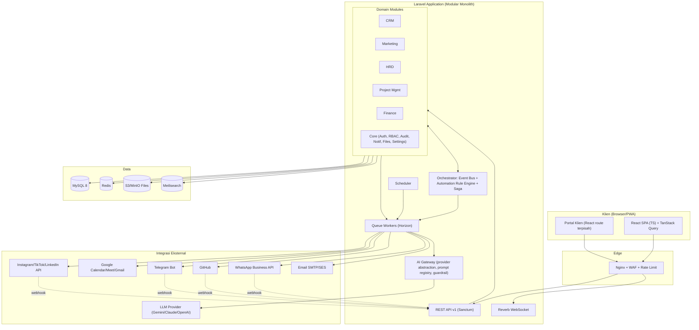
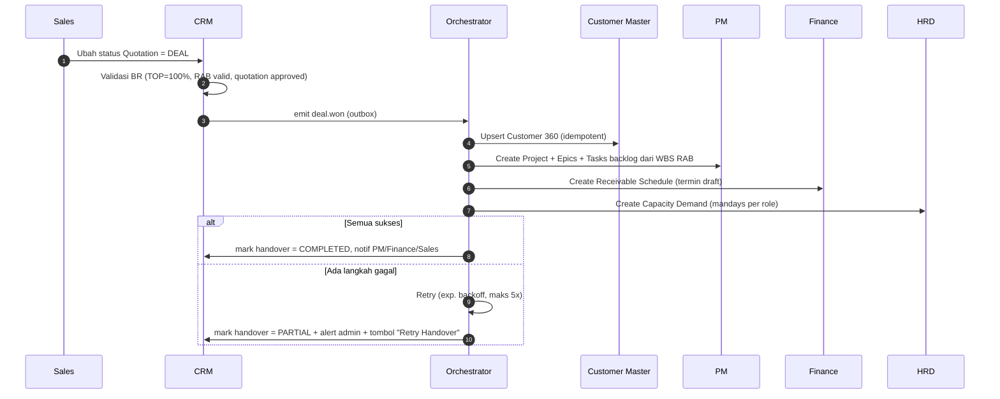
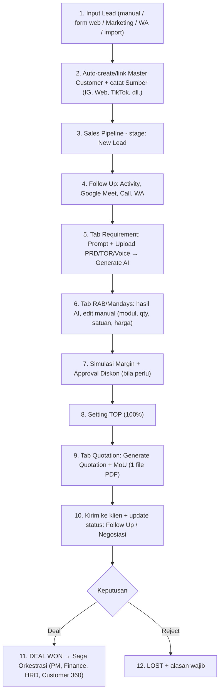
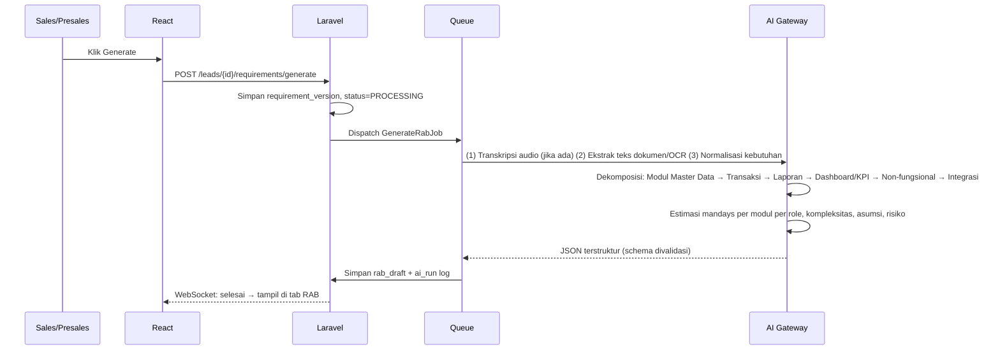
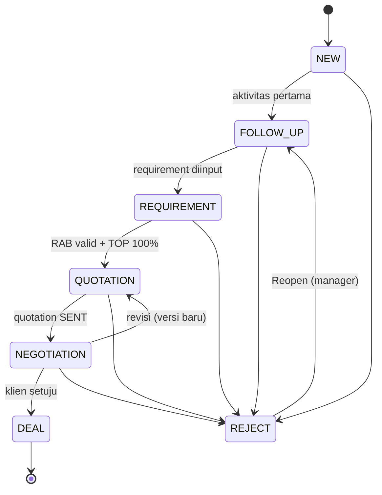
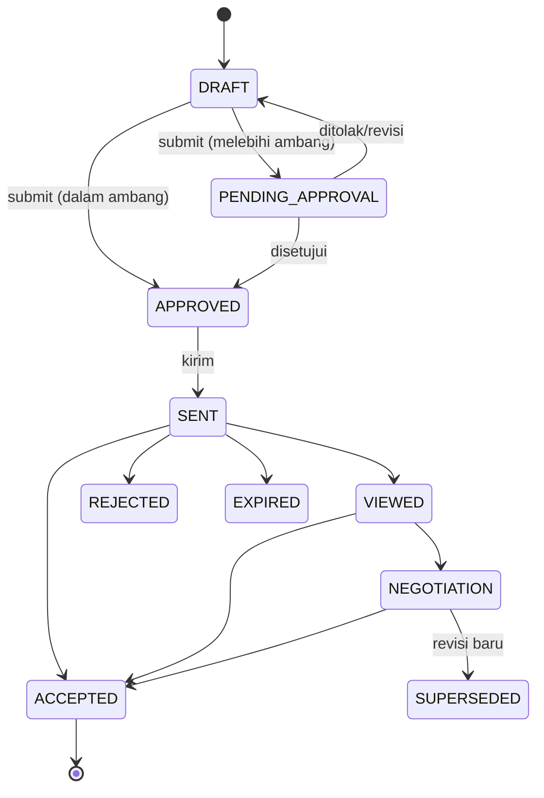
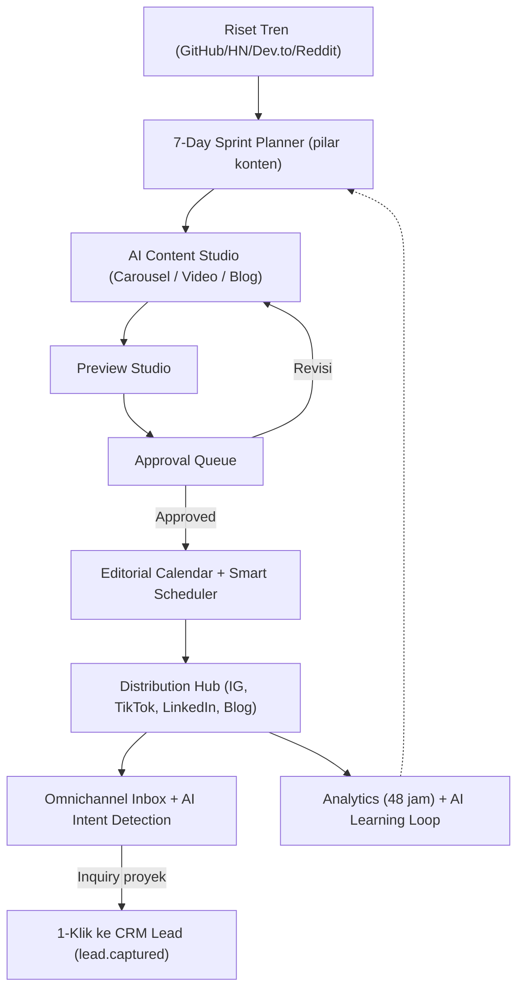
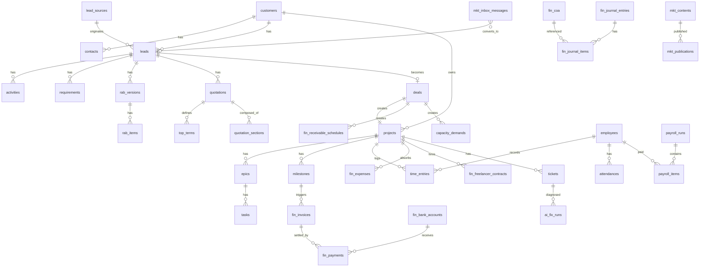

# PRODUCT REQUIREMENTS DOCUMENT (PRD)
# ASTACODE ERP ORCHESTRATOR — Platform ERP Otomasi Terpadu untuk Software House

| Atribut | Keterangan |
|---|---|
| Kode Dokumen | PRD-ASTA-ERP-001 |
| Versi | 1.1 (Draft Lengkap — CRM diselaraskan dengan PRD CRM v2.0) |
| Tanggal | 2 November 2026 |
| Penyusun | Senior System Analyst (ERP) |
| Status | Draft — Siap Review Stakeholder |
| Platform | ASTACODE ERP Orchestrator |
| Stack Resmi | **Backend: Laravel (PHP 8.3+) · Database: MySQL 8 · Frontend: React JS (Vite + TypeScript)** |
| Modul Cakupan | (1) CRM · (2) Marketing & AI Content Engine · (3) HRD & Workload · (4) Project Management (MP) · (5) Finance & Cashflow |
| Dokumen Sumber | Resume Workflow Finance V3, PRD Management Project v3.2, Ringkasan Bisnis CRM–Marketing–HRD v1.0, Brief CRM dari Product Owner, PRD CRM v2.0 (Spesifikasi Teknis & Bisnis Lengkap) |

> **Catatan penting tentang dokumen ini.** Prototipe lama dibangun dengan Vanilla JS. PRD ini **menggantikan arsitektur frontend/backend prototipe** menjadi Laravel + MySQL + React, namun **mempertahankan seluruh logika bisnis, alur, dan aturan** dari dokumen sumber. Bagian yang saya perbaiki/tambahkan dari dokumen sumber ditandai **[REVISI]** atau **[TAMBAHAN]**.

---

## DAFTAR ISI

1. Informasi Dokumen & Riwayat Perubahan
2. Pendahuluan & Latar Belakang Bisnis
3. Target Pengguna & Hak Akses (RBAC)
4. Arsitektur Sistem (Laravel + MySQL + React)
5. Orkestrasi Lintas Modul & Mesin Otomasi
6. MODUL 1 — CRM (Spesifikasi Terlengkap)
7. MODUL 2 — Marketing & AI Content Engine
8. MODUL 3 — HRD & Workload Management
9. MODUL 4 — Project Management (MP)
10. MODUL 5 — Finance & Cashflow
11. Skema Data & Entitas (MySQL)
12. Desain API (Laravel REST)
13. Spesifikasi AI Layer
14. Integrasi Eksternal
15. Spesifikasi UI/UX (React)
16. Kebutuhan Non-Fungsional
17. Keamanan, Privasi & Kepatuhan
18. Pelaporan & Analitik Terpadu
19. Roadmap Implementasi & Rilis
20. Risiko & Mitigasi
21. Kriteria Penerimaan (Acceptance Criteria)
22. Lampiran (COA, Glosarium, Struktur Folder, Open Questions)

---

## 1. INFORMASI DOKUMEN & RIWAYAT PERUBAHAN

| Versi | Tanggal | Penyusun | Perubahan |
|---|---|---|---|
| 0.1 | — | Tim Produk | Resume workflow Finance, PM, dan ringkasan CRM/Marketing/HRD (prototipe Vanilla JS) |
| 1.0 | 02-11-2026 | Senior SA | Penyatuan 5 modul, re-arsitektur ke Laravel + MySQL + React, perluasan CRM skala industri, generator Quotation+MoU satu file, WhatsApp AI Inbox |
| 1.1 | 02-11-2026 | Senior SA | Penyelarasan modul CRM dengan PRD CRM v2.0: Voice Note Recorder & AI Transcriber, Files & Stage Docs, Legal Studio 22 Pasal MoU + Addendum + log e-Sign/e-Meterai, Project Transition Hub & kalender AR, Delivery Readiness Check, RBAC Legal & Finance AR, gating transisi, preset TOP, penomoran `LD-`/`QT/`, NFR & skenario BDD |

**Pemangku kepentingan:** Owner/Direktur, Head of Sales, Marketing Lead, HR Manager, Project Manager, Tech Lead, Finance Manager, IT/DevOps.

---

## 2. PENDAHULUAN & LATAR BELAKANG BISNIS

### 2.1 Problem Statement
1. **Silo antar divisi.** Marketing, Sales, delivery teknis, HR, dan keuangan memakai alat berbeda (WA, Excel, Trello/Jira, Word). Data lead, scope, RAB, kapasitas SDM, dan invoice tidak pernah sinkron.
2. **Estimasi proyek subjektif & lambat.** Menyusun RAB/mandays dan dokumen penawaran manual memakan berhari-hari dan rawan salah hitung.
3. **Penawaran, MoU, dan RAB terpisah.** Dokumen legal sering tidak konsisten dengan angka RAB.
4. **Handover Sales → Delivery → Finance bocor.** PM tidak tahu scope kontrak, Finance telat menerbitkan invoice termin.
5. **Kapasitas SDM tidak transparan.** Overload pada engineer tertentu, idle pada yang lain.
6. **Margin proyek baru diketahui setelah proyek selesai.**
7. **Komunikasi klien tercecer** di WhatsApp pribadi tanpa histori, SLA, atau tiket.

### 2.2 Visi Produk
Satu platform **ERP Orchestrator** yang menjadi *Single Source of Truth* seluruh rantai nilai software house:

```
Marketing ──► CRM ──► Project Management ──► Finance
   │            │            ▲                    ▲
   │            └────────────┼────────────────────┤
   └────────────► HRD ───────┴────────────────────┘
```

Setiap peristiwa bisnis (lead masuk, deal won, milestone selesai, jam kerja dicatat, invoice dibayar) **memicu otomasi lintas modul** tanpa input ganda.

### 2.3 Tujuan & Metrik Keberhasilan (OKR)

| Tujuan | Metrik | Target (12 bulan pasca go-live) |
|---|---|---|
| Mempercepat penawaran | Waktu dari lead → Quotation+MoU terbit | dari ±5 hari → **< 4 jam** |
| Akurasi RAB | Deviasi RAB vs realisasi mandays | **< 15%** |
| Kickoff cepat | Deal Won → proyek aktif di PM | **< 1 jam (otomatis)** |
| Penagihan tepat waktu | Milestone approved → invoice terbit | **< 24 jam** |
| Kesehatan arus kas | DSO | turun **≥ 30%** |
| Transparansi margin | Proyek dengan margin real-time | **100%** |
| Beban SDM seimbang | Engineer overload (>100% utilisasi) | **< 5%** |
| Kualitas pembukuan | Jurnal tidak balance | **0** |
| Efisiensi manual | Input data ganda antar modul | **0** |
| Konversi Marketing | Lead inbound dari konten | naik **≥ 25%** |

### 2.4 Ruang Lingkup
**Dalam cakupan (In-Scope):** seluruh fitur 5 modul di dokumen ini, AI layer, integrasi WhatsApp/Google/GitHub/Telegram/Sosial Media, RBAC, audit trail, pelaporan.

**Di luar cakupan (Out-of-Scope v1.0):**
- Rekonsiliasi bank otomatis (CSV matching), aset tetap & depresiasi, modul pajak DJP terpisah, budgeting/cost center terpisah (tetap ditiadakan sesuai keputusan PRD Finance).
- Manajemen persediaan/manufaktur/POS.
- Aplikasi mobile native (v1.0 memakai web responsif/PWA).
- e-Faktur & e-Bupot terintegrasi DJP (dicatat sebagai *future work*; v1.0 menyimpan nomor & file bukti potong).

### 2.5 Asumsi & Ketergantungan
- Perusahaan single-tenant (Astacode), arsitektur disiapkan *multi-company-ready* (kolom `company_id` pada tabel utama).
- Mata uang dasar IDR; dukungan mata uang lain sebatas tampilan di quotation (opsional fase 3).
- Tersedia akun WhatsApp Business (Cloud API atau gateway pihak ketiga), Google Workspace, GitHub org, Telegram Bot, dan API key LLM.

---

## 3. TARGET PENGGUNA & HAK AKSES (RBAC)

### 3.1 Persona
| Persona | Peran | Kebutuhan Utama |
|---|---|---|
| **Direktur / Owner** | Pengambil keputusan | Dashboard eksekutif, forecast, margin, persetujuan diskon & payroll |
| **Head of Sales / Sales Manager** | Mengelola pipeline | Forecast, kualitas lead, persetujuan diskon, win-rate |
| **Sales / Account Executive** | Closing | Pipeline, follow up, RAB, quotation, WA |
| **Presales / Solution Architect** | Scoping teknis | AI requirement, RAB, WBS |
| **Marketing Lead / Content Creator** | Brand & lead gen | Studio konten, approval, inbox sosmed |
| **HR Manager / HR Staff** | SDM | Presensi, rekrutmen, PKL, payroll |
| **Project Manager** | Delivery | Alokasi, Kanban, milestone, invoice trigger |
| **Developer / QA** | Eksekusi | Task, daily log, time tracking |
| **Tech Lead** | Quality gate | Review PR, approval AI fix |
| **Finance / Accounting** | Keuangan | AR/AP, jurnal, laporan |
| **Klien (eksternal)** | Pemesan | Portal klien: tiket, status, approval UAT, invoice |
| **Super Admin / IT** | Sistem | User, role, integrasi, audit |
| **Legal Counsel** | Kontrak & kepatuhan | Kelola 22 Pasal MoU, Addendum, audit e-Sign/e-Meterai |
| **Finance AR Specialist** | Penagihan | Verifikasi NPWP, review/kunci TOP, invoice DP & termin |

### 3.2 Matriks Peran × Modul (R=Read, C=Create, U=Update, D=Delete, A=Approve, X=No Access)

| Modul / Fitur | Owner | Sales Mgr | Sales | Presales | Marketing | HR | PM | Dev/QA | Finance | Klien |
|---|---|---|---|---|---|---|---|---|---|---|
| CRM: Lead & Pipeline | R | RCUDA | RCU (milik sendiri) | RU | R | X | R | X | R | X |
| CRM: RAB & Quotation | R | RCUDA | RCU | RCU | X | X | R | X | R | X |
| CRM: Rate Card & Margin Internal | R | RCUDA | R (tanpa margin) | R | X | X | X | X | R | X |
| CRM: Approval Diskon | A | A | X | X | X | X | X | X | R | X |
| Marketing Studio & Inbox | R | R | R | X | RCUDA | X | X | X | R (ads) | X |
| HRD: Presensi & Daily Log | R | X | self | self | self | RCUDA | R | self | R | X |
| HRD: Payroll | A | X | X | X | X | RCU | X | X | A | X |
| PM: Proyek & Kanban | R | R | R | R | X | R | RCUDA | RCU (tugas) | R | R terbatas |
| PM: AI Fix & GitHub | R | X | X | X | X | X | RU | RCU | X | X |
| Finance: AR/AP/Jurnal | R | R (AR miliknya) | X | X | X | R | R (HPP proyek) | X | RCUDA | R (invoice miliknya) |
| Laporan Konsolidasi | R | R (sales) | X | X | R (mkt) | R (hr) | R (proyek) | X | R | X |
| Admin & Audit | X | X | X | X | X | X | X | X | X | X (hanya Super Admin) |

> Implementasi: **Spatie Laravel-Permission** (role + permission granular, mis. `crm.lead.create`, `finance.journal.view`), ditambah **Policy** per model untuk aturan kepemilikan record (record-level security, mis. Sales hanya melihat lead miliknya + tim).

### 3.3 Aturan Akses Khusus
- **Dual-view margin:** field HPP internal/margin disembunyikan di level API (bukan hanya UI) untuk peran tanpa `crm.margin.view`.
- **Portal klien** memakai guard terpisah (`client`) dengan data dibatasi per `customer_id`.
- **Field-level masking** untuk gaji, NPWP, rekening bank, token integrasi.
- **Segregation of duties:** pembuat jurnal manual ≠ penyetuju; pembuat payroll ≠ penyetuju.

### 3.4 Penyesuaian RBAC CRM (dari PRD CRM v2.0) **[TAMBAHAN]**

| Fitur / Entitas CRM | Super Admin/Direktur | Sales PIC | Presales | PM | Finance AR | Legal |
|---|:---:|:---:|:---:|:---:|:---:|:---:|
| Buat & edit lead | ✅ | ✅ (milik sendiri) | 👁️ | 👁️ | ❌ | ❌ |
| Jalankan AI Requirement & Voice Note | ✅ | ✅ | ✅ | 👁️ | ❌ | ❌ |
| Ubah Rate Card & Internal Cost RAB | ✅ | ❌ | ✅ | 👁️ | 👁️ | ❌ |
| Beri diskon sampai 10% | ✅ | ✅ | ❌ | ❌ | 👁️ | ❌ |
| Diskon > 10% | ✅ (via Approval) | ❌ (ajukan) | ❌ | ❌ | 👁️ | ❌ |
| Ubah & kunci skema TOP (100%) | ✅ | ✅ (ubah) | 👁️ | 👁️ | ✅ (review & kunci) | 👁️ |
| Pindahkan stage ke Deal Won | ✅ (override + audit) | ✅* | ❌ | 👁️ + Readiness Check | 👁️ | ❌ |
| Edit 22 klausul hukum standar | ✅ | ❌ | ❌ | ❌ | ❌ | ✅ |
| Buat Addendum / Change Request | ✅ | ✅ (draf) | ✅ (draf) | ✅ (usulan) | 👁️ | ✅ (final) |
| Dashboard Executive Reports | ✅ | 👁️ (milik sendiri) | ❌ | 👁️ (delivery) | ✅ | ❌ |

*\*Hanya bila RAB valid dan TOP balance 100%.* Super Admin boleh meng-override stage; setiap override wajib alasan dan tercatat di audit log.

---

## 4. ARSITEKTUR SISTEM (LARAVEL + MYSQL + REACT)

### 4.1 Prinsip Arsitektur
1. **Modular Monolith** — satu codebase Laravel dengan modul terpisah (domain-driven), siap dipecah jadi service bila perlu.
2. **Event-Driven Orchestration** — modul berkomunikasi lewat *Domain Events* (bukan query silang antar tabel modul).
3. **API-First** — React hanya mengonsumsi REST API (+ WebSocket); API terdokumentasi OpenAPI.
4. **Async by default** — pekerjaan berat (AI, PDF, email, WA, sync) lewat **Queue**.
5. **Auditable** — setiap perubahan data penting tercatat (siapa, kapan, sebelum, sesudah).
6. **AI dengan guardrail** — AI membantu, manusia menyetujui (human-in-the-loop) untuk aksi berisiko.

### 4.2 Stack Teknologi

| Lapisan | Teknologi | Catatan |
|---|---|---|
| Backend Framework | **Laravel 11/12 (PHP 8.3+)** | Modular via `nwidart/laravel-modules` atau struktur `app/Modules/*` |
| Database Utama | **MySQL 8.0** (InnoDB, utf8mb4) | Transaksi ACID untuk jurnal; JSON column untuk payload fleksibel |
| Cache / Queue / Session | **Redis 7** | Laravel Horizon untuk monitoring queue |
| Realtime | **Laravel Reverb** (WebSocket) | Notifikasi, Kanban live, WA inbox live |
| Auth | **Laravel Sanctum** (SPA cookie + token) + 2FA TOTP | OAuth Google (SSO opsional) |
| RBAC | **spatie/laravel-permission** | + Policies |
| Audit | **spatie/laravel-activitylog** atau `owen-it/laravel-auditing` | Immutable log |
| Media/File | **spatie/laravel-medialibrary** → S3/MinIO | Antivirus scan (ClamAV) untuk upload |
| PDF | **Browsershot (Puppeteer/Chromium)** atau DomPDF | Browsershot dipilih untuk layout A4 presisi (Quotation+MoU) |
| Search | **Laravel Scout + Meilisearch** | Pencarian lead/customer/tiket/dokumen |
| Excel/CSV | **maatwebsite/excel** | Impor/ekspor |
| Scheduler | Laravel Scheduler + Cron | SLA, reminder, sync, laporan |
| API Docs | **Scribe / L5-Swagger (OpenAPI 3)** | |
| Frontend | **React 18 + TypeScript + Vite** | |
| State Server | **TanStack Query** | Cache, refetch, optimistic update |
| State Client | **Zustand** | UI state ringan |
| Routing | **React Router v6** | Route guard berbasis permission |
| UI Kit | **Tailwind CSS + shadcn/ui (Radix)** | Design tokens, dark mode |
| Form | **React Hook Form + Zod** | Validasi skema bersama |
| Tabel | **TanStack Table** + virtualisasi | Grid RAB editable, daftar besar |
| Kanban DnD | **dnd-kit** | Pipeline CRM & Board PM |
| Grafik | **Recharts / ECharts** | Dashboard |
| Gantt | **frappe-gantt / dhtmlx (lisensi dicek)** | Roadmap PM |
| Editor Rich Text | **TipTap** | Quotation/MoU template, Docs & Wiki |
| Realtime Client | **Laravel Echo + pusher-js (Reverb)** | |
| Testing BE | **Pest/PHPUnit**, Larastan (PHPStan) | Coverage ≥ 80% domain inti |
| Testing FE | **Vitest + React Testing Library + Playwright (E2E)** | |
| DevOps | **Docker, GitHub Actions CI/CD, Nginx, Supervisor** | Staging + Production |
| Observabilitas | **Sentry, Laravel Telescope (dev), Prometheus/Grafana, Loki** | |

### 4.3 Diagram Arsitektur Logis



### 4.4 Struktur Modul Backend (Laravel)
```
app/Modules/
 ├─ Core/        (Auth, User, Role, Permission, AuditLog, Notification, File, Setting, Numbering, Webhook, ApprovalEngine)
 ├─ Crm/         (Lead, Customer, Contact, Pipeline, Activity, Requirement, Rab, Quotation, Mou, Contract, WaInbox, RateCard, Forecast ...)
 ├─ Marketing/   (Trend, Sprint, ContentStudio, Approval, Scheduler, Distribution, Inbox, Analytics, AdsBudget)
 ├─ Hrd/         (Employee, Attendance, DailyLog, NightWorkload, Recruitment, Pkl, Payroll, Leave, Performance)
 ├─ Pm/          (Project, Epic, Task, Sprint, Board, Roadmap, TimeTracking, Qa, Wiki, ServiceDesk, Github, AiFix, TeamCapacity)
 ├─ Finance/     (Invoice, Payment, Expense, Vendor, Freelancer(SPK), Payroll Posting, BankAccount, InternalTransfer, Coa, Journal, Reports)
 └─ Orchestrator/ (EventCatalog, AutomationRule, Saga, Outbox, IntegrationBridge)
```
Setiap modul memiliki: `Models/ Actions/ Services/ Policies/ Http/(Controllers, Requests, Resources)/ Events/ Listeners/ Jobs/ Database/(migrations, seeders)/ routes/api.php/ Tests/`.

**Pola kode:**
- **Action classes** (single-purpose, mis. `ConvertLeadToDealAction`) → mudah diuji & dipakai ulang oleh API, job, dan automation rule.
- **Form Request** untuk validasi, **API Resource** untuk serialisasi (termasuk field masking).
- **Database transaction + Outbox pattern**: event dicatat di tabel `outbox_events` dalam transaksi yang sama dengan perubahan data → dikirim ke queue → menjamin tidak ada event hilang.
- **Idempotency key** pada operasi lintas modul (mis. pembuatan proyek dari deal) agar aman bila event diproses ulang.

### 4.5 Struktur Frontend (React)
```
src/
 ├─ app/ (router, providers, guards)
 ├─ shared/ (ui, hooks, api-client, utils, i18n, permissions)
 ├─ features/
 │   ├─ crm/ (leads, pipeline, lead-detail/{overview,activity,requirement,rab,quotation,documents,comm,...}, customers, wa-inbox, reports)
 │   ├─ marketing/ ...
 │   ├─ hrd/ ...
 │   ├─ pm/ ...
 │   └─ finance/ ...
 └─ portal-client/
```
- Lazy-loading per modul (code splitting), error boundary per fitur, skeleton loading, optimistic updates pada drag-and-drop.
- i18n: Bahasa Indonesia (default) + English.

### 4.6 Strategi Lingkungan & Deployment
`local (Docker Compose)` → `staging` → `production`. Migrasi DB via Laravel migration (zero-downtime: expand/contract). Backup MySQL harian + binlog PITR, retensi 30 hari; backup file S3 versioning.

---

## 5. ORKESTRASI LINTAS MODUL & MESIN OTOMASI

### 5.1 Peta Alur End-to-End (Lead-to-Cash-to-Cash)

```mermaid
flowchart LR
    A["Marketing: Konten & Inbox"] -->|Lead Handoff| B["CRM: Lead"]
    B --> C["Requirement + AI Generate Mandays"]
    C --> D["RAB (editable) + Margin"]
    D --> E["Setting TOP"]
    E --> F["Quotation + MoU (1 PDF)"]
    F --> G{"Status"}
    G -->|Deal| H["Deal Won"]
    G -->|Reject| X["Lost + Alasan"]
    H --> I["Customer Master (360)"]
    H --> J["PM: Project + WBS dari RAB"]
    H --> K["Finance: Jadwal Termin AR"]
    J --> L["HRD: Kebutuhan Kapasitas"]
    L --> M["Alokasi Engineer/Freelancer"]
    M --> N["Eksekusi Sprint + Daily Log"]
    N -->|Jam kerja| O["Finance: HPP Direct Labor"]
    N -->|Milestone/UAT Approved| P["Finance: Aktifkan Invoice Termin"]
    P --> Q["Klien Bayar → Jurnal Otomatis"]
    Q --> R["Laporan: P&L Proyek, DSO, EBITDA"]
    R -->|Feedback| A
```



### 5.2 Katalog Event Domain (Event Catalog)

| Event | Produsen | Konsumen | Payload Kunci | Aksi Otomatis |
|---|---|---|---|---|
| `lead.captured` | Marketing / Web Form / WA | CRM | name, contact, source, utm, inquiry | Buat Lead (New Lead), dedup, auto-assign Sales, upsert Customer draft |
| `lead.stage_changed` | CRM | CRM, Notif | lead_id, from, to | Update probabilitas, SLA follow-up, notif |
| `quotation.sent` / `quotation.approved` | CRM | CRM, Notif | quotation_id, version | Snapshot read-only, kirim email/WA |
| `deal.won` | CRM | PM, Finance, HRD, CRM | deal_id, customer_id, quotation_id, wbs_modules, mandays_budget, top_scheme, deadline | **Saga Deal-Won** (lihat 5.3) |
| `deal.lost` | CRM | Marketing, Analytics | reason_code | Win/loss analytics, nurture campaign |
| `project.created` | PM | HRD, Finance | project_id, mandays_budget | Hitung kebutuhan kapasitas, siapkan P&L proyek |
| `milestone.approved` | PM | Finance, Notif | project_id, termin_no, milestone | Aktifkan tombol/auto-draft invoice termin |
| `invoice.issued` | Finance | CRM, PM, Klien | invoice_id | Jurnal AR, notif klien |
| `invoice.paid` | Finance | CRM, PM | invoice_id, paid_at | Jurnal kas, update DSO, margin proyek |
| `timelog.recorded` | HRD/PM | Finance, PM | employee_id, task_id, hours, rate | Direct labor cost proyek |
| `payroll.approved` | HRD | Finance | payroll_run_id, totals | Jurnal beban gaji / HPP freelance |
| `expense.claimed` | Semua | Finance | amount, receipt, project_id? | Antrian verifikasi klaim |
| `ads.spent` | Marketing | Finance | campaign_id, amount | Beban pemasaran |
| `ticket.created` | PM Service Desk | PM, AI | ticket_id, severity | SLA timer, AI diagnostik |
| `wa.message_received` | WA Gateway | CRM | phone, text, media | Routing ke lead/customer, AI draft balasan |

### 5.3 Saga "Deal Won" (Transaksi Terdistribusi dengan Kompensasi)


- Setiap langkah **idempotent** (kunci unik `deal_id + target`).
- Status handover terlihat di detail Deal (`Handover Tracker`: PM ✔, Finance ✔, HRD ✔).
- Kompensasi manual disediakan (batalkan proyek yang terbentuk bila deal dibatalkan sebelum kickoff).

### 5.4 Automation Rule Engine (No-Code)
Admin dapat membuat aturan **Trigger → Condition → Action** tanpa coding.

| Elemen | Contoh |
|---|---|
| Trigger | `lead.stage_changed`, `lead.idle > 5 hari`, `invoice.overdue`, `task.status_changed`, jadwal cron |
| Condition | `lead.value > 100jt AND source = 'Instagram'`, `utilisasi > 100%` |
| Action | Assign ke user/round-robin, kirim WA/email/Telegram, buat task/aktivitas, ubah field, buat tiket, panggil webhook, minta approval, jalankan AI (ringkas/draft) |

**Aturan bawaan (default seeds):** auto-assign round-robin lead baru; reminder follow-up H+1; eskalasi lead stale ≥5 hari ke Sales Manager; reminder invoice H-3/H+1/H+7 ke klien; alert utilisasi >100%; alert margin proyek <30%; reminder perpanjangan kontrak SLA H-60.

### 5.5 Approval Engine Generik
Alur persetujuan berjenjang yang dapat dikonfigurasi: `diskon > X%`, `quotation > nilai tertentu`, `payroll run`, `klaim lembur malam`, `pengeluaran > batas`, `jurnal manual`, `publikasi konten`. Mendukung paralel/serial, delegasi, SLA approval, dan escalation.

### 5.6 Notifikasi Terpadu
Kanal: in-app (WebSocket), email, WhatsApp, Telegram. Preferensi per pengguna, *digest harian*, *quiet hours*. Template berbasis Blade/Markdown dengan variabel.

### 5.7 Penomoran Dokumen Otomatis (Numbering Service)
Format konfigurabel & atomic (lock row): `LD-2026-0001`, `QT/2026/11/0001-R1`, `MOU/2026/11/0001`, `ADD/2026/11/0001`, `INV/2026/11/0001`, `SPK/…`, `TICKET-0001`, `JRN-AR/2026/11/0001`. Reset per bulan/tahun sesuai konfigurasi.

---

## 6. MODUL 1 — CRM (CUSTOMER RELATIONSHIP MANAGEMENT)

### 6.1 Visi & Tujuan
Mengelola siklus penjualan proyek perangkat lunak **dari lead hingga kontrak** secara terukur, dengan **AI Presales** yang menerjemahkan kebutuhan klien menjadi mandays/RAB, **dokumen Quotation + MoU dalam satu file**, dan **komunikasi WhatsApp terpadu berbantuan AI**. Setiap lead yang diinput otomatis membentuk/menautkan **Master Data Customer**.

### 6.2 Peta Menu CRM

| # | Menu | Fungsi Ringkas |
|---|---|---|
| 1 | **Dashboard CRM** | KPI penjualan, funnel, forecast, aktivitas hari ini |
| 2 | **Leads** | Input & daftar lead, impor, dedup, scoring |
| 3 | **Sales Pipeline** | Kanban (default) / Tabel / Visual Workflow Tracker (progres linear per stage); detail lead bertab |
| 4 | **Customers (Master 360°)** | Master data customer, kontak, histori proyek |
| 5 | **Contacts** | Kontak individu lintas customer |
| 6 | **Activities & Calendar** | Jadwal meeting/follow-up, integrasi Google Calendar/Meet |
| 7 | **Quotations & MoU** | Daftar dokumen, versi, status, persetujuan |
| 8 | **Contracts, Legal & Renewals** | Kontrak aktif, **Legal Studio 22 Pasal MoU**, Addendum/Change Request, log e-Sign & e-Meterai, SLA/maintenance, perpanjangan |
| 9 | **WhatsApp Client Care** | Inbox WA terpadu + AI auto-reply/draft |
| 10 | **Rate Card & Katalog Modul** | Tarif per role, katalog modul reusable (template RAB) |
| 11 | **Template Library** | Template Quotation, MoU, pasal-pasal, email, WA |
| 12 | **Forecast & Target** | Target per sales/tim, forecast terbobot |
| 13 | **Campaign & Segmentasi** | Segmen customer, broadcast WA/email (opt-in) |
| 14 | **Upsell/Cross-sell & Account Plan** | Peluang lanjutan di customer existing |
| 15 | **Win/Loss Analytics** | Analisis alasan kalah, kompetitor, sumber terbaik |
| 16 | **Approvals** | Antrian persetujuan diskon/quotation |
| 17 | **Laporan CRM** | Standar & custom report, ekspor |
| 18 | **Pengaturan CRM** | Pipeline, SLA, scoring, sumber lead, aturan assign, field kustom |
| 19 | **Project Transition Hub** | Monitor proyek hasil Deal Won → PM: status provisioning, WBS, PM, kickoff |
| 20 | **Kalender Penagihan Termin (AR)** | Tampilan baca dari Finance: jadwal termin & status faktur (Draft/Sent/Paid/Overdue) per customer/deal |
| 21 | **Voice Notes & Dokumen AI** | Rekaman, transkrip, ringkasan, action item (lintas lead) |

### 6.3 Alur Bisnis End-to-End CRM



**Status/Stage Pipeline (selaras brief Product Owner):**

| Stage | Kode | Probabilitas | Syarat Masuk |
|---|---|---|---|
| New Lead | `NEW` | 10% | Lead terinput |
| Follow Up | `FOLLOW_UP` | 20% | Minimal 1 aktivitas terjadwal/tercatat |
| Requirement | `REQUIREMENT` | 35% | Requirement diinput (prompt/upload) |
| Quotation | `QUOTATION` | 55% | RAB valid (≥1 item) + TOP = 100% *(BR-CRM-01)* |
| Negosiasi | `NEGOTIATION` | 75% | Quotation terkirim (ada versi *SENT*) |
| Deal (Won) | `DEAL` | 100% | Quotation disetujui + TOP 100% *(BR-CRM-02)* |
| Reject (Lost) | `REJECT` | 0% | Alasan wajib *(BR-CRM-03)* |

> **[REVISI]** Brief menyebut status "lead, follow up, negosiasi, deal, reject" pada tab Quotation. Sistem menyatukan keduanya: **status pipeline tunggal** yang bisa diubah dari Kanban (drag) maupun dari tab Quotation; keduanya menulis ke satu field `leads.stage` agar tidak ada dua sumber kebenaran. Probabilitas default dapat diubah Admin.

**Penyelarasan PRD CRM v2.0 [TAMBAHAN]:**
- **Nilai enum DB:** `new_lead, follow_up, requirement, quotation, negotiation, deal, reject` (huruf kecil snake_case; label huruf besar di dokumen hanya penamaan).
- **Transisi yang diizinkan:**

| Dari | Ke | Syarat / Catatan |
|---|---|---|
| New Lead | Follow Up | Sales PIC ditetapkan & kontak awal ≤ **30 menit** jam kerja |
| New Lead | Reject | Spam / di luar kualifikasi (alasan wajib) |
| Follow Up | Requirement | Klien merespons & discovery call terjadwal |
| Follow Up | Reject | Tidak merespons / budget tidak tersedia |
| Requirement | Quotation | WBS selesai & RAB valid (≥ 1 item) |
| Requirement | Reject | Klien membatalkan kebutuhan |
| Quotation | Negotiation | Quotation & draf MoU **terkirim** ke klien |
| Quotation | Reject | Penawaran ditolak mentah |
| Negotiation | Deal | Klien setuju, MoU ditandatangani, **TOP = 100%**, Readiness Check PM lolos |
| Negotiation | Quotation | Revisi scope/nilai RAB (membuat versi baru / draf Addendum) |
| Negotiation | Reject | Kalah negosiasi / kompetitor |

- **Output wajib sistem per stage:** New Lead → record `lead`; Follow Up → aktivitas meeting terjadwal; Requirement → daftar modul WBS & estimasi mandays awal; Quotation → `rab_summary` & `top_scheme` draf; Negotiation → quotation berstatus *Sent*, histori revisi; Deal → auto-trigger Project PM + Master Customer + jadwal invoice Finance; Reject → `reject_reason` + masuk kampanye nurturing.
- **Aktivitas wajib Sales PIC per stage** ditampilkan sebagai checklist di tab Overview (mis. New Lead: verifikasi WA/Email aktif & identifikasi industri/skala; Follow Up: discovery call, jadwal presentasi/survei, profiling pemegang keputusan; Negotiation: bahas garansi, SLA, DP, harga).

### 6.4 Spesifikasi Fungsional Rinci

#### FR-CRM-01 — Input Lead & Auto-Master Customer
**Deskripsi:** Form input lead yang sekaligus membuat/menautkan Master Customer.

| Field | Tipe | Wajib | Validasi/Catatan |
|---|---|---|---|
| Nama Kontak (PIC) | text | Ya | min 2 karakter |
| Perusahaan / Nama Bisnis | text | Ya* | *boleh "Perorangan" |
| Jenis Customer | enum (Perusahaan, Perorangan, Instansi, Startup, UMKM) | Ya | |
| No. WhatsApp | phone E.164 | **Ya** (form manual) | Dinormalisasi otomatis ke `+628…`. Lead dari Marketing boleh hanya Email sampai pindah ke Follow Up |
| Email | email | Tidak (disarankan) | |
| **Judul Proyek (`title`)** | text | **Ya** | mis. "Aplikasi HRD 500 Karyawan & Mobile ESS" |
| **Tipe Proyek (`project_type`)** | enum | Ya | Web & Mobile App, ERP Custom, Fintech, IoT & Telematics, E-Commerce, Lainnya |
| **Prioritas (`priority`)** | enum | Ya (default Medium) | Hot, High, Medium, Low |
| **Target Closing (`target_closing`)** | date | Tidak | Dipakai forecast |
| **Sumber Lead (Source)** | enum + master | **Ya** | Instagram, Website, TikTok, LinkedIn, Facebook, WhatsApp Marketing, Google Ads, Meta Ads, Referral/Relasi, Event/Webinar, Cold Outreach, Marketplace, Lainnya |
| Sub-Sumber (`sub_source`) / Detail | text | Tidak | Nama campaign / akun / referrer (mis. Instagram DM, Website Form, WhatsApp Inbound, LinkedIn Outreach, Meta Ads, Event) |
| UTM (source/medium/campaign) | auto | Tidak | Terisi otomatis dari form web |
| Kebutuhan Singkat | textarea | Tidak | |
| **Estimasi Nilai Proyek (`est_value`)** | currency IDR | **Ya** | Nilai kasar awal; dasar forecast sebelum RAB tersedia |
| Range Budget Klien | currency range | Tidak | Bila klien menyebutkan |
| Target Go-live | date | Tidak | |
| Industri / Sektor | enum | Tidak | |
| Jenis Layanan | multi-enum | Tidak | Web App, Mobile App, ERP/HRD/…, Maintenance, UI/UX, Konsultasi |
| Sales PIC | user | Auto | Round-robin / berbasis aturan / manual |
| Tag | multi | Tidak | |
| Consent komunikasi | checkbox | Ya (jika pemasaran) | UU PDP |

**Perilaku otomatis:**
1. **Deteksi duplikat** (nomor WA, email, nama perusahaan fuzzy match ≥85%). Jika ditemukan → tampilkan modal *"Customer sudah ada: Tautkan / Buat baru / Gabung"*.
2. **Upsert Master Customer** (`customers` status `PROSPECT`) + `contacts` + `lead_sources` dalam satu transaksi.
3. Catat **atribusi sumber** (first-touch & latest-touch) pada customer; pada lead disimpan sumber lead saat itu.
4. Tetapkan Sales PIC, buat **Activity otomatis "Follow up pertama"** (SLA ≤ **30 menit** jam kerja).
5. Hitung **Lead Score** awal (lihat FR-CRM-12).
6. Emit `lead.created`.

**Mode Customer (`customerMode`):** toggle **Existing Customer** (pilih dari database; data legal terisi otomatis) vs **New Customer** (nama PT/CV, brand, industri, skala karyawan, alamat, **NPWP 16 digit**, PIC primer). Validasi wajib minimal: judul proyek, nama PIC, nomor WhatsApp, nilai estimasi.

**Output:** Lead muncul di Pipeline stage *New Lead*; Customer muncul di Master Data.

#### FR-CRM-02 — Sales Pipeline (Kanban default + Tabel)
- **Toggle tampilan:** Kanban *(default)* ⇄ Tabel ⇄ **Visual Workflow Tracker** (progres linear tahap per lead, dengan hari-di-stage `days_in_stage`) (preferensi disimpan per user).
- **Kanban:** kolom per stage; kartu menampilkan: kode lead, nama proyek/perusahaan, nilai estimasi, Sales PIC (avatar), umur lead, ikon stale (≥5 hari tanpa aktivitas), probabilitas, label sumber, tanggal aktivitas berikutnya, ikon WA belum dibalas.
- **Header kolom:** jumlah lead, total nilai, nilai terbobot.
- **Drag & drop** antar kolom dengan validasi BR; bila gagal validasi → kartu kembali + toast alasan + tombol langsung ke tab penyebab (mis. "Lengkapi TOP").
- **Drop ke Reject** memunculkan modal alasan wajib; **drop ke Deal** menampilkan modal konfirmasi + ringkasan handover.
- **Filter & saved views:** Sales PIC, sumber, rentang nilai, tanggal, tag, stage, industri, stale-only, "milik saya/tim".
- **Pencarian global** (Meilisearch) + quick-add lead (tombol `+`).
- **Tabel:** kolom dapat diatur, sort multi-kolom, bulk action (assign ulang, ubah tag, ekspor CSV, hapus-lunak), inline edit.
- **Swimlane** opsional: per Sales / per Sumber / per Industri.
- **Aksi massal & WIP indicator** tidak diberlakukan pada CRM (khusus PM).

#### FR-CRM-03 — Detail Lead (Slide-over/Full Page) dengan Tab

Header detail: kode lead, nama, **tombol ubah status (dropdown stage)**, Sales PIC, nilai, probabilitas, lead score, tombol cepat (WA, Email, Jadwalkan Meeting, Buat Quotation), indikator SLA.

| Tab | Isi |
|---|---|
| **1. Overview / Beranda** | Ringkasan lead: profil perusahaan, PIC, sumber & UTM, kebutuhan, budget, timeline, stage + riwayat stage (stepper), nilai RAB terkini, margin (jika izin), next action, aktivitas terakhir, dokumen terbaru, lead score + faktor, tim/watchers, tombol AI "Ringkas lead", **AI Presales Assistant**, **Next Best Action** (rekomendasi langkah berikutnya berbasis aturan + AI, mis. "jadwalkan discovery call", "kirim pengingat quotation"), checklist aktivitas wajib per stage, **KPI summary** (umur lead, hari di stage, nilai, margin) |
| **2. Activity** | Timeline + penjadwalan: Meeting (Google Meet), Call, Follow-up WA/Email, Task, Demo, Kunjungan, Catatan. Kalender mini, pengingat, hasil aktivitas (outcome), lampiran |
| **3. Requirement** | Input kebutuhan: **kolom Prompt (teks)** dan/atau **Upload** (PDF/DOCX/TXT/gambar/audio/video-rekaman meeting). Tombol **Generate**. Riwayat generate (versi) |
| **4. RAB / Mandays** | Tabel estimasi hasil AI, **dapat diedit penuh**; kalkulasi total, kontingensi, diskon, pajak, margin (dual-view) |
| **5. Quotation** | Generate Quotation+MoU (1 file), daftar versi, preview A4, kirim, lacak buka/unduh, **ubah status** |
| **6. TOP / Termin Pembayaran** | Skema termin, validasi 100%, trigger penagihan |
| **7. Komunikasi** | Thread WhatsApp (dua arah), email, catatan panggilan; AI suggest reply |
| **8. Kontak & Stakeholder** | Daftar PIC/decision maker, peran (Decision Maker, Influencer, Finance, Teknis), peta relasi |
| **9. Dokumen** | NDA, RFP/TOR, proposal, bukti legal; versioning, e-sign status |
| **10. Tugas & Catatan** | To-do terkait lead, catatan internal (mention @user) |
| **11. Kompetitor & Risiko** | Kompetitor terdeteksi, harga pembanding, risiko deal, mitigasi |
| **12. Persetujuan** | Riwayat approval diskon/quotation |
| **13. Riwayat & Audit** | Log perubahan field & stage (siapa/kapan/nilai lama→baru) |
| **14. Handover (aktif setelah Deal)** | Tracker status serah-terima ke PM, Finance, HRD + link proyek & jadwal invoice |
| **15. Files & Stage Docs** | Repositori dokumen per tahapan pipeline (lihat FR-CRM-20) |
| **16. Voice Notes & Dokumen AI** | Rekaman audio, transkrip, ringkasan eksekutif, action item (lihat FR-CRM-19) |

#### FR-CRM-04 — Tab Activity & Penjadwalan
- **Jenis aktivitas:** `MEETING`, `CALL`, `FOLLOW_UP`, `EMAIL`, `WHATSAPP`, `DEMO`, `SITE_VISIT`, `TASK`, `NOTE`.
- **Buat jadwal meeting:** judul, tanggal-waktu, durasi, peserta (internal + kontak klien), lokasi/tautan, agenda. Opsi **"Buat Google Meet"** → sistem membuat event Google Calendar dengan Meet link via Google Calendar API (OAuth per user), mengirim undangan ke peserta.
- **Sinkronisasi dua arah** dengan Google Calendar (perubahan jadwal tercermin).
- **Pengingat:** H-1 / 1 jam sebelum (in-app, email, WA ke sales).
- **Hasil aktivitas:** setelah selesai, wajib isi *outcome* (Berhasil/Reschedule/Tidak merespons) + catatan + next step → otomatis membuat aktivitas berikutnya (opsional).
- **Rekaman meeting:** unggah audio/video atau tautan transkrip → dapat dikirim ke tab Requirement sebagai sumber AI.
- **AI Meeting Notes:** ringkasan, keputusan, action item, dari transkrip.
- **Aturan:** lead tanpa aktivitas terjadwal ke depan ditandai *"No Next Step"*; ≥5 hari tanpa aktivitas ditandai *Stale* → notifikasi + eskalasi.

#### FR-CRM-05 — Tab Requirement + AI Generate
**Input:**
- **Prompt teks bebas** (mis. "Client ingin aplikasi HRD untuk 200 karyawan, ada presensi GPS, payroll, rekrutmen, laporan, dashboard KPI").
- **Upload** (satu atau banyak): PRD/TOR/RFP (PDF, DOCX, TXT), screenshot/wireframe (PNG/JPG), voice note/rekaman (MP3/M4A/WAV/MP4).
- Dapat **kombinasi** prompt + file, atau salah satunya (minimal salah satu wajib).
- **Parameter opsional:** platform (web/mobile/keduanya), tech preference, jumlah user, integrasi wajib, deadline, tingkat detail (Ringkas/Standar/Rinci), asumsi produktivitas, **pilih Template Katalog** (mis. "ERP HRD standar").

**Tombol Generate (alur pemrosesan):**


**Output AI (terstruktur, tervalidasi JSON Schema):**
- Daftar **modul** hierarkis: `Kategori → Modul → Sub-fitur`.
- Per baris: `kategori`, `nama modul`, `deskripsi`, `role utama` (FE/BE/Mobile/UIUX/QA/DevOps/PM), `mandays`, `kompleksitas (Low/Med/High)`, `catatan asumsi`, `confidence score`.
- **Ringkasan:** total mandays, estimasi durasi (berdasar tim), asumsi, risiko, **pertanyaan klarifikasi** untuk klien (mis. "Perlu integrasi mesin fingerprint?").
- **[TAMBAHAN] Kategori layer teknis (WBS):** setiap baris juga diberi layer — Frontend UI/UX · Backend Core & Database · Integrasi API / Payment Gateway · Mobile Application · DevOps & Cloud Security · QA Testing & UAT Support — selain pengelompokan fungsional (Master Data/Transaksi/Laporan/Dashboard).
- **[TAMBAHAN] Rekomendasi Tech Stack:** saran arsitektur per proyek (mis. React, Laravel, MySQL/PostgreSQL, Docker) beserta alasan; dapat diedit dan ikut masuk ke Langkah 1 PM serta Pendahuluan Quotation.
- **Out-of-scope yang disarankan** (anti scope creep).

**Contoh keluaran (kebutuhan "Aplikasi HRD"):**

| Kategori | Modul | Role | Mandays |
|---|---|---|---|
| Master Data | Data Karyawan, Departemen, Jabatan, Lokasi Kerja, Shift, Kalender Libur, Komponen Gaji | BE+FE | 10 |
| Transaksi | Presensi (GPS/WiFi), Cuti/Izin, Lembur, Mutasi/Promosi, Pinjaman, Penggajian, Rekrutmen (ATS) | BE+FE | 38 |
| Laporan | Rekap Absensi, Slip Gaji, Laporan Cuti, Turnover, Headcount, Ekspor PDF/Excel | BE+FE | 12 |
| Dashboard & KPI | Dashboard Eksekutif, KPI Karyawan, Penilaian Kinerja | FE+BE | 10 |
| Non-Fungsional | RBAC, Audit Log, Notifikasi, Import/Export, Backup | BE | 8 |
| UI/UX | Wireframe & Design System | UIUX | 8 |
| QA | Test plan, regression, UAT support | QA | 10 |
| PM | Koordinasi & manajemen | PM | 6 |

**Aturan:**
- Setiap generate membuat **versi baru** (`requirement_versions`), tidak menimpa RAB yang sudah diedit; user memilih **"Gunakan sebagai RAB"** atau **"Gabungkan (merge) ke RAB saat ini"**.
- Mekanisme **"Regenerate dengan feedback"** (mis. "tambahkan modul inventori, kurangi estimasi QA").
- Mode **"Generate per bagian"** (hanya modul tertentu).
- File upload dipindai antivirus, batas 25 MB/file (dapat dikonfigurasi), teks dibatasi token dengan *chunking*.
- Data klien dikirim ke LLM sesuai kebijakan privasi (opsi *redaksi PII* sebelum kirim; opsi provider *zero-retention*).

#### FR-CRM-06 — Tab RAB / Mandays (Editable, Tidak Bergantung AI)
**Struktur tabel (grid editable seperti spreadsheet):**

| Kolom | Keterangan |
|---|---|
| No | Otomatis, dapat di-grup (Kategori) |
| Kategori | Master Data / Transaksi / Laporan / Dashboard / UI-UX / QA / Non-Fungsional / Lainnya |
| Item / Modul | Nama + deskripsi (rich text ringan) |
| Role | Dropdown (FE, BE, Mobile, UI/UX, QA, DevOps, PM, Fullstack) |
| Quantity | Angka (desimal 0,5) — mis. jumlah mandays |
| Satuan | Mandays / Paket / Bulan / Lisensi / Lot / Unit |
| Harga Satuan | Default dari **Rate Card** per role; **dapat di-override** |
| Sub Total | `Qty × Harga` (otomatis) |
| HPP Internal | `Qty × Cost Rate` (hanya Internal View) |
| Catatan | Opsional |
| Sumber | `AI` / `Manual` / `Template` (badge) |

**Fitur:**
- **Edit inline** semua kolom; tambah/hapus/duplikasi/urut ulang baris (drag), grup kategori collapsible, **tambah item manual**, **impor dari Template Katalog** atau Excel, **ekspor** Excel.
- **Undo/redo**, auto-save draft, **riwayat versi RAB** (bandingkan versi: diff qty/harga).
- **Baris khusus:** item *Optional* (add-on yang tidak dihitung ke total kecuali dicentang), item *Gratis/Bonus*, item *Recurring* (maintenance/SLA bulanan/tahunan).
- **Ringkasan kalkulasi (panel kanan, real-time):**

```
Subtotal Pekerjaan                 = Σ Sub Total (item non-optional)
(+) Kontingensi Risiko (default 10%) = Subtotal × %kontingensi   [dapat diubah/dinolkan, wajib alasan jika <5%]
(−) Diskon (nominal atau %)         = (Subtotal + Kontingensi) × %diskon   [> batas → Approval]
= Total Sebelum Pajak (DPP)         = Subtotal + Kontingensi − Diskon
(+) PPN (default 11%, konfigurabel)= DPP × tarif PPN
= TOTAL INVESTASI                   = DPP + PPN
Terbilang                           = konversi Rupiah → teks Indonesia
```
- **Simulasi Margin (Internal View):**
```
HPP Internal   = Σ (Qty × Cost Rate per role) + biaya langsung lain (cloud, lisensi, freelance)
Gross Margin % = (DPP − HPP Internal) / DPP
```
Warna indikator: hijau ≥ 40%, kuning 25–40%, merah < 25% (ambang konfigurasi). **Peringatan** bila margin < batas minimum → butuh approval.
- **Dual-View toggle:** *Internal View* (HPP, margin, cost rate) vs *Client View* (hanya total investasi profesional). Untuk peran tanpa izin margin, Internal View tidak tersedia (disaring di API).
- **Derivasi durasi:** dari total mandays per role dan ukuran tim yang diasumsikan → estimasi minggu pengerjaan + kapasitas tersedia (diambil dari modul HRD/PM, informatif).
- **Validasi simpan:** qty > 0, harga ≥ 0, minimal 1 item; peringatan bila ada role tanpa tarif.

#### FR-CRM-07 — Setting TOP (Terms of Payment)
| Field | Keterangan |
|---|---|
| Nama Termin | DP, Termin 1, Termin 2, UAT, Retensi, Pelunasan |
| Persentase / Nominal | Salah satu; sistem menyinkronkan keduanya |
| Trigger Penagihan | `SIGNING` (saat TTD), `DATE` (tanggal), `MILESTONE` (modul/fitur selesai), `UAT_PASSED`, `GO_LIVE`, `BAST`, `RETENTION_END` |
| Deskripsi Syarat | Teks yang muncul di Quotation & MoU |
| Jatuh Tempo | Net N hari setelah invoice terbit |
| Terkait Milestone PM | (opsional) pilih epic/milestone yang akan memicu |

- **Preset TOP** (PRD CRM v2.0): **30/40/30** (DP 30% → Backend/Frontend Staging 40% → UAT & BAST 30%); **50/50** (DP → Serah Terima); **20/30/30/20** (DP → Prototype UI/UX → Staging Demo → Go-Live & Retensi); **Custom** (jumlah termin bebas). Preset tambahan: 40/30/20/10 dengan retensi 10%, bulanan/recurring.
- **Terbilang otomatis** per termin dan total (mis. `Rp92.966.940` → "Sembilan Puluh Dua Juta Sembilan Ratus Enam Puluh Enam Ribu Sembilan Ratus Empat Puluh Rupiah").
- **Kunci saat tidak balance:** bila Σ ≠ 100%, tombol simpan final & ekspor dokumen terkunci, menampilkan selisih persentase dan nominal ("Sisa alokasi belum diatur: 10% (Rp30.000.000)").
- **Jatuh tempo** invoice default ≤ 14 hari kalender (selaras Pasal 6 MoU), dapat dikonfigurasi.
- **Review Finance AR:** Finance dapat meninjau dan **mengunci** TOP; perubahan setelah dikunci memerlukan persetujuan Finance. Finance juga memverifikasi NPWP customer sebelum invoice DP terbit.
- **Validasi:** total persentase **harus tepat 100,00%** (BR-CRM-02); selisih pembulatan diserap pada termin terakhir.
- **Perhitungan nominal per termin** otomatis dari DPP dan menampilkan PPN & estimasi PPh 23 (informatif) per termin.
- Menjadi dasar **Receivable Schedule** di Finance saat Deal Won.

#### FR-CRM-08 — Tab Quotation: Generate Quotation + MoU dalam SATU FILE

**Tombol: "Generate Quotation & MoU"** → menghasilkan **satu dokumen PDF A4 terpadu** dengan susunan **baku** sebagai berikut:

| Bagian | Halaman | Isi |
|---|---|---|
| **A. Cover & Pendahuluan Quotation** | Hal. 1 | Kop perusahaan (logo, alamat, NPWP), nomor & tanggal quotation (`QT/YYYY/MM/NNNN`), masa berlaku (default 30 hari kalender), profil PT Astacode Solusindo Teknologi, kepada Yth. (nama PIC, perusahaan, alamat), perihal/judul proyek, **kata pengantar/pendahuluan** (latar belakang kebutuhan, ringkasan solusi, ruang lingkup tingkat tinggi, metodologi singkat, timeline ringkas, ringkasan investasi), kontak Sales PIC |
| **B. Item / RAB & Scope Modul** | Hal. 2 – n | **Tabel RAB lengkap** (kategori → modul → deskripsi → qty → satuan → harga → subtotal), kontingensi (jika ditampilkan), diskon, **DPP, PPN, Total, Terbilang**; **uraian scope modul** (deskripsi fitur per modul), **asumsi, batasan, exclusion/out-of-scope**, jadwal/estimasi durasi, **skema termin pembayaran (TOP)** dengan trigger |
| **C. Kumpulan MoU / Perjanjian Kerja Sama** | Hal. n+1 – m | **22 pasal baku** (Lampiran H; dikelola Legal Counsel melalui Legal Studio, FR-CRM-21) + data terisi otomatis: para pihak, ruang lingkup (mengacu Lampiran RAB), nilai & termin pembayaran, jangka waktu & jadwal, hak kekayaan intelektual, kerahasiaan (NDA), batasan revisi & change request, UAT & serah terima (BAST), garansi & masa maintenance, SLA, tanggung jawab & batasan, force majeure, terminasi, penyelesaian sengketa, hukum yang berlaku, perpajakan, lain-lain |
| **D. Halaman Tanda Tangan** | Hal. terakhir | Blok tanda tangan **Pihak Pertama (Astacode)** & **Pihak Kedua (Klien)** + alokasi **e-Meterai** (stempel elektronik; PDF resolusi vektor 300 DPI siap dibubuhi) atau meterai tempel, nama, jabatan, tanggal, saksi (opsional), **QR verifikasi dokumen** + hash dokumen |

> **[Penegasan sesuai brief]** Satu file tunggal berurutan: **Hal. 1 = Pendahuluan Quotation → Hal. 2 dst = Item RAB & Scope Modul lengkap → Bagian berikutnya = Kumpulan MoU → Terakhir = Tanda Tangan.** Tidak ada file terpisah; nomor halaman kontinu "Hal. X dari Y".

**Mekanisme:**
1. **Template engine:** Template (rich text TipTap/Blade) dengan *merge fields* `{{customer.name}}`, `{{rab.table}}`, `{{top.table}}`, `{{total.terbilang}}`, `{{quotation.valid_until}}`, dll. Pasal MoU dipilih dari **Clause Library** (wajib/opsional, dengan varian), dapat disusun ulang.
2. **Edit sebelum final:** Preview A4 *live* (split editor + preview); pendahuluan dapat **digenerate AI** dari data lead/requirement lalu diedit; pasal MoU dapat ditambah/diubah per dokumen.
3. **Versioning:** `QT/2026/11/0001-R1, R2, …`; setiap versi menyimpan *snapshot* RAB + TOP + konten (BR-CRM-04). Perbandingan antar versi.
4. **Status dokumen (`quotations.status`):** `DRAFT → PENDING_APPROVAL → APPROVED_INTERNAL → SENT → VIEWED → NEGOTIATION → ACCEPTED (DEAL) / REJECTED / EXPIRED / SUPERSEDED`.
5. **Kirim:** unduh PDF, kirim via email/WhatsApp (tautan aman berkedaluwarsa + OTP opsional), **pelacakan** dibuka/diunduh/durasi baca.
6. **Persetujuan internal:** bila diskon > ambang atau margin < minimum → Approval Engine sebelum bisa `SENT`.
7. **Watermark `DRAFT`** pada versi belum disetujui; hilang pada versi final.
8. **E-Sign (opsional fase 2):** tanda tangan digital klien via tautan (tanda tangan gambar + OTP, atau integrasi PSrE bersertifikat seperti Privy/VIDA/Peruri bila diinginkan). Dokumen bertanda tangan disimpan read-only dengan hash SHA-256.
9. **Upload dokumen ber-TTD manual:** unggah PDF hasil scan bertanda tangan sebagai *Signed Copy*.

**Ubah status dari tab Quotation:** dropdown status lead mengikuti stage pipeline (**Lead/New → Follow Up → Negosiasi → Deal → Reject**) + tombol aksi cepat ("Tandai Terkirim", "Klien Setuju → Deal", "Klien Menolak → Reject"). Setiap perubahan tercatat pada Riwayat & memicu otomasi (BR terkait dijalankan).

#### FR-CRM-09 — Deal Won & Handover Otomatis
Saat status menjadi **DEAL** (validasi BR-CRM-02, quotation ACCEPTED, signed copy diunggah *(konfigurasi: wajib/opsional)*):
1. **Quotation → read-only snapshot** (BR-CRM-04).
2. **Customer** diubah `PROSPECT → ACTIVE`; Customer 360 dilengkapi (NPWP, alamat penagihan wajib diisi bila belum).
3. Emit `deal.won` → **Saga** (lihat 5.3): Project di PM (WBS dari RAB → Epics/Tasks backlog + mandays budget + TOP scheme), Receivable Schedule di Finance (termin draft + pajak), Capacity Demand di HRD.
4. Notifikasi ke PM, Finance, Tech Lead, Sales; buat **Kickoff Checklist** otomatis.
5. Tab **Handover** menampilkan status tiap tujuan + tautan.
6. **Invoice DP otomatis:** Finance menerima Receivable Schedule dan menerbitkan **draft Invoice DP** (termin pertama) setelah verifikasi NPWP; klien diberi notifikasi.
7. **Kickoff Gate:** proyek di PM dibuat berstatus *Provisioned* dan dapat diaktifkan penuh (sprint & time logging) sesuai kebijakan **DP lunas** (lihat FR-CRM-23, selaras Pasal 5 MoU).
8. Pesan sukses UI: "Deal berhasil disahkan! Proyek baru dan jadwal invoice telah diterbitkan otomatis."

#### FR-CRM-10 — Reject / Lost
- Modal wajib: **Kategori alasan** (Kalah Harga, Klien Batal, Kompetitor, Scope Tidak Cocok, Timeline Tidak Cocok, Tidak Ada Respons, Budget Tidak Tersedia, Lainnya) + **catatan evaluasi** + *kompetitor (opsional)* + *harga kompetitor (opsional)* (BR-CRM-03).
- Opsi **Nurture:** masukkan ke kampanye pemeliharaan (reaktivasi 90 hari) / tandai *Do Not Contact*.
- Lead Lost dapat **dibuka kembali** (Reopen) oleh Sales Manager dengan alasan.

#### FR-CRM-11 — WhatsApp Client Care Inbox (Terintegrasi AI)
**Tujuan:** Maintain relasi klien/lead via WhatsApp dalam satu inbox tim, dengan **AI yang dapat menjawab satu per satu** sesuai konteks klien.

**Integrasi:** WhatsApp Business **Cloud API (Meta)** sebagai jalur resmi utama (template message untuk pesan di luar jendela 24 jam). Alternatif: gateway pihak ketiga (WAHA/Twilio/360dialog) via adapter. *(Catatan risiko: penggunaan WhatsApp Web tidak resmi berisiko pemblokiran nomor; PRD merekomendasikan jalur resmi.)*

**Fitur:**
| Fitur | Deskripsi |
|---|---|
| Inbox terpadu | Daftar percakapan, filter (belum dibaca, milik saya, tanpa PIC, menunggu klien, AI aktif), pencarian, label |
| Pemetaan otomatis | Nomor → Lead/Customer/Kontak; nomor tak dikenal → opsi "Buat Lead" (auto-capture) |
| Penugasan | Assign ke Sales/AM, transfer, catatan internal (tidak terlihat klien) |
| Media | Teks, gambar, dokumen, voice note (di-transkrip AI), lokasi, kontak |
| Template & Quick Reply (*Canned Responses*) | Template pesan terverifikasi Meta, snippet `/shortcut`, variabel. Bawaan: **follow up penawaran**, **pengingat meeting UAT**, **notifikasi penerbitan invoice termin** |
| Sinkron timeline & Pin | Seluruh pesan tercatat di tab Komunikasi lead/customer; pesan/kesepakatan penting dapat di-**pin** ke timeline lead (Auto-Log) |
| **AI Reply Modes** | (1) **Off**, (2) **Suggest** — AI menyusun draf, manusia kirim *(default)*, (3) **Auto-reply terbatas** — AI membalas otomatis untuk intent aman (FAQ, status proyek, jadwal, terima kasih) dengan keyakinan ≥ ambang, (4) **After-hours auto** — AI menjawab di luar jam kerja + eskalasi esok hari |
| Konteks AI | AI memakai: profil customer, histori percakapan, status lead/proyek/invoice/tiket (read-only), basis pengetahuan (FAQ, layanan, harga publik, SOP), tone brand |
| **Guardrail AI** | Tidak boleh: memberi diskon/harga final di luar RAB yang disetujui, menjanjikan tanggal/ruang lingkup baru, membagikan data internal/margin/data klien lain, menyetujui kontrak. Hal tersebut → **handoff ke manusia** + label "Perlu Sales". Respons sensitif (komplain, marah, hukum, pembayaran sengketa) otomatis eskalasi |
| Deteksi intent & sentimen | Klasifikasi: inquiry baru, minta harga, minta jadwal, bug/komplain (→ tiket PM), pembayaran, follow-up proposal, lainnya |
| Aksi cepat dari chat | Buat lead, jadwalkan meeting, buat tiket service desk, kirim invoice/quotation, buat task |
| Penanda AI | Pesan AI diberi tanda internal "dikirim oleh AI"; opsi disclosure ke klien sesuai kebijakan |
| Jam kerja & SLA | Response SLA (mis. 15 menit jam kerja), timer, eskalasi bila terlewat |
| Opt-in/out | Kelola consent; pesan "STOP" otomatis menandai Do Not Contact |
| Broadcast terkontrol | Kirim template ke segmen (hanya opt-in), batas rate, laporan delivery |
| Log & audit | Seluruh keputusan AI (prompt, sumber konteks, skor keyakinan) tersimpan untuk audit |

**Aturan bisnis:**
- BR-WA-01: Pesan di luar jendela 24 jam hanya via template yang disetujui.
- BR-WA-02: Auto-reply AI hanya aktif untuk kontak yang memiliki consent komunikasi.
- BR-WA-03: Semua balasan AI yang menyentuh angka/harga/tanggal komitmen **wajib** *Suggest* (tidak auto) kecuali dari sumber data tervalidasi (mis. status invoice).
- BR-WA-04: Tombol **"Ambil alih"** menghentikan AI di percakapan tersebut seketika.

#### FR-CRM-12 — Lead Scoring & Prioritisasi
Skor 0–100 berbasis aturan yang dapat dikonfigurasi:
- **Fit:** industri, ukuran perusahaan, budget ≥ ambang, kejelasan kebutuhan.
- **Engagement:** balasan WA, kehadiran meeting, buka quotation.
- **Intent:** permintaan harga/demo, urgensi timeline.
- **Sumber:** bobot per sumber berdasar historis konversi.
- Skor memengaruhi **urutan prioritas** & **auto-assign**; label *Hot/Warm/Cold*. (Fase 2: model prediktif dari histori win/loss.)

#### FR-CRM-13 — Master Data Customer (Customer 360°)
| Bagian | Isi |
|---|---|
| Profil | Kode (CUS-0001), nama legal, nama brand, jenis, sektor, ukuran, website, alamat (kantor & penagihan), logo |
| Legal & Pajak | Nama terdaftar PT/CV, nama brand, NPWP (**16 digit**, diverifikasi Finance), NIB, PKP (Ya/Tidak), pemotong PPh 23 (Ya/Tidak), skala perusahaan, dokumen legal |
| Atribusi | **Sumber akuisisi pertama** & terakhir, campaign, UTM, tanggal pertama masuk |
| Kontak (Multi-Stakeholder Matrix) | Banyak kontak dengan peran: **Decision Maker** (otorisasi anggaran & TTD kontrak), **Technical Lead** (penguji teknis saat UAT), **Finance Lead** (pencairan dana & bukti potong PPh 23), Influencer; preferensi kanal |
| Riwayat | Lead, quotation, deal, proyek (aktif/selesai), kontrak SLA, tiket, invoice, pembayaran |
| Keuangan | Total nilai kontrak, piutang berjalan, **DSO**, rasio kolektibilitas, rating pembayaran |
| Kesehatan | **Health Score 0–100**: ketepatan pembayaran termin (bobot utama) + frekuensi *repeat project*, dilengkapi aktivitas, tiket terbuka, NPS/CSAT |
| Komunikasi | Seluruh WA/email/meeting |
| Account Plan | Peluang upsell, rencana kunjungan, pemilik akun |
| Status | `PROSPECT`, `ACTIVE`, `INACTIVE`, `CHURNED`, `BLACKLIST` |
- Merge duplikat dengan histori terjaga; field kustom; impor/ekspor.

#### FR-CRM-14 — Contracts, SLA & Renewal
- Kontrak aktif (dari deal) + kontrak maintenance/SLA terpisah (tanggal mulai/akhir, cakupan, jam respons, biaya bulanan).
- **Pengingat perpanjangan** H-90/60/30; pembuatan **quotation renewal** satu klik dari kontrak sebelumnya.
- Integrasi dengan PM Service Desk (SLA terukur) & Finance (invoice recurring).

#### FR-CRM-15 — Forecast, Target & Analytics
- Target per sales/tim/periode; **Weighted pipeline** = Σ(nilai × probabilitas); forecast bulan/kuartal.
- Funnel konversi per stage, **velocity** (rata-rata hari per stage), win rate, average deal size, sales cycle, **source ROI** (lead → deal per sumber, bila biaya iklan dari Marketing tersedia → CAC & ROAS), loss reasons, kompetitor, aktivitas per sales.
- **Stale lead report**, **pipeline aging**, **forecast accuracy**.
- **Rumus baku (PRD CRM v2.0):** `Weighted Forecast = Σ (nilai lead × probabilitas stage)`; `Win Rate % = Deal Won / (Deal Won + Reject) × 100%`; `Average Sales Cycle` = rata-rata hari New Lead → Deal Won.
- **Revenue Forecast AI:** grafik **Weighted vs Unweighted** pipeline per bulan/kuartal + narasi AI (risiko, deal kunci, rekomendasi tindakan). **Lead Source Attribution:** konversi per sumber (Instagram, Website, Referral, Ads, dst.).

#### FR-CRM-16 — Rate Card, Katalog Modul & Template
- **Rate Card** per role (cost rate internal & selling rate), berlaku periode, level (Junior/Mid/Senior); versi historis.
- **Katalog Modul** reusable (mis. "Presensi GPS", "Payroll", "Payment Gateway") dengan estimasi mandays baku → mempercepat RAB, juga menjadi *few-shot* konteks untuk AI (kalibrasi estimasi dari proyek lampau: **feedback loop realisasi mandays PM → katalog**).
- **Template Library:** Quotation, MoU, Clause Library, email, WA template.

#### FR-CRM-17 — Persetujuan (Approval)
Aturan default (diselaraskan dengan PRD CRM v2.0): Sales boleh memberi diskon **≤ 10%**; **> 10% s.d. 15%** → Sales Manager; **> 15%** atau margin < 25% → Direktur/Super Admin; quotation > Rp 500 jt → Direktur. Semua ambang dapat dikonfigurasi (lihat Open Question #13).

#### FR-CRM-18 — Pengaturan CRM
Pipeline & probabilitas, sumber lead (master), alasan lost, SLA follow-up, aturan assign (round-robin, berbasis sumber/industri/nilai), scoring rules, field kustom (drag form builder), integrasi (WA, Google, email), kebijakan AI, tarif pajak, format penomoran, kop surat.

#### FR-CRM-19 — Voice Note Recorder & AI Transcriber Presales **[TAMBAHAN dari PRD CRM v2.0]**
**Tujuan:** merekam atau mengunggah diskusi teknis dan mengubahnya menjadi artefak presales terstruktur.

| Tahap | Spesifikasi |
|---|---|
| 1. Rekam / Unggah | Rekam langsung di browser (MediaRecorder / Web Audio API) dengan timer durasi realtime, jeda/lanjut; atau unggah `.mp3 .wav .m4a` (+ `.mp4` audio). Izin mikrofon diminta eksplisit; **checkbox consent rekaman** (UU PDP) wajib dicentang oleh pengguna bahwa para peserta telah diberi tahu |
| 2. Transkripsi | Speech-to-text Bahasa Indonesia (+ campuran istilah teknis Inggris), opsi pemisahan pembicara; proses async via queue, progres via WebSocket |
| 3. Ekstraksi terstruktur (JSON Schema) | **Executive Summary** (latar belakang masalah klien) · **Client Core Needs** (3–5 poin) · **Technical Scope** (rekomendasi modul WBS + mandays awal) · **Action Items** (tugas, PIC, due date) |
| 4. Tindak lanjut 1-klik | *Sinkronkan Action Item → `activities`* (jadwal tindak lanjut); *Kirim Technical Scope → tab Requirement* (sebagai sumber Generate); simpan ringkasan ke timeline lead |

**Aturan:** audio asli disimpan terenkripsi dengan retensi yang dapat diatur (default 12 bulan, lalu hanya transkrip); transkrip/ringkasan dapat diedit manusia sebelum disinkronkan; hasil AI berstatus draf (BR-CRM-10); batas durasi default 120 menit/rekaman.

#### FR-CRM-20 — Files & Stage Docs (Repositori Dokumen per Tahapan) **[TAMBAHAN]**
Repositori dokumen lead yang dikelompokkan per stage pipeline, dengan versioning, tag, pencarian, dan pratinjau.

| Stage | Dokumen yang dikelola (contoh) | Status kelengkapan |
|---|---|---|
| New Lead | Bukti inquiry (screenshot DM/form), profil perusahaan | Opsional |
| Follow Up | Notulen discovery call, jadwal/undangan meeting | Disarankan |
| Requirement | RFP/TOR/brief, wireframe, rekaman & transkrip | Wajib salah satu sebelum Generate |
| Quotation | Ekspor RAB, skema TOP, draf quotation | Otomatis dari sistem |
| Negotiation | Quotation PDF terkirim, draf MoU, korespondensi revisi | Otomatis |
| Deal | MoU/kontrak bertanda tangan, NPWP, bukti e-Meterai, NDA | Wajib sebelum Deal Won (konfigurabel: blokir/peringatan) |
| Reject | Catatan evaluasi, penawaran kompetitor (bila ada) | Opsional |

Fitur: unggah massal & drag-drop, antivirus, hash integritas, izin per dokumen (mis. dokumen margin hanya Presales/Direktur), tautan aman berkedaluwarsa untuk klien.

#### FR-CRM-21 — Contracts & Legal Studio (22 Pasal MoU, Addendum, Log e-Sign) **[TAMBAHAN]**
**A. Clause Library 22 Pasal Baku.** Seluruh dokumen Quotation+MoU otomatis memuat 22 pasal standar (daftar lengkap di **Lampiran H**). Pengelolaan:
- Hanya **Legal Counsel** (dan Super Admin) yang dapat mengubah teks klausul; setiap perubahan = **versi klausul baru** (tanggal efektif, penyusun, alasan); dokumen lama tetap memakai versi yang terkunci (snapshot).
- Sales/Presales dapat mengajukan **permintaan penyimpangan klausul** (mis. garansi 120 hari) → Approval Legal; klausul yang dimodifikasi ditandai pada dokumen dan log audit.
- Nilai variabel dalam klausul (PPN, jatuh tempo, garansi, denda, SLA P1/P2/P3) ditarik dari **parameter sistem**, bukan diketik ulang, agar konsisten dengan RAB/TOP.

**B. Generator Addendum (Change Request).** Dipicu dari (a) Change Request di PM (FR-PM-17), (b) revisi scope pada stage Negotiation, atau (c) manual oleh Sales/Legal.
- Isi: nomor `ADD/YYYY/MM/NNNN`, referensi MoU/quotation induk, uraian perubahan scope, delta RAB (mandays tambahan, harga), dampak jadwal, perubahan TOP/invoice tambahan, halaman tanda tangan.
- Alur: Draf (Sales/Presales/PM) → Review Legal → Approval nilai (ambang diskon/margin berlaku) → Kirim → Tanda tangan → **efek otomatis**: nilai kontrak & scope proyek di PM ter-update, RAB tambahan masuk backlog, invoice tambahan dijadwalkan di Finance.

**C. Log Pengesahan e-Sign & e-Meterai.** Setiap dokumen bertanda tangan menyimpan: penanda tangan, peran, waktu (ISO-8601), IP/perangkat, hash SHA-256 dokumen, penyedia/serial sertifikat tanda tangan, nomor seri e-Meterai & status pembubuhan, bukti verifikasi (QR). Tampilan *Audit E-Sign Trail* untuk Legal; berkas read-only.

#### FR-CRM-22 — Project Transition Hub & Kalender Penagihan (AR) **[TAMBAHAN]**
- **Project Transition Hub:** daftar Deal Won dengan stepper provisioning: *Project dibuat → WBS/epics diimpor → PM ditetapkan → Receivable Schedule dibuat → Invoice DP terbit → DP lunas → Kickoff terjadwal → Proyek aktif*. Menampilkan umur transisi, PM penanggung jawab, tombol **Retry Handover** pada langkah gagal, dan tautan ke proyek di PM. Target provisioning otomatis ≤ 2 menit.
- **Kalender Penagihan Termin:** tampilan baca (bersumber dari Finance) berisi jadwal termin per deal/customer, status faktur *Draft / Sent / Paid / Overdue*, umur piutang; Sales melihat milik sendiri, Finance melihat semua. Aksi cepat: kirim pengingat penagihan via WA (template), buka invoice di Finance.

#### FR-CRM-23 — Delivery Readiness Check & Kickoff Gate **[TAMBAHAN]**
- **Delivery Readiness Check (PM):** sebelum status Deal Won disahkan, sistem meminta PM meninjau WBS/RAB: kejelasan scope, kelayakan mandays terhadap kapasitas tim (data HRD), tech stack, timeline. Hasil: *Siap* / *Siap dengan catatan* / *Belum siap* (blokir sampai diselesaikan atau di-waive Direktur). SLA review default 1 hari kerja; mode **wajib** (default) atau **advisory** (konfigurasi).
- **Kickoff Gate (DP):** sesuai Pasal 5 MoU (kontrak efektif setelah DP lunas), proyek dibuat saat Deal Won tetapi **sprint & time logging aktif setelah invoice DP berstatus Paid** (konfigurabel: *ikuti DP* / *langsung aktif*; Direktur dapat membuka lebih awal dengan alasan).

#### FR-CRM-24 — Pipeline Guard & Audit **[TAMBAHAN]**
Aturan transisi ditegakkan di server (bukan hanya UI) oleh satu kelas terpusat sehingga konsisten untuk drag-drop, tombol aksi, API, dan automation rule:

```php
final class PipelineTransitionGuard
{
    public function assert(Lead $lead, string $to, ?string $rejectReason = null, ?string $rejectNote = null): void
    {
        if (! in_array($to, Pipeline::allowedFrom($lead->stage_id), true)) {
            throw new DomainException("Transisi {$lead->stage_id} → {$to} tidak diizinkan.");
        }

        if ($to === 'quotation' && $lead->activeRab()?->items()->count() < 1) {
            throw new DomainException('Tahap Quotation memerlukan estimasi RAB yang sudah dibuat (minimal 1 item modul).');
        }

        if ($to === 'deal') {
            $quo = $lead->activeQuotation;
            if (! $lead->activeRab() || $lead->activeRab()->items()->count() < 1) {
                throw new DomainException('Tidak dapat Deal tanpa RAB yang valid dan disepakati.');
            }
            if (! $quo || ! $quo->topScheme?->is_balanced) {
                $gap = $quo?->topScheme?->remainingPercent() ?? 100;
                throw new DomainException("Termin pembayaran pada Quotation belum balance (100%). Sisa alokasi: {$gap}%.");
            }
            // + Readiness Check PM (FR-CRM-23), dokumen wajib stage Deal (FR-CRM-20)
        }

        if ($to === 'reject' && (blank($rejectReason) || mb_strlen(trim((string) $rejectNote)) < 10)) {
            throw new DomainException('Perpindahan ke Reject wajib memilih alasan dan catatan evaluasi minimal 10 karakter.');
        }
    }
}
```
- **Stale badge:** lead di stage yang sama ≥ 5 hari tanpa aktivitas (`days_in_stage`) → badge merah *Stale Warning* di kartu + notifikasi ke Sales PIC (eskalasi ≥ 10 hari).
- **Audit log immutable:** setiap perpindahan stage, perubahan nilai, diskon, dan skema TOP tercatat (user ID, timestamp ISO-8601, nilai lama → baru). Override Super Admin wajib alasan.

### 6.5 Aturan Bisnis CRM

| ID | Aturan |
|---|---|
| BR-CRM-01 | Lead tidak dapat pindah ke **Quotation** tanpa RAB valid (≥1 item, total > 0) |
| BR-CRM-02 | Lead tidak dapat menjadi **Deal** bila total termin ≠ 100% atau quotation belum *ACCEPTED* |
| BR-CRM-03 | **Reject** wajib kategori alasan + catatan |
| BR-CRM-04 | Quotation yang *ACCEPTED/SENT* menjadi snapshot **read-only**; perubahan = versi revisi baru |
| BR-CRM-05 | Setiap lead wajib terhubung ke satu Customer (otomatis dibuat) |
| BR-CRM-06 | Diskon/margin melewati ambang wajib melalui Approval sebelum status `SENT` |
| BR-CRM-07 | Hanya peran dengan `crm.margin.view` melihat HPP/margin (disaring di server) |
| BR-CRM-08 | Lead stale ≥ 5 hari tanpa aktivitas → notifikasi; ≥ 10 hari → eskalasi manager |
| BR-CRM-09 | Nomor WA/Email unik per customer-contact; duplikat memicu dialog gabung |
| BR-CRM-10 | Hasil AI bersifat **draf**; tidak pernah otomatis masuk quotation tanpa review manusia |
| BR-CRM-11 | Quotation kedaluwarsa otomatis pada `valid_until`; perlu revisi/perpanjangan |
| BR-CRM-12 | Pemindahan stage mundur diizinkan dengan catatan alasan (kecuali dari Deal/Reject) |
| BR-CRM-13 | Deal Won idempotent: tidak dapat membuat proyek ganda untuk deal yang sama |
| BR-CRM-14 | Reject mewajibkan kategori alasan **dan** catatan evaluasi ≥ 10 karakter; tombol konfirmasi nonaktif sampai terpenuhi |
| BR-CRM-15 | Override stage oleh Super Admin wajib alasan dan tercatat di audit log |
| BR-CRM-16 | Teks 22 klausul baku hanya dapat diubah Legal Counsel/Super Admin; dokumen terbit memakai snapshot versi klausul |
| BR-CRM-17 | Deal Won mensyaratkan Delivery Readiness Check PM (mode wajib) dan dokumen wajib stage Deal (bila diatur blokir) |
| BR-CRM-18 | TOP yang telah dikunci Finance hanya dapat diubah dengan persetujuan Finance; total termin tetap 100% |
| BR-CRM-19 | Addendum yang telah ditandatangani memperbarui nilai kontrak, scope PM, dan jadwal invoice secara otomatis dan tidak dapat diedit |
| BR-CRM-20 | Perekaman voice note mensyaratkan consent pengguna; hasil AI tetap draf sampai ditinjau manusia |
| BR-CRM-21 | Aktivasi penuh proyek mengikuti Kickoff Gate (DP lunas) kecuali di-waive Direktur dengan alasan |

### 6.6 State Machine Lead & Quotation




### 6.7 Endpoint API CRM (ringkas)

| Method | Endpoint | Fungsi |
|---|---|---|
| POST | `/api/v1/crm/leads` | Buat lead + upsert customer |
| GET | `/api/v1/crm/leads?stage=&source=&owner=` | Daftar/tabel & kanban |
| PATCH | `/api/v1/crm/leads/{id}/stage` | Pindah stage (validasi BR) |
| GET | `/api/v1/crm/leads/{id}` | Detail + ringkasan |
| POST | `/api/v1/crm/leads/{id}/activities` | Buat aktivitas / Google Meet |
| POST | `/api/v1/crm/leads/{id}/requirements` | Simpan prompt + file |
| POST | `/api/v1/crm/leads/{id}/requirements/generate` | Jalankan AI (async) |
| GET/PUT | `/api/v1/crm/leads/{id}/rab` | Ambil/simpan RAB (bulk upsert item) |
| POST | `/api/v1/crm/leads/{id}/rab/recalculate` | Hitung ulang total/margin |
| PUT | `/api/v1/crm/leads/{id}/top` | Simpan skema termin |
| POST | `/api/v1/crm/leads/{id}/quotations` | Buat draft quotation (+ MoU) |
| POST | `/api/v1/crm/quotations/{id}/generate-pdf` | Render PDF gabungan |
| POST | `/api/v1/crm/quotations/{id}/send` | Kirim email/WA |
| PATCH | `/api/v1/crm/quotations/{id}/status` | Ubah status |
| POST | `/api/v1/crm/leads/{id}/win` | Deal Won (memicu saga) |
| POST | `/api/v1/crm/leads/{id}/lose` | Reject + alasan |
| GET/POST | `/api/v1/crm/wa/conversations`, `/messages` | Inbox WA |
| POST | `/api/v1/webhooks/whatsapp` | Webhook masuk |
| GET | `/api/v1/crm/customers/{id}/360` | Customer 360 |
| GET | `/api/v1/crm/reports/{type}` | Laporan |

### 6.8 Skema Data CRM (tabel utama)

| Tabel | Kolom Kunci |
|---|---|
| `customers` | id, code, legal_name, brand_name, type, industry, size, npwp, is_pkp, status, first_source_id, latest_source_id, owner_id, health_score, billing_address(JSON), created_at |
| `contacts` | id, customer_id, name, role, title, email, phone_wa, is_primary, consent_comm, consent_at |
| `lead_sources` | id, name, channel_group, is_active |
| `leads` | id, code (`LD-YYYY-NNNN`), customer_id, contact_id, title, project_type, priority(Hot/High/Medium/Low), source_id, sub_source, utm(JSON), stage_id(enum: new_lead, follow_up, requirement, quotation, negotiation, deal, reject), probability, est_value, budget_range, target_closing, target_golive, owner_id (sales_pic), score, days_in_stage, stale_since, active_quotation_id, reject_reason_id, reject_note, won_at, created_by |
| `lead_stage_history` | id, lead_id, from_stage, to_stage, changed_by, reason, changed_at |
| `activities` | id, lead_id, customer_id, type, title, start_at, end_at, status, outcome, google_event_id, meet_link, attendees(JSON), notes |
| `requirements` | id, lead_id, version, prompt_text, status, params(JSON), created_by |
| `requirement_files` | id, requirement_id, file_id, kind(doc/audio/image), transcript_text |
| `ai_runs` | id, module, purpose, provider, model, prompt_ref, input_hash, output(JSON), tokens_in, tokens_out, cost, latency_ms, status, human_decision |
| `rab_versions` | id, lead_id, version, source, contingency_pct, discount_type, discount_value, tax_rate, subtotal, dpp, tax, total, hpp_internal, margin_pct, status |
| `rab_items` | id, rab_version_id, sort, category, name, description, role, qty, unit, unit_price, subtotal, cost_rate, hpp, is_optional, is_recurring, origin(AI/MANUAL/TEMPLATE), ai_confidence, notes |
| `top_schemes` / `top_milestones` | scheme: id, quotation_id, preset_name, is_balanced, locked_by_finance_at; milestone: term_number, milestone_name, percentage, amount_idr, terbilang_text, trigger_condition(trigger_type), due_days_offset, project_milestone_ref |
| `quotations` | id, lead_id, number, version, status, valid_until, rab_version_id, snapshot(JSON), pdf_file_id, signed_file_id, sent_at, viewed_at, accepted_at, hash |
| `quotation_sections` | id, quotation_id, type(INTRO/RAB_SCOPE/MOU/SIGN), content(JSON/HTML), sort |
| `document_templates`, `clauses` | id, type, name, body, variables, version, is_default |
| `wa_conversations`, `wa_messages` | id, phone, customer_id/lead_id, owner_id, ai_mode, status; direction, type, body, media_id, wa_msg_id, sent_by(USER/AI/CLIENT), ai_confidence, delivered_at, read_at |
| `rate_cards` | id, role, level, cost_rate, sell_rate, valid_from, valid_to |
| `module_catalog` | id, name, category, default_mandays_by_role(JSON), description |
| `contracts` | id, customer_id, project_id, type(PROJECT/SLA), start, end, value, renewal_alert_days, status |
| `lead_scores`, `targets`, `approvals` | …(lihat Core Approval) |
| `voice_notes` | id, lead_id, file_id, duration_sec, consent_at, transcript_text, executive_summary, core_needs(JSON), technical_scope(JSON), status, created_by |
| `voice_note_action_items` | id, voice_note_id, task, pic_user_id, due_date, synced_activity_id |
| `lead_documents` | id, lead_id, stage_id, doc_type, file_id, version, is_required, uploaded_by |
| `contract_clauses` / `clause_versions` | clause_no(1–22), title, body, variables(JSON), version, effective_from, edited_by (Legal) |
| `quotation_clauses` | quotation_id, clause_no, clause_version_id, is_modified, approved_by_legal |
| `addendums` | id, number (`ADD/…`), parent_quotation_id, deal_id, reason, delta_rab_version_id, delta_value, new_top_scheme_id, status, signed_file_id |
| `esign_logs` | id, document_type, document_id, signer, role, signed_at, ip, device, doc_hash, cert_serial, emeterai_serial, emeterai_status |
| `delivery_readiness_checks` | id, lead_id, reviewer_pm_id, result, notes, reviewed_at, waived_by |
| `canned_responses`, `wa_pins` | id, name, body, category; message_id, lead_id, pinned_by |

### 6.9 UI/UX Kunci CRM
- **Kanban:** kartu ringkas, *virtualized*, dnd-kit, optimistic update, indikator warna stale/hot.
- **Detail lead:** slide-over lebar (70/30): konten tab di kiri, **sidebar sticky** kanan (PIC, stage, nilai, next action, watchers).
- **RAB Grid:** komponen spreadsheet (keyboard nav, paste dari Excel, rumus tampil read-only), panel total *sticky*, toggle *Client/Internal view*.
- **Quotation Editor:** split-screen *editor ↔ preview A4*; daftar bagian (Pendahuluan, RAB & Scope, MoU, TTD) dapat disusun; indikator jumlah halaman.
- **State UI:** loading skeleton, empty state dengan CTA, error dengan *retry*, status AI "sedang menyusun…" via WebSocket.
- **Responsif:** Kanban horizontal scroll di mobile; inbox WA mode satu-panel.

### 6.10 Acceptance Criteria CRM (Ringkas)
- **AC-CRM-01** GIVEN form lead diisi dengan sumber "Instagram" WHEN disimpan THEN lead muncul di kolom *New Lead*, customer baru dibuat dengan atribusi "Instagram", dan aktivitas follow-up pertama terbuat.
- **AC-CRM-02** GIVEN no. WA sudah ada WHEN input lead THEN muncul dialog duplikat dengan opsi tautkan/gabung.
- **AC-CRM-03** GIVEN tab Requirement berisi prompt "aplikasi HRD…" WHEN klik Generate THEN dalam ≤ 60 detik tab RAB terisi item modul (master/transaksi/laporan/dashboard) dengan mandays per role dan badge sumber AI.
- **AC-CRM-04** GIVEN RAB hasil AI WHEN user mengubah qty, satuan, harga THEN sub total & total terhitung ulang real-time dan badge item berubah menjadi *Manual*.
- **AC-CRM-05** GIVEN total termin 90% WHEN pindah ke Deal THEN ditolak dengan pesan "Total termin harus 100%".
- **AC-CRM-06** GIVEN RAB & TOP valid WHEN klik Generate Quotation & MoU THEN dihasilkan **satu PDF** berurutan: Pendahuluan → RAB & Scope → MoU → Tanda Tangan, dengan nomor halaman kontinu.
- **AC-CRM-07** GIVEN user tanpa izin margin WHEN memanggil API RAB THEN field HPP/margin tidak ada pada respons.
- **AC-CRM-08** GIVEN status diubah ke Deal WHEN validasi lolos THEN dalam ≤ 2 menit proyek terbentuk di PM, termin di Finance, dan kebutuhan kapasitas di HRD; tracker menunjukkan ✔.
- **AC-CRM-09** GIVEN pesan WA masuk berisi pertanyaan status proyek WHEN mode Suggest THEN muncul draf balasan berbasis status proyek riil; WHEN klien menanyakan diskon THEN AI tidak menjawab angka & menandai "Perlu Sales".
- **AC-CRM-10** GIVEN Reject tanpa alasan WHEN simpan THEN ditolak validasi.

**Skenario BDD tambahan (PRD CRM v2.0):**
```gherkin
# AC-CRM-11 — Quotation wajib RAB
GIVEN pengguna di Pipeline Kanban memilih Lead tanpa data RAB
WHEN kartu digeser ke kolom "Quotation"
THEN perpindahan dibatalkan dan kartu kembali
AND toast: "Tahap Quotation memerlukan estimasi RAB yang sudah dibuat (minimal 1 item modul)."

# AC-CRM-12 — Deal wajib TOP 100%
GIVEN Lead di "Negotiation" dengan RAB Rp300.000.000 dan TOP berjumlah 90% (DP 30% + Termin 1 60%)
WHEN Sales PIC menekan "Closing Deal (Won)"
THEN status ditolak
AND modal: "Termin pembayaran pada Quotation belum balance (100%). Sisa alokasi: 10% (Rp30.000.000)."

# AC-CRM-13 — Reject wajib alasan & catatan
GIVEN pengguna memilih "Reject Lead"
THEN tombol "Simpan Status Reject" disabled
UNTIL kategori alasan dipilih DAN catatan evaluasi ≥ 10 karakter

# AC-CRM-14 — Handover otomatis
GIVEN Lead dengan RAB valid, TOP 100%, Readiness Check lolos
WHEN Super Admin/Sales PIC mengesahkan "Deal (Won)"
THEN status menjadi Deal (hijau, 100%)
AND proyek baru terbentuk di PM dan jadwal termin terdaftar di Finance
AND pesan: "Deal berhasil disahkan! Proyek baru dan jadwal invoice telah diterbitkan otomatis."

# AC-CRM-15 — Voice Note
GIVEN rekaman meeting 30 menit diunggah dengan consent dicentang
WHEN transkripsi selesai
THEN muncul Executive Summary, 3–5 Client Core Needs, Technical Scope, dan Action Items
AND klik "Sinkronkan" membuat aktivitas tindak lanjut tanpa input ulang

# AC-CRM-16 — Addendum
GIVEN klien meminta fitur di luar RAB setelah Deal
WHEN Addendum ditandatangani
THEN nilai kontrak dan scope proyek di PM ter-update dan invoice tambahan terjadwal di Finance

# AC-CRM-17 — Klausul baku
GIVEN user Sales membuka editor klausul
THEN teks 22 pasal hanya-baca; hanya Legal Counsel yang dapat menyimpan perubahan
```

---

## 7. MODUL 2 — MARKETING & AI CONTENT ENGINE

### 7.1 Visi
Mengotomatiskan corong *content-driven inbound marketing*: riset tren → produksi konten AI → approval → distribusi → inbox → **lead ke CRM** → analitik yang mengalimentasi AI (*learning loop*).

### 7.2 Peta Menu
Dashboard Marketing · Riset Tren · 7-Day Sprint Planner · AI Content Studio · Approval Queue · Editorial Calendar · Distribution Hub · Omnichannel Inbox · Social Listening & Kompetitor · Performance Analytics · Brand Kit · Campaign & Ads Budget · Pengaturan.

### 7.3 Alur


### 7.4 Spesifikasi Fungsional

| ID | Fitur | Deskripsi & Aturan |
|---|---|---|
| FR-MKT-01 | Riset Tren | Penarik tren terjadwal (GitHub Trending, Hacker News, Dev.to, Reddit via API resmi/RSS); pengelompokan topik oleh AI; skor relevansi terhadap layanan Astacode; simpan sebagai *ide topik* |
| FR-MKT-02 | Pilar Konten & Sprint Planner | Komposisi default: 40% Tren, 30% Edukasi/Evergreen, 15% Serial Mingguan, 10% Interaktif, 5% Promosi Jasa (konfigurabel). Matriks 7 hari: tanggal, platform, format, PIC, topik, status (`planned, in_review, ready, published`) |
| FR-MKT-03 | AI Content Studio | **Carousel IG** 5–10 slide (Hook→Konteks→Solusi Teknis→Kesimpulan→CTA) 1080×1350; **Video pendek** 45–60 dtk (hook 3 dtk, naskah teleprompter, arahan visual); **Blog** 800–1.500 kata + code snippet + meta SEO. Memakai Brand Kit dan *prompt registry* berversi |
| FR-MKT-04 | Preview Studio | Carousel swipe, teleprompter bertimer, pratinjau SERP Google, cek kontras kode (syntax highlight) |
| FR-MKT-05 | Approval Queue | Split-screen; aksi: Approve, Edit & Approve, Regenerate with Feedback, Reject; inline quick-edit; alur berjenjang (Creator → Marketing Lead) |
| FR-MKT-06 | Editorial Calendar & Smart Scheduler | Kalender drag-drop; saran jam tayang dari heatmap audiens; antrean publikasi; *retry* otomatis |
| FR-MKT-07 | Distribution Hub | Koneksi akun (Instagram Graph API, TikTok Content Posting API, LinkedIn, Blog CMS/Webhook); pantau status/kedaluwarsa token OAuth; log publikasi |
| FR-MKT-08 | Omnichannel Inbox | DM IG, komentar TikTok/IG, form web, email konsultasi dalam satu kotak masuk; auto-reply FAQ; **AI Intent Detection** (inquiry harga/proyek) → tombol *Transfer to CRM* (pra-isi sumber, campaign, kontak) |
| FR-MKT-09 | Social Listening & Kompetitor | Pelacak kata kunci brand/kompetitor, ringkasan mingguan oleh AI |
| FR-MKT-10 | Analytics & Learning Loop | Metrik reach, saves, shares, engagement `=(likes+comments+saves+shares)/reach`; dikumpulkan 48 jam pasca tayang; AI mengekstrak pola high-engagement untuk memperbarui prompt (versi baru, dapat di-rollback) |
| FR-MKT-11 | Campaign & Ads Budget | Rencana anggaran iklan per campaign (Meta/Google/TikTok), realisasi belanja → event `ads.spent` ke Finance (beban pemasaran, akun 6050) |
| FR-MKT-12 | Atribusi Lead | Mengaitkan konten/campaign → lead → deal (via UTM & `lead_sources`), menghitung **CPL, CAC, ROAS** bersama data Finance & CRM |

### 7.5 Aturan Bisnis
- **BR-MKT-01** Slide wajib watermark logo & palet brand kit.
- **BR-MKT-02** Tidak ada publikasi tanpa status *Approved* Marketing Lead.
- **BR-MKT-03** Blog wajib skor SEO ≥ 80/100 sebelum tombol publish aktif.
- **BR-MKT-04** Handoff ke CRM mensyaratkan minimal Nama + (WA atau Email) dan consent.
- **BR-MKT-05** [TAMBAHAN] Konten AI wajib melewati cek **plagiarisme/faktual ringan** dan disclaimer bila memuat klaim teknis sensitif; larangan memuat data klien tanpa izin.
- **BR-MKT-06** [TAMBAHAN] Seluruh integrasi sosmed memakai **API resmi**; tidak memakai scraping akun pribadi.

### 7.6 Data Utama
`mkt_trends`, `mkt_topics`, `mkt_sprints`, `mkt_contents`(type, status, brand_kit_id, seo_score, prompt_version), `mkt_content_assets`, `mkt_approvals`, `mkt_schedules`, `mkt_channels`(oauth tokens terenkripsi), `mkt_publications`, `mkt_inbox_threads/messages`(intent, sentiment, converted_lead_id), `mkt_campaigns`, `mkt_ad_spends`, `mkt_metrics`, `mkt_prompt_versions`, `brand_kits`.

### 7.7 Acceptance Criteria
- **AC-MKT-01** GIVEN topik di Sprint Planner WHEN klik Generate Carousel THEN muncul 5–10 slide sesuai format dengan watermark brand.
- **AC-MKT-02** GIVEN konten belum Approved WHEN dijadwalkan THEN sistem menolak.
- **AC-MKT-03** GIVEN komentar "Berapa biaya bikin app seperti ini?" WHEN diproses THEN ditandai *inquiry* dan tombol Transfer to CRM muncul; setelah diklik, lead tercipta dengan sumber & campaign terisi.

---

## 8. MODUL 3 — HRD & WORKLOAD MANAGEMENT

### 8.1 Visi
Mengelola 3 tipe tenaga kerja (**Karyawan Tetap, Mitra Freelance, Peserta PKL/Magang**) berbasis **hasil kerja (progress-driven)**, melindungi karyawan dari beban berlebih, dan menyuplai data biaya & kapasitas ke PM dan Finance.

### 8.2 Peta Menu
Dashboard HR · Data Karyawan/Mitra · Presensi · Daily Log · Workload Malam · Cuti & Izin · Kapasitas & Alokasi · Rekrutmen (ATS) · PKL/Magang · Payroll Engine · Penilaian Kinerja · Dokumen & Surat · Laporan · Pengaturan.

### 8.3 Spesifikasi Fungsional

| ID | Fitur | Deskripsi & Aturan |
|---|---|---|
| FR-HRD-01 | Master Pegawai | Profil, status (Tetap/Kontrak/Freelance/PKL), jabatan, divisi, role teknis (PM/BE/FE/Fullstack/QA/UIUX/DevOps), skill, atasan, rekening, struktur upah (gaji pokok, tunjangan, **hourly rate** freelance), dokumen, kontak darurat |
| FR-HRD-02 | Presensi | Check-in satu klik (< 10 dtk). **Onsite:** validasi BSSID WiFi / IP statis kantor. **WFH:** GPS + radius geofence ≤ 50 m (atau lokasi terdaftar), consent eksplisit; koordinat **tidak disimpan permanen** setelah verifikasi (BR-HRD-01). Check-out, koreksi dengan approval, shift & toleransi telat |
| FR-HRD-03 | Daily Log Progress-Driven | Ringkasan progres, **≥1 referensi task aktif (dari PM)** atau URL commit/PR valid (BR-HRD-02), jam kerja riil → otomatis menjadi **time entry** di PM (`timelog.recorded`) |
| FR-HRD-04 | Night Workload Engine | Kerja > 22:00 → toggle klaim; Manajer menyetujui: **Auto-Carryover** (masuk lebih siang H+1 tanpa potongan telat) atau **Insentif Lembur** (nominal ke payroll) (BR-HRD-04) |
| FR-HRD-05 | Cuti & Izin | Jenis cuti, kuota, approval berjenjang, kalender tim, integrasi ke kapasitas |
| FR-HRD-06 | Kapasitas & Alokasi | Matriks utilisasi: jam teralokasi vs kapasitas (40 jam/minggu, dikurangi cuti/libur). Indikator Normal (hijau ≤ 80%), Hampir Penuh (kuning 81–100%), Overload (merah > 100%). Menerima **Capacity Demand** dari Deal Won; merekomendasikan engineer (berdasarkan skill, beban, biaya) |
| FR-HRD-07 | Rekrutmen (ATS) | Lowongan, portal karir, **AI Resume Parser** (skill, pengalaman, skor kecocokan), Kanban (Applied → Screening → Test → Interview → Offered → Hired), jadwal interview, offering letter |
| FR-HRD-08 | PKL/Magang | Portal publik pengajuan sekolah/kampus, **kalender kuota per divisi** (BR-HRD-03: tolak otomatis jika penuh dengan surat penolakan sopan otomatis), surat penerimaan bernomor, log harian pembimbing, evaluasi akhir, **e-Sertifikat PDF ber-QR** (opsi tampil/sembunyi transkrip) |
| FR-HRD-09 | Multi-Model Payroll | **Tetap:** gaji pokok + tunjangan + insentif malam + lembur − BPJS − PPh 21 − potongan. **Freelance:** Σ(jam riil × hourly rate) atau per milestone selesai. **PKL:** uang saku. Alur: *Draft HR → Verifikasi Finance → Approval Direktur → Final Release*. Slip gaji PDF terenkripsi (password/e-mail). Perhitungan **PPh 21 (TER/progresif sesuai regulasi berlaku)** dan **BPJS** terparametrisasi (tabel tarif di Pengaturan, bukan hard-code) |
| FR-HRD-10 | Penilaian Kinerja | KPI/OKR per role, 360° ringan, skor dari data riil (delivery, kualitas, kehadiran) |
| FR-HRD-11 | Dokumen & Surat | Template kontrak kerja, surat peringatan, surat keterangan, penomoran otomatis |
| FR-HRD-12 | Laporan | Rekap kehadiran, keterlambatan, lembur, utilisasi, turnover, biaya SDM per proyek, headcount |

### 8.4 Aturan Bisnis
BR-HRD-01 (UU PDP GPS) · BR-HRD-02 (bukti progres) · BR-HRD-03 (kuota PKL) · BR-HRD-04 (approval workload malam) · **BR-HRD-05** [TAMBAHAN] data gaji hanya terlihat HR/Finance/Direktur dan pemilik · **BR-HRD-06** [TAMBAHAN] payroll yang telah *Final* terkunci (koreksi lewat run penyesuaian) · **BR-HRD-07** [TAMBAHAN] freelancer hanya mencatat jam pada task proyek yang ditugaskan padanya.

### 8.5 Integrasi
- **HRD → PM:** `timelog.recorded` (jam & task), ketersediaan/kapasitas.
- **HRD → Finance:** `payroll.approved` → jurnal 6010 (gaji tetap, OPEX) dan 5020 (freelance proyek, HPP) + 2030 Utang Gaji; klaim lembur.
- **CRM → HRD:** Capacity Demand dari mandays RAB per role.

### 8.6 Data Utama
`employees`, `employment_contracts`, `salary_structures`, `attendances`, `daily_logs`, `daily_log_refs`, `night_claims`, `leave_types/balances/requests`, `capacity_demands`, `allocations`, `job_openings`, `applicants`, `applicant_stages`, `pkl_applications`, `pkl_quota`, `pkl_certificates`, `payroll_runs`, `payroll_items`, `payslips`, `performance_reviews`, `hr_documents`.

### 8.7 Acceptance Criteria
- **AC-HRD-01** GIVEN WFH tanpa consent GPS WHEN check-in THEN ditolak dengan permintaan consent.
- **AC-HRD-02** GIVEN daily log tanpa task/commit WHEN submit THEN ditolak.
- **AC-HRD-03** GIVEN engineer utilisasi 110% WHEN dialokasikan task baru THEN muncul peringatan merah & saran alternatif.
- **AC-HRD-04** GIVEN payroll disetujui Finance WHEN final release THEN jurnal beban gaji terbentuk otomatis & slip PDF terkirim.

---

## 9. MODUL 4 — PROJECT MANAGEMENT (MP)

### 9.1 Visi
*Single source of truth* delivery: dari Deal Won → alokasi → eksekusi agile → service desk → AI bug fix → penagihan termin, setara Jira/Linear/GitLab.

### 9.2 Peta Menu
Portofolio Proyek · Workspace Proyek (Ringkasan, Board Kanban, Backlog & Sprint, Roadmap/Gantt, Daftar Pekerjaan (JQL-like), QA & Testing, Docs & Wiki, Time Tracking, Finance & Budget, Tiket) · Deals Won (Intake 3 Langkah) · Otomasi Fix Bug AI · GitHub & Cabang · Service Desk / Portal Klien · Management Team (Kapasitas) · Pengaturan.

### 9.3 Spesifikasi Fungsional

| ID | Fitur | Deskripsi & Aturan |
|---|---|---|
| FR-PM-01 | Intake Deal Won (3 Langkah) | **Langkah 1** Penerimaan Aplikasi & Spesifikasi (arsitektur, scope, daftar modul/epics dari RAB). **Langkah 2** Pembagian Modul ke developer (matriks kapasitas 5+ peran, jam & role interaktif, tombol **🚀 Terbitkan ke Backlog Kanban**). **Langkah 3** Setting TOP & Terbitkan Invoice (mengirim ke Finance). Navigasi *back* bertahap 3→2→1→Katalog. Katalog proyek: Card Grid / Tabel |
| FR-PM-02 | Workspace Proyek | 10 sub-tab (lihat 9.2) |
| FR-PM-03 | Board Kanban | 7 kolom: Backlog, To Do, In Progress, Code Review, In QA, Done, Released; **WIP limit** per kolom, swimlane, filter cepat; transisi tervalidasi (mis. ke *Done* butuh PR merged & QA pass bila diaktifkan) |
| FR-PM-04 | Backlog & Sprint | Epics, story points, kapasitas sprint, Start/Complete Sprint, carry-over, burndown/burnup mandays |
| FR-PM-05 | Roadmap/Gantt | Dependensi (FS/SS), milestone tenggat, critical path sederhana |
| FR-PM-06 | Daftar Pekerjaan | Pencarian ala JQL (`status = "In QA" AND assignee = me`), sort multi-kolom, simpan filter, ekspor CSV |
| FR-PM-07 | Task Detail Modal 70/30 | Kiri: deskripsi, Acceptance Criteria, RCA AI, subtask checklist, aktivitas, komentar. Kanan (sticky): assignee, reporter, estimasi, prioritas (Low/Med/High/Urgent), severity, SLA, story points, sprint, label |
| FR-PM-08 | QA & Testing | Test case/matrix, test run, bug blocking, **UAT sign-off** (memicu `milestone.approved`) |
| FR-PM-09 | Docs & Wiki | PRD proyek, API spec, catatan kickoff, versi |
| FR-PM-10 | Time Tracking | Entri jam (manual/dari Daily Log HRD), alert over-budget mandays (80% & 100%) |
| FR-PM-11 | Finance & Budget Proyek | Budget mandays vs realisasi, HPP langsung (freelance, cloud) dari Finance, **margin real-time**, early warning margin < ambang |
| FR-PM-12 | GitHub & Cabang | PAT/OAuth App/Webhook dua arah; konvensi `main` (protected), `staging`, `develop`, `epic/`, `feat/`, `fix/`; syarat ≥1 approval + CI lulus; tautkan commit/PR ke task via key (`PRJ-123`) |
| FR-PM-13 | Service Desk & Portal Klien | Bot Telegram 4 kanal (Umum, PM, Backend, Frontend) + form portal + **WhatsApp (via CRM inbox)** → tiket `TICKET-xxx`; **SLA countdown** (respons & resolusi) per kontrak garansi; **Client Restricted View** (tanpa catatan internal); persetujuan UAT oleh klien |
| FR-PM-14 | Otomasi Fix Bug AI | **AI Diagnostic Engine** baca log/stack trace/screenshot → RCA → klasifikasi severity → usulan patch → **buat branch `fix/<key>-<desc>` + draft PR**. **Guardrail:** AI dilarang merge ke `main`/deploy production; wajib approval Senior Dev/Tech Lead; berjalan di sandbox/branch; rahasia/secret disaring dari prompt; audit lengkap |
| FR-PM-15 | Management Team | Matriks kapasitas, utilisasi, skill; sinkron dengan HRD |
| FR-PM-16 | Automation Rules | Auto-assign, auto-label, eskalasi SLA, notifikasi |
| FR-PM-17 | Change Request | Permintaan di luar scope → estimasi → persetujuan klien → addendum (menghasilkan RAB tambahan di CRM + invoice di Finance) |

### 9.4 Aturan Bisnis
- **BR-PM-01** Proyek hanya dibuat dari Deal Won (idempotent) atau manual oleh Direktur/PM dengan alasan.
- **BR-PM-02** Milestone yang terkait termin harus berstatus *Approved (UAT)* untuk mengaktifkan invoice termin.
- **BR-PM-03** `main` terproteksi; merge butuh review + CI hijau.
- **BR-PM-04** AI tidak boleh merge/deploy tanpa persetujuan manusia.
- **BR-PM-05** Tiket SLA berjalan hanya pada jam kontrak (kalender kerja & libur diperhitungkan).
- **BR-PM-06** [TAMBAHAN] Scope baru di luar WBS awal = Change Request (tidak boleh langsung masuk sprint).
- **BR-PM-07** [TAMBAHAN] Over-budget mandays ≥ 100% memerlukan persetujuan PM/Direktur untuk melanjutkan logging.

### 9.5 Data Utama
`projects`(code, customer_id, deal_id, contract_value, budget_mandays, top_scheme_id, status, health), `epics`, `tasks`, `task_links`, `sprints`, `boards/columns`, `time_entries`, `test_cases/runs`, `wiki_pages`, `milestones`, `change_requests`, `tickets`, `ticket_sla`, `github_connections`, `repos`, `pull_requests`, `ai_fix_runs`, `project_members`, `capacity_allocations`.

### 9.6 Acceptance Criteria
- **AC-PM-01** GIVEN Deal Won WHEN saga selesai THEN proyek ada di katalog dengan epics/tasks dari RAB dan budget mandays sesuai.
- **AC-PM-02** GIVEN klik "Terbitkan ke Backlog Kanban" THEN seluruh modul menjadi task terstruktur di Backlog dalam detik.
- **AC-PM-03** GIVEN tiket severity High WHEN AI diagnosis selesai THEN branch `fix/` & draft PR terbuat, status *Menunggu Review*, tanpa merge otomatis.
- **AC-PM-04** GIVEN UAT milestone di-approve THEN tombol/draft invoice termin aktif di Finance ≤ 1 menit.

---

## 10. MODUL 5 — FINANCE & CASHFLOW MANAGEMENT

### 10.1 Prinsip Arsitektur
1. **Cash Pool Terpadu** (rekening kas likuid utama).
2. **HPP Proyek vs OPEX Kantor** dipisah tegas (akun 5xxx vs 6xxx).
3. **Zero Manual Double-Entry:** semua transaksi menghasilkan **jurnal seimbang otomatis**.
4. **Pelaporan multi-level:** Consolidated P&L (EBITDA), P&L per Proyek, Portofolio Customer (DSO).
5. **Fitur yang tetap ditiadakan:** rekonsiliasi bank otomatis, aset tetap & depresiasi pabrik, modul pajak DJP terpisah, budgeting/cost center terpisah.

### 10.2 Peta Menu
Executive Dashboard · **Kas Masuk (AR):** Invoicing & Termin · **Kas Keluar (AP):** Klaim Struk AI OCR, Tagihan Vendor Cloud & SaaS, SPK Freelancer, Payroll, Biaya Operasional HQ · **Kas & Likuiditas:** Rekening Bank & Kas, Mutasi Internal · **Akuntansi:** Chart of Accounts, Jurnal Umum · **Laporan:** Consolidated P&L, P&L per Project, Customer Portfolio, Arus Kas, Neraca Saldo (Trial Balance) · Pengaturan (pajak, penomoran, periode).

### 10.3 Spesifikasi Fungsional

| ID | Fitur | Deskripsi & Aturan |
|---|---|---|
| FR-FIN-01 | Invoicing & Termin (AR) | Receivable schedule dari CRM (Deal Won); trigger aktivasi dari `milestone.approved` atau tanggal/signing; modal Edit Termin; **kalkulator pajak**; terbitkan invoice (PDF + kirim email/WA klien); status `DRAFT → READY → ISSUED(PENDING) → PARTIAL → PAID / OVERDUE / VOID`; **"Tandai Lunas"** dengan input tanggal bayar, rekening, bukti transfer; pembayaran sebagian; credit note; reminder otomatis (H-3, H+1, H+7, H+14) |
| FR-FIN-02 | Klaim Struk AI OCR | Drag & drop foto struk → OCR ekstrak vendor, tanggal, nominal (+ confidence); Finance verifikasi & pilih akun/proyek; pencairan via Kas Kecil/Transfer; deteksi duplikat (hash gambar + vendor+tanggal+nominal) |
| FR-FIN-03 | Tagihan Vendor Cloud & SaaS | Tagihan berkala AWS/GCP/GitHub/SendGrid; alokasi ke **5030 Cloud Proyek** (server dedicated proyek) atau **6030 SaaS** (internal); jatuh tempo → widget peringatan dashboard |
| FR-FIN-04 | SPK Freelancer / Subkon | PM menerbitkan SPK (nomor, proyek, role, total fee, milestone); verifikasi deliverable PM → invoice freelancer → pembayaran → **debit 5020**; kontrol total pembayaran ≤ total fee SPK; PPh 23/21 sesuai status penerima (parameter) |
| FR-FIN-05 | Payroll Staf Tetap | Menerima `payroll.approved` dari HRD → jurnal 6010 (OPEX) tanpa membebani HPP proyek; freelance hours → 5020 |
| FR-FIN-06 | Biaya Operasional HQ | Sewa, internet, listrik, konsumsi, dll → 6xxx; recurring template; approval Finance & Direksi |
| FR-FIN-07 | Rekening Bank & Kas | Daftar rekening (BCA 1010, Kas Kecil 1020, dll.), saldo berjalan dari jurnal |
| FR-FIN-08 | Mutasi Internal (Non-P&L) | Pindah dana antar rekening; jurnal `(D) 1020 / (K) 1010`; tag sumber `TRF`; tidak menyentuh 4xxx/5xxx/6xxx |
| FR-FIN-09 | Chart of Accounts | Hierarki akun (lihat Lampiran A), tambah/ubah/nonaktifkan (tidak boleh hapus bila sudah ada transaksi), validasi kategori & normal balance |
| FR-FIN-10 | Jurnal Umum Otomatis | Entri berpasangan dari semua modul, filter sumber (AR, AP, HR, OPEX, TRF, MANUAL); **validasi debit = kredit**; periode terkunci; jurnal koreksi/pembalik (tidak edit/hapus jurnal posted); jurnal manual terbatas dengan approval |
| FR-FIN-11 | Consolidated P&L | Pendapatan, HPP, Laba Kotor, OPEX, **EBITDA/Laba Operasional**; sub-item; periode (bulan/kuartal/tahun), perbandingan periode |
| FR-FIN-12 | P&L per Proyek | Nilai kontrak, termin terbayar, serapan HPP (freelance + cloud + direct labor dari timelog), margin Rp & %, **Visual Margin Bar**, baris total (`<tfoot>`), early warning |
| FR-FIN-13 | Customer Portfolio | Profil, kolektibilitas, **DSO**, **Top Paying Client**, **Upcoming Inflow 14 hari**, aging piutang (0–30/31–60/61–90/>90) |
| FR-FIN-14 | Executive Dashboard | Arus kas (3 bln/6 bln/1 th), donut alokasi biaya, saldo kas, piutang jatuh tempo, utang jatuh tempo, runway, margin proyek, tren |
| FR-FIN-15 | Arus Kas & Proyeksi | Laporan kas masuk-keluar aktual + proyeksi dari jadwal termin & tagihan terjadwal |

### 10.4 Aturan Pajak & Penagihan
- **DPP** = nilai termin (sebelum pajak). **PPN** = DPP × tarif (default 11%, **konfigurabel** — disesuaikan regulasi yang berlaku; berlaku hanya jika perusahaan PKP).
- **PPh 23** = DPP × 2% (jasa), hanya jika klien pemotong PPh 23 (flag di Customer); dasar pemotongan umumnya atas jumlah bruto sebelum PPN.
- **Total tagihan** (ditagih ke klien) = DPP + PPN. **Kas bersih diterima** = DPP + PPN − PPh 23.
- Bukti potong PPh 23 diunggah saat/ setelah pembayaran; selisih (bila klien belum memotong/menyetor) ditandai untuk tindak lanjut.

### 10.5 Pola Jurnal Otomatis **[REVISI — Basis Akrual]**

> Dokumen sumber mencatat satu jurnal saat "Tandai Lunas" yang langsung menyentuh Pendapatan. Agar laporan P&L akurat dan DSO bermakna, PRD ini menetapkan **dua jurnal** (akrual): saat invoice terbit dan saat pembayaran.

| Peristiwa | Debit | Kredit |
|---|---|---|
| **Invoice termin diterbitkan** (jasa dikerjakan) | 1030 Piutang Usaha (DPP+PPN) | 4010 Pendapatan Jasa (DPP); 2020 Utang PPN (PPN) |
| **Invoice DP / uang muka** (belum ada jasa) | 1030 Piutang Usaha | **2040 Pendapatan Diterima Dimuka** (DPP); 2020 Utang PPN |
| **Pengakuan pendapatan DP** (saat milestone/UAT sesuai kebijakan) | 2040 Pendapatan Diterima Dimuka | 4010 Pendapatan Jasa |
| **Pembayaran klien diterima** | 1010 Bank (kas bersih); 1040 Uang Muka PPh 23 (PPh dipotong) | 1030 Piutang Usaha (DPP+PPN) |
| **Klaim struk — proyek** | 5010 Direct Cost | 1020 Kas Kecil / 1010 Bank |
| **Klaim struk — kantor** | 6040 Utilitas/Operasional (atau akun 6xxx sesuai) | 1020 / 1010 |
| **SPK freelance dibayar** | 5020 Subkon & Freelancer | 1010 Bank (± 2010 jika via utang dulu; ± utang PPh) |
| **Tagihan AWS proyek** | 5030 Cloud Proyek | 2010 Utang Vendor → saat bayar: D 2010 / K 1010 |
| **Tagihan SaaS internal** | 6030 SaaS | 2010 / 1010 |
| **Payroll tetap** | 6010 Gaji HQ | 2030 Utang Gaji (+ utang BPJS/PPh21) → bayar: D 2030 / K 1010 |
| **Mutasi internal** | 1020 Kas Kecil | 1010 Bank |

*(Contoh angka: DPP 100.000.000 → PPN 11.000.000 → PPh 23 2.000.000. Terbit: D 1030 111.000.000 / K 4010 100.000.000, K 2020 11.000.000. Bayar: D 1010 109.000.000, D 1040 2.000.000 / K 1030 111.000.000.)*

> Kebijakan akuntansi (akrual vs kas, pengakuan DP) **dikonfirmasi Finance Manager/auditor** (lihat Open Questions). Mesin jurnal dibuat berbasis **posting rules** yang dapat dikonfigurasi agar kebijakan dapat berubah tanpa coding.

### 10.6 Aturan Bisnis Finance
- **BR-FIN-01** Setiap jurnal wajib `Σ debit = Σ kredit`; transaksi ditolak (rollback) bila tidak seimbang.
- **BR-FIN-02** Jurnal berstatus *Posted* tidak dapat diubah/dihapus; koreksi via jurnal pembalik.
- **BR-FIN-03** Pengeluaran terkait proyek **wajib** `project_id` (HPP); tanpa proyek → OPEX.
- **BR-FIN-04** Mutasi internal tidak boleh memengaruhi akun 4xxx/5xxx/6xxx.
- **BR-FIN-05** Invoice termin proyek hanya dapat *ISSUED* bila trigger terpenuhi (milestone approved/tanggal/signing) atau di-override Finance Manager dengan alasan.
- **BR-FIN-06** Periode akuntansi yang ditutup tidak dapat menerima posting baru.
- **BR-FIN-07** Pembayaran freelance ≤ total fee SPK + addendum yang disetujui.
- **BR-FIN-08** [TAMBAHAN] Segregation of duties pada jurnal manual & disbursement di atas batas.
- **BR-FIN-09** [TAMBAHAN] Nominal disimpan sebagai `DECIMAL(18,2)` (bukan float); pembulatan konsisten.

### 10.7 Data Utama
`fin_invoices`, `fin_invoice_items`, `fin_receivable_schedules`, `fin_payments`, `fin_expenses`, `fin_vendors`, `fin_vendor_bills`, `fin_freelancer_contracts`(SPK), `fin_bank_accounts`, `fin_internal_transfers`, `fin_coa`, `fin_journal_entries`, `fin_journal_items`, `fin_posting_rules`, `fin_periods`, `fin_tax_settings`, `fin_credit_notes`, `fin_ocr_receipts`.

### 10.8 Acceptance Criteria
- **AC-FIN-01** GIVEN invoice DPP 100 jt, PPN 11%, PPh23 2% WHEN diterbitkan & dilunasi THEN dua jurnal terbentuk seimbang dan kas bersih = 109 jt.
- **AC-FIN-02** GIVEN mutasi BCA→Kas Kecil WHEN diposting THEN laba & EBITDA tidak berubah.
- **AC-FIN-03** GIVEN SPK freelance proyek X dibayar THEN margin proyek X turun sebesar nominal itu secara real-time.
- **AC-FIN-04** GIVEN upaya posting jurnal tidak seimbang THEN ditolak.
- **AC-FIN-05** GIVEN milestone di-approve THEN invoice termin terkait siap diterbitkan.

---

## 11. SKEMA DATA & ENTITAS (MYSQL)

### 11.1 Konvensi
- Engine InnoDB, `utf8mb4_unicode_ci`; PK `BIGINT UNSIGNED` (atau `ULID` untuk entitas publik); `created_at/updated_at/deleted_at` (soft delete pada entitas bisnis); `created_by/updated_by`; `company_id` (multi-company-ready).
- Uang: `DECIMAL(18,2)`; persen: `DECIMAL(7,4)`; waktu disimpan UTC, ditampilkan `Asia/Jakarta`.
- Kolom JSON (MySQL JSON) untuk payload fleksibel, dengan *generated column* + index bila perlu pencarian.
- Foreign key dengan `ON DELETE RESTRICT` untuk data finansial; indeks komposit pada filter umum (`stage, owner_id`, `project_id, status`, dll.).
- **Core:** `users`, `roles`, `permissions`, `model_has_*`, `audit_logs`, `notifications`, `files`, `approvals`, `approval_steps`, `settings`, `numbering_sequences`, `webhooks_in/out`, `outbox_events`, `automation_rules`, `automation_runs`, `ai_runs`, `prompt_templates`, `integrations`(token terenkripsi).

### 11.2 ERD Tingkat Tinggi (Lintas Modul)



### 11.3 Contoh DDL Kritis (referensi implementasi)

```sql
-- Jurnal: integritas double-entry
CREATE TABLE fin_journal_entries (
  id BIGINT UNSIGNED AUTO_INCREMENT PRIMARY KEY,
  company_id BIGINT UNSIGNED NOT NULL,
  entry_number VARCHAR(40) NOT NULL UNIQUE,
  source_module ENUM('AR','AP','HR','OPEX','TRF','MANUAL') NOT NULL,
  source_type VARCHAR(60) NULL,
  source_id BIGINT UNSIGNED NULL,
  transaction_date DATE NOT NULL,
  description VARCHAR(255) NOT NULL,
  total_debit DECIMAL(18,2) NOT NULL,
  total_credit DECIMAL(18,2) NOT NULL,
  status ENUM('POSTED','REVERSED') NOT NULL DEFAULT 'POSTED',
  reversed_by BIGINT UNSIGNED NULL,
  created_by BIGINT UNSIGNED NOT NULL,
  created_at TIMESTAMP NULL,
  CONSTRAINT chk_balanced CHECK (total_debit = total_credit),
  INDEX idx_src (source_type, source_id),
  INDEX idx_date (transaction_date)
) ENGINE=InnoDB;

CREATE TABLE fin_journal_items (
  id BIGINT UNSIGNED AUTO_INCREMENT PRIMARY KEY,
  journal_entry_id BIGINT UNSIGNED NOT NULL,
  account_code VARCHAR(10) NOT NULL,
  project_id BIGINT UNSIGNED NULL,   -- dimensi proyek untuk P&L per proyek
  customer_id BIGINT UNSIGNED NULL,
  debit DECIMAL(18,2) NOT NULL DEFAULT 0,
  credit DECIMAL(18,2) NOT NULL DEFAULT 0,
  FOREIGN KEY (journal_entry_id) REFERENCES fin_journal_entries(id),
  FOREIGN KEY (account_code) REFERENCES fin_coa(account_code),
  CHECK ((debit = 0) <> (credit = 0))
) ENGINE=InnoDB;

-- RAB item
CREATE TABLE rab_items (
  id BIGINT UNSIGNED AUTO_INCREMENT PRIMARY KEY,
  rab_version_id BIGINT UNSIGNED NOT NULL,
  sort_order INT NOT NULL,
  category VARCHAR(60) NOT NULL,
  name VARCHAR(255) NOT NULL,
  description TEXT NULL,
  role ENUM('PM','BE','FE','FULLSTACK','MOBILE','UIUX','QA','DEVOPS','OTHER') NOT NULL,
  qty DECIMAL(10,2) NOT NULL,
  unit VARCHAR(30) NOT NULL DEFAULT 'Mandays',
  unit_price DECIMAL(18,2) NOT NULL,
  subtotal DECIMAL(18,2) AS (qty * unit_price) STORED,
  cost_rate DECIMAL(18,2) NULL,      -- hanya internal
  is_optional TINYINT(1) DEFAULT 0,
  is_recurring TINYINT(1) DEFAULT 0,
  origin ENUM('AI','MANUAL','TEMPLATE') NOT NULL,
  ai_confidence DECIMAL(5,2) NULL,
  FOREIGN KEY (rab_version_id) REFERENCES rab_versions(id) ON DELETE CASCADE
) ENGINE=InnoDB;
```
*(Catatan: `CHECK` konstrain didukung MySQL 8.0.16+. Validasi seimbang tetap ditegakkan di application layer dalam DB transaction sebagai lapisan utama.)*

---

## 12. DESAIN API (LARAVEL REST)

| Aspek | Standar |
|---|---|
| Versi & Basis | `/api/v1/...`, JSON, `Accept: application/json` |
| Auth | Sanctum (SPA cookie + CSRF) untuk web; token personal untuk integrasi; guard `client` untuk portal |
| Otorisasi | Middleware permission + Policy per resource |
| Format respons | `{ "data": …, "meta": {pagination}, "links": … }`; error: RFC 7807 `{type,title,status,detail,errors{field:[msg]}}` |
| Pagination & filter | `?page=&per_page=&sort=-created_at&filter[stage]=QUOTATION&include=customer,owner` (cursor pagination untuk daftar besar) |
| Idempotensi | Header `Idempotency-Key` untuk POST kritis (win deal, issue invoice, payment) |
| Konkurensi | Optimistic locking `version`/`updated_at` (409 bila konflik) pada RAB/Quotation/Task |
| Rate limit | Per user & per IP; throttling khusus endpoint AI & webhook |
| Webhook masuk | Verifikasi signature (HMAC), replay protection, *dead-letter* |
| Webhook keluar | Event tertandatangani, retry eksponensial, log delivery |
| Realtime | Channel privat (`private-lead.{id}`, `private-board.{id}`, `private-wa.{conversationId}`), event `LeadStageChanged`, `RabGenerated`, `WaMessageReceived` |
| Dokumentasi | OpenAPI 3 otomatis (Scribe) + koleksi Postman |
| Pengujian kontrak | Contract tests terhadap OpenAPI di CI |

---

## 13. SPESIFIKASI AI LAYER

### 13.1 Use Case AI

| Modul | Use Case | Mode |
|---|---|---|
| CRM | Ringkas lead; ekstraksi requirement; **generate RAB/mandays**; draf pendahuluan quotation; draf pasal MoU; ringkasan meeting & transkripsi; draf balasan WA/auto-reply; scoring; deteksi intent | Suggest (human review) |
| Marketing | Riset tren, generate konten, SEO, intent detection inbox, learning loop | Suggest + Approval |
| HRD | Resume parsing & matching; ringkasan daily log | Assist |
| PM | RCA bug, klasifikasi severity, draft PR, estimasi, ringkasan sprint | **Human-in-the-loop wajib** |
| Finance | OCR struk, klasifikasi akun (saran), deteksi anomali/duplikat | Suggest |

### 13.2 AI Gateway
- **Provider abstraction** (Gemini / Claude / OpenAI / model lokal) + *fallback* otomatis; pemilihan model per use case (cepat-murah vs akurat).
- **Prompt Registry** berversi (DB) dengan variabel, *A/B*, rollback.
- **Structured output:** wajib JSON Schema (tervalidasi; *retry* dengan perbaikan bila invalid). Contoh skema RAB: `{summary{total_mandays, duration_weeks, assumptions[], risks[], clarifying_questions[]}, items[{category,name,description,role,mandays,complexity,confidence,notes}]}`.
- **RAG:** basis pengetahuan (katalog modul, proyek lampau, FAQ, SOP) di vector store (MySQL 9 vector / pgvector eksternal / Meilisearch hybrid / Qdrant) untuk kalibrasi estimasi & jawaban WA.
- **Guardrail:** PII redaction opsional, deteksi prompt injection pada dokumen upload/pesan klien, allowlist *tool/action* untuk agen, batasan aksi (AI tidak menulis ke Finance/GL; tidak mengirim ke klien tanpa kebijakan), *rate limit* & **budget** biaya per modul/bulan.
- **Observabilitas:** setiap panggilan tersimpan di `ai_runs` (prompt ref, tokens, biaya, latensi, hasil, keputusan manusia: diterima/diedit/ditolak) → metrik akurasi (mis. MAPE estimasi vs realisasi).
- **Evaluasi berkala:** set uji emas (golden set) untuk RAB & balasan WA; rilis prompt baru hanya jika lolos ambang.

### 13.3 Kalibrasi Estimasi (Feedback Loop)
Realisasi mandays per modul dari PM/HRD dikembalikan ke **Module Catalog** (rata-rata & deviasi) → dipakai sebagai konteks AI berikutnya → akurasi estimasi meningkat seiring waktu.

---

## 14. INTEGRASI EKSTERNAL

| Integrasi | Tujuan | Catatan |
|---|---|---|
| WhatsApp Business Cloud API (Meta) | Inbox CRM, notifikasi, kirim quotation/invoice | Template message, webhook, jendela 24 jam |
| Google Workspace | Calendar + **Meet**, Gmail (opsional), Drive (opsional), SSO | OAuth 2.0 per user, scope minimum |
| GitHub | Repo, branch, PR, webhook, CI status | GitHub App disarankan dibanding PAT |
| Telegram Bot | Service desk 4 kanal, notifikasi internal | Webhook |
| Instagram Graph / TikTok / LinkedIn | Publikasi & inbox | API resmi, token OAuth terenkripsi |
| LLM Provider | AI Gateway | Zero-retention bila tersedia |
| OCR | Struk (LLM vision / Google Vision / Tesseract fallback) | |
| Email | SMTP / SES / Postmark | SPF/DKIM/DMARC |
| E-Sign (opsional) | PSrE (Privy/VIDA/Peruri) | Fase 2 |
| Payment/Bank (opsional fase 3) | Virtual account/QRIS di invoice | |
| Penyimpanan | S3/MinIO | Enkripsi at-rest |

---

## 15. SPESIFIKASI UI/UX (REACT)

### 15.1 Prinsip Desain
Konsisten (design system tunggal lintas 5 modul), grid 8-pt, tipografi Inter + JetBrains Mono (kode/ID), ikon Lucide, **dark/light mode**, aksesibilitas **WCAG 2.1 AA**, keyboard-first (command palette `Ctrl/Cmd+K`), responsif (≥ 360 px), PWA installable.

### 15.2 Layout Global
- **Sidebar** per modul (ikon + label; collapse), **topbar** (pencarian global, notifikasi, quick-create, switch modul, profil).
- **Breadcrumb**, **command palette**, **notification center**, **widget task saya** lintas modul.
- Halaman standar: *List* (tabel + filter + saved views) · *Detail* (header + tab + sidebar sticky) · *Form* (stepper/section) · *Dashboard* (kartu KPI + grafik).

### 15.3 State & Komponen
Loading → skeleton; Empty → ilustrasi + CTA; Error → pesan + retry + kode korelasi; Permission denied → halaman 403 informatif; Offline → banner + antrean draf lokal (daily log/presensi). Komponen kunci: DataTable (virtualized), Kanban, SpreadsheetGrid (RAB), A4 Preview, GanttChart, ChatThread (WA), FileDropzone (+progres), ApprovalTimeline, ActivityFeed, CurrencyInput (IDR), PhoneInput (+62), DateRange, StatusBadge.

### 15.4 Peta Rute (contoh)
```
/dashboard
/crm/dashboard | /crm/leads | /crm/pipeline | /crm/pipeline/:id/{overview|activity|requirement|rab|quotation|top|comm|contacts|docs|tasks|competitor|approvals|history|handover}
/crm/customers[/:id] | /crm/wa | /crm/quotations | /crm/contracts | /crm/rate-cards | /crm/templates | /crm/forecast | /crm/reports | /crm/settings
/marketing/{dashboard|trends|planner|studio|approvals|calendar|distribution|inbox|analytics|campaigns}
/hr/{dashboard|employees|attendance|daily-log|night|leave|capacity|recruitment|pkl|payroll|reports}
/pm/{portfolio|deals|projects/:id/{summary|board|backlog|roadmap|issues|qa|wiki|time|budget|tickets}|ai-fix|github|service-desk|team}
/finance/{dashboard|invoices|expenses|vendors|freelancers|payroll|opex|accounts|transfers|coa|journal|reports/*}
/portal (klien) /admin
```

### 15.5 Wireframe Teks — Tab RAB
```
┌──────────────────────────────────────────────────────────────────────┬───────────────────────────┐
│ [AI Generate ▼] [+ Item] [Impor] [Template] [Undo] [Redo]  Versi: v3 │  RINGKASAN                │
├──┬──────────┬───────────────┬──────┬─────┬────────┬──────────┬───────┤  Subtotal   Rp ........   │
│# │Kategori  │Item/Modul     │Role  │Qty  │Satuan  │Harga     │Sub    │  Kontingensi 10%          │
├──┼──────────┼───────────────┼──────┼─────┼────────┼──────────┼───────┤  Diskon     [  ] % / Rp   │
│1 │Master    │Data Karyawan  │BE    │ 4   │Mandays │ 1.500.000│ 6.000 │  DPP                      │
│… │…         │…              │…     │…    │…       │…         │…      │  PPN 11%                  │
└──┴──────────┴───────────────┴──────┴─────┴────────┴──────────┴───────┤  TOTAL INVESTASI          │
 [Client View | Internal View]  Margin: 38% 🟡                          │  Terbilang: ...           │
                                                                        └───────────────────────────┘
```

---

## 16. KEBUTUHAN NON-FUNGSIONAL

| Kategori | Target |
|---|---|
| **Performa** | P95 API baca < 300 ms, tulis < 500 ms; halaman interaktif (TTI) < 3 s pada 4G; Kanban 1.000 kartu lancar (virtualisasi); pembuatan PDF Quotation+MoU ≤ 15 s (async, notifikasi) ; AI generate RAB ≤ 60 s (async) |
| **Skalabilitas** | 300 pengguna terdaftar / 100 concurrent (awal); desain horizontal (stateless app, worker scalable); pengindeksan & arsip data lama (log, pesan WA) |
| **Ketersediaan** | Uptime ≥ 99,5% (jam kerja 99,9%); RTO ≤ 4 jam; RPO ≤ 15 menit (binlog) |
| **Keandalan** | Queue dengan retry/backoff/dead-letter; outbox event; idempotensi; graceful degradation saat AI/WA down (fitur manual tetap jalan) |
| **Keamanan** | Lihat bagian 17 |
| **Auditabilitas** | Audit log immutable untuk data finansial, RAB, quotation, payroll, perubahan role |
| **Observabilitas** | Logging terstruktur + correlation ID, metrik, tracing, alerting (queue lag, error rate, kegagalan webhook) |
| **Kompatibilitas** | Chrome/Edge/Firefox/Safari 2 versi terakhir; mobile web |
| **Lokalisasi** | id-ID default (format Rp `1.234.567,00`, tanggal `dd MMM yyyy`, zona `Asia/Jakarta`) + en-US |
| **Maintainability** | Coverage ≥ 80% domain inti, Larastan level 6+, ESLint/Prettier, Conventional Commits, CI wajib hijau |
| **Backup/DR** | Harian full + binlog; uji restore bulanan; replikasi file lintas region |
| **Kapasitas penyimpanan** | Lampiran ≤ 25 MB default; retensi dokumen sesuai kebijakan (kontrak ≥ 10 th, data keuangan ≥ 10 th) |
| **Performa CRM (PRD CRM v2.0)** | Render awal Kanban < 1,2 s (p95); kalkulasi ulang RAB < 100 ms saat input berubah (dihitung di klien, diverifikasi server) |
| **Enkripsi (CRM)** | Data kontak, nilai kontrak, dan transkrip dienkripsi at-rest (AES-256: enkripsi volume/objek + kolom sensitif) dan in-transit (TLS 1.3) |
| **Dokumen hukum** | PDF A4 vektor tajam (setara 300 DPI), siap dibubuhi e-Meterai dan tanda tangan elektronik |
| **Audit log** | Immutable (append-only), timestamp ISO-8601, ID pengguna; mencakup perpindahan stage, diskon, TOP, klausul, e-Sign |
| **Draf offline** | Draf formulir/penawaran yang sedang diketik disimpan otomatis di browser (LocalStorage/IndexedDB) dan dipulihkan saat koneksi kembali |
| **Anonimisasi PDP** | Data pribadi PIC klien dapat dianonimkan atas permintaan setelah kerja sama berakhir |

---

## 17. KEAMANAN, PRIVASI & KEPATUHAN

- **Autentikasi:** password kuat (argon2id/bcrypt), 2FA TOTP wajib untuk Finance/HR/Admin/Direktur, *lockout*, manajemen sesi/perangkat, SSO Google opsional.
- **Otorisasi:** RBAC + Policy + field-level masking (gaji, margin, HPP, NPWP, rekening).
- **Enkripsi:** TLS 1.2+; at-rest (disk + kolom sensitif via Laravel `encrypted` cast: token integrasi, NPWP, rekening, gaji); manajemen kunci (KMS/Vault).
- **Aplikasi:** perlindungan OWASP Top 10 (CSRF, XSS, SQLi via Eloquent/binding, SSRF pada fetch URL, upload validation + antivirus, rate limit, CSP, secure cookies, dependency scanning/Dependabot, SAST/DAST di CI).
- **AI-specific:** *prompt injection defense*, pemisahan data antar customer pada RAG, tidak mengirim secret/kredensial ke LLM, kontrol egress.
- **UU PDP No. 27/2022:** dasar pemrosesan & consent (lead, WA, GPS), hak subjek data (akses, koreksi, hapus/anonimisasi), minimisasi & retensi data, pencatatan pemrosesan, prosedur notifikasi insiden (≤ 3×24 jam), penunjukan penanggung jawab data. Data lokasi WFH tidak disimpan permanen.
- **Dokumen legal:** hash SHA-256 + QR verifikasi; versi immutable.
- **Audit & forensik:** log akses data sensitif (siapa melihat slip gaji/margin).
- **Pengelolaan rahasia:** `.env` di secret manager; rotasi token; GitHub App key terproteksi.
- **Pengujian keamanan:** pentest sebelum go-live & tahunan.

---

## 18. PELAPORAN & ANALITIK TERPADU

| Laporan | Modul | Pemilik |
|---|---|---|
| Executive Dashboard (revenue, margin, pipeline, kas, utilisasi, backlog tiket) | Lintas | Direktur |
| Funnel & Forecast Penjualan, Win/Loss, Source ROI | CRM | Sales Mgr |
| CAC, CPL, ROAS, performa konten | Marketing + CRM + Finance | Marketing Lead |
| Utilisasi & Biaya SDM per proyek, turnover | HRD + PM + Finance | HR/PM |
| Burndown/Burnup, Velocity, SLA Compliance, Estimasi vs Realisasi | PM | PM/Tech Lead |
| Consolidated P&L, P&L per Proyek, Arus Kas, Aging Piutang, DSO, Trial Balance | Finance | Finance |
| **Lead-to-Cash Cycle Time** (lead → bayar pertama) | Lintas | Direktur |
- Mekanisme: tabel **read-model/summary** (diperbarui via event & job terjadwal) + query teragregasi terindeks; opsi *read replica*; ekspor PDF/Excel/CSV; jadwal kirim laporan via email.

---

## 19. ROADMAP IMPLEMENTASI & RILIS

| Fase | Durasi Indikatif | Cakupan | Output |
|---|---|---|---|
| **0. Fondasi** | 4–6 minggu | Arsitektur, Core (Auth, RBAC, Audit, Files, Notif, Numbering, Approval, Outbox, Orchestrator dasar), design system React, CI/CD, staging | Skeleton terdeploy |
| **1. CRM Inti** | 10–12 minggu | Leads, Customer master, Pipeline Kanban/Tabel/Workflow Tracker, Activities+Google Meet, Voice Note & AI Transcriber, Requirement+AI Generate, RAB editable, TOP, Files & Stage Docs, **Quotation+MoU PDF tunggal (22 pasal)**, Legal Studio & Addendum, status & Deal/Reject, Readiness Check, Project Transition Hub | Siklus lead→quotation→deal |
| **2. PM + Finance Inti** | 10–12 minggu | Handover saga, proyek/Kanban/backlog/time, invoicing & termin, jurnal otomatis, COA, P&L, mutasi | Deal→Project→Invoice→Jurnal |
| **3. HRD** | 8 minggu | Master pegawai, presensi, daily log, workload malam, kapasitas, payroll | Biaya SDM & kapasitas terintegrasi |
| **4. WhatsApp AI & Service Desk** | 6–8 minggu | WA inbox + AI modes, Telegram service desk, SLA, portal klien, AI Fix Bug + GitHub | Komunikasi & dukungan |
| **5. Marketing Engine** | 8 minggu | Studio konten, approval, scheduler, distribusi, inbox, analytics, atribusi lead | Lead inbound otomatis |
| **6. Optimasi & Skala** | berkelanjutan | E-sign, scoring prediktif, forecasting lanjutan, payment gateway, mobile PWA offline, BI | Penyempurnaan |
- **Strategi rilis:** feature flag per modul, pilot internal (UAT dengan data nyata terbatas), parallel-run Finance 1–2 bulan sebelum cut-over, migrasi data (customer, kontrak aktif, COA, saldo awal) via skrip ETL + validasi.
- **Pelatihan & adopsi:** SOP per peran, video singkat, *sandbox*, champion per divisi.

---

## 20. RISIKO & MITIGASI

| Risiko | Dampak | Mitigasi |
|---|---|---|
| Estimasi AI tidak akurat | Margin/RAB meleset | Selalu draf + review; kalibrasi katalog; metrik MAPE; batas deviasi & approval |
| Nomor WA diblokir (jalur tidak resmi) | Komunikasi terhenti | Gunakan WhatsApp Business Cloud API resmi; template terverifikasi |
| Halusinasi/kebocoran data lewat AI | Reputasi/legal | Guardrail, RAG terisolasi per customer, redaksi PII, mode Suggest default |
| Scope terlalu besar (5 modul) | Keterlambatan | Fase bertahap, MVP per fase, prioritas CRM→PM→Finance |
| Kesalahan akuntansi/pajak | Temuan audit/pajak | Review akuntan, posting rules konfigurabel, parallel-run, periode lock |
| Kegagalan saga lintas modul | Data tidak sinkron | Outbox, retry, idempotensi, tracker & tombol retry |
| Ketergantungan API sosmed berubah | Fitur publikasi putus | Adapter terisolasi, monitoring token, fallback manual |
| Adopsi pengguna rendah | ROI turun | UX sederhana, pelatihan, otomasi yang terasa manfaatnya sejak awal |
| Keamanan data gaji/margin | Insiden | RBAC ketat, masking, audit akses, 2FA |
| Vendor lock-in LLM | Biaya/kontinuitas | AI Gateway multi-provider |

---

## 21. KRITERIA PENERIMAAN LINTAS MODUL (END-TO-END)

| ID | Skenario | GIVEN – WHEN – THEN |
|---|---|---|
| E2E-01 | Lead to Deal | GIVEN lead dari Instagram, requirement "aplikasi HRD", RAB dan TOP 100% WHEN quotation+MoU dibuat, dikirim, dan klien setuju (Deal) THEN customer, proyek, jadwal invoice, dan kebutuhan kapasitas terbentuk otomatis tanpa input ulang |
| E2E-02 | Milestone to Cash | GIVEN proyek berjalan WHEN UAT Termin-1 di-approve oleh PM/klien THEN invoice termin-1 siap terbit; setelah dibayar jurnal terbentuk, DSO & margin proyek terupdate |
| E2E-03 | Biaya Proyek | GIVEN freelance dibayar dan engineer mencatat jam WHEN laporan P&L per Proyek dibuka THEN HPP proyek mencerminkan keduanya dan margin tampil real-time |
| E2E-04 | Payroll | GIVEN daily log & lembur malam disetujui WHEN payroll di-final THEN beban gaji (OPEX) dan freelance (HPP) terjurnal; slip terkirim |
| E2E-05 | Marketing to CRM | GIVEN komentar inquiry di IG WHEN dikonversi THEN lead baru dengan sumber Instagram & campaign tercatat di pipeline |
| E2E-06 | Bug to Fix | GIVEN klien melapor via WA/Telegram WHEN tiket dibuat dan AI mendiagnosis THEN draft PR terbuat dan menunggu approval Tech Lead; tidak ada auto-merge |
| E2E-07 | Integritas | GIVEN seluruh transaksi bulan berjalan WHEN trial balance dijalankan THEN total debit = total kredit |
| E2E-08 | Keamanan | GIVEN user Sales WHEN mencoba mengakses data gaji/HPP via API THEN 403/field tidak tersedia dan tercatat di audit |

**Definition of Done (per fitur):** kode + unit/feature test lulus, review kode, dokumentasi API, migrasi aman, audit log & permission terpasang, UI memenuhi state (loading/empty/error), lolos QA & UAT, metrik/log tersedia.

---

## 22. LAMPIRAN

### Lampiran A — Chart of Accounts (Usulan Diperluas)
> Dokumen sumber: 18 akun. Di bawah: 18 akun asli (ditandai ●) + **[TAMBAHAN]** akun yang diperlukan agar pola akrual, pajak, dan marketing berjalan benar. Final dikonfirmasi Finance.

| Kode | Nama Akun | Kategori | Normal |
|---|---|---|---|
| 1010 ● | Kas/Bank Operasional (BCA) | Aset | D |
| 1020 ● | Kas Kecil (Petty Cash) | Aset | D |
| 1030 ● | Piutang Usaha | Aset | D |
| 1040 ● | Uang Muka Pajak PPh 23 | Aset | D |
| 2010 ● | Utang Vendor | Kewajiban | K |
| 2020 ● | Utang PPN | Kewajiban | K |
| 2030 ● | Utang Gaji | Kewajiban | K |
| **2040** | Pendapatan Diterima Dimuka (DP) **[TAMBAHAN]** | Kewajiban | K |
| **2050** | Utang BPJS & PPh 21/23/26 **[TAMBAHAN]** | Kewajiban | K |
| 3010 ● | Modal Disetor | Ekuitas | K |
| 3020 ● | Laba Ditahan | Ekuitas | K |
| 4010 ● | Pendapatan Jasa Pengembangan | Pendapatan | K |
| 4020 ● | Pendapatan Cloud/SLA | Pendapatan | K |
| 4030 ● | Pendapatan Maintenance | Pendapatan | K |
| 5010 ● | HPP — Direct Cost Proyek | HPP | D |
| 5020 ● | HPP — Subkon & Freelancer | HPP | D |
| 5030 ● | HPP — Cloud & Server Proyek | HPP | D |
| **5040** | HPP — Direct Labor (dari timelog) **[TAMBAHAN]** | HPP | D |
| 6010 ● | Beban Gaji & Upah Tetap | OPEX | D |
| 6020 ● | Beban Sewa Gedung | OPEX | D |
| 6030 ● | Beban Langganan Software/SaaS | OPEX | D |
| 6040 ● | Beban Utilitas & Operasional Kantor | OPEX | D |
| **6050** | Beban Pemasaran & Iklan **[TAMBAHAN]** | OPEX | D |

### Lampiran B — Glosarium
RAB (Rencana Anggaran Biaya) · TOP (Terms of Payment) · MoU (Memorandum of Understanding) · HPP (Harga Pokok Produksi) · OPEX · DPP · PPN · PPh 23 · DSO · AR/AP · EBITDA · WBS · UAT · BAST · SPK · SLA · RCA · RAG · WIP · PKL · ATS · COA.

### Lampiran C — Struktur Penomoran
`LD-YYYY-NNNN` · `QT/YYYY/MM/NNNN-Rn` · `ADD/YYYY/MM/NNNN` · `MOU/YYYY/MM/NNNN` · `CUS-NNNN` · `PRJ-NNN` (task key `PRJ-123`) · `INV/YYYY/MM/NNNN` · `SPK/YYYY/MM/NNNN` · `TICKET-NNNN` · `JRN-{AR|AP|HR|OPEX|TRF}/YYYY/MM/NNNN` · `PAY/YYYY/MM`.

### Lampiran D — Variabel Template Quotation & MoU (Merge Fields)
`{{company.*}}`, `{{customer.legal_name}}`, `{{contact.name}}`, `{{lead.title}}`, `{{quotation.number}}`, `{{quotation.date}}`, `{{quotation.valid_until}}`, `{{rab.table}}`, `{{rab.subtotal}}`, `{{rab.discount}}`, `{{rab.dpp}}`, `{{rab.tax}}`, `{{rab.total}}`, `{{rab.total_terbilang}}`, `{{scope.modules}}`, `{{assumptions}}`, `{{exclusions}}`, `{{timeline}}`, `{{top.table}}`, `{{sales.name}}`, `{{signer.company.name/title}}`, `{{signer.client.name/title}}`, `{{qr.verify}}`.

### Lampiran E — Struktur Halaman PDF "Quotation + MoU" (Final)
```
[Hal. 1]      COVER & PENDAHULUAN QUOTATION
[Hal. 2..k]   ITEM RAB + SCOPE MODUL (tabel RAB, total, terbilang, uraian scope, asumsi, exclusion, timeline, TOP)
[Hal. k+1..m] KUMPULAN MoU / PERJANJIAN (pasal 1..N)
[Hal. m+1]    HALAMAN TANDA TANGAN (Pihak 1 & Pihak 2, materai, saksi, QR/hash verifikasi)
Footer: No. Dokumen · Versi · "Hal. X dari Y" · Kerahasiaan
```

### Lampiran F — Perbaikan/Penyelarasan terhadap Dokumen Sumber
1. **Stack:** Vanilla JS → **Laravel + MySQL + React**; logika bisnis dipertahankan.
2. **Stage CRM:** disatukan antara 7 tahap (dokumen sumber) dan status brand (lead, follow up, negosiasi, deal, reject) menjadi satu pipeline.
3. **Jurnal AR:** dari satu jurnal saat lunas → **akrual dua jurnal** (terbit & bayar) + akun 2040 untuk DP.
4. **COA:** 18 → 23 akun (penambahan 2040, 2050, 5040, 6050).
5. **Termin:** contoh 30/40/30 (PM/Finance) vs 30/30/30/10 (CRM) → **dibuat konfigurabel**, validasi = 100%.
6. **Pajak:** PPN & PPh 23 **konfigurabel**, bukan konstanta.
7. **CRM:** ditambah WhatsApp AI Inbox, Quotation+MoU satu file, scoring, forecast, contract/renewal, rate card & katalog modul.
8. **Orkestrator:** event catalog, saga Deal-Won, rule engine, approval engine.
9. **Handover Step 3 PM vs Finance:** penerbitan invoice dari PM = *trigger/permintaan*; penerbitan resmi & jurnal tetap di Finance.
10. **Penyelarasan CRM v2.0 (v1.1):** ditambahkan Voice Note Recorder, Files & Stage Docs, Legal Studio 22 pasal + Addendum + log e-Sign/e-Meterai, Project Transition Hub & kalender AR, Delivery Readiness Check & Kickoff Gate, RBAC Legal & Finance AR, tab/menu baru, preset TOP 20/30/30/20, rekomendasi Tech Stack & layer WBS, penomoran `LD-`/`QT/`/`ADD/`, field lead (`project_type`, `priority`, `target_closing`), dan NFR/BDD dari PRD CRM v2.0.
11. **Kewajiban WA di form lead:** WhatsApp wajib pada input manual (v2.0); lead dari Marketing boleh Email saja hingga Follow Up.
12. **Follow-up pertama:** SLA diperketat dari 1 jam menjadi 30 menit.
13. **Ambang diskon & approval:** disatukan (≤10% Sales, >10–15% Sales Manager, >15% Direktur) — menunggu konfirmasi (Open Question #13).

### Lampiran G — Open Questions (Perlu Keputusan Stakeholder)
1. Kebijakan pengakuan pendapatan (akrual penuh vs termin/kas) dan perlakuan DP → konfirmasi akuntan/auditor.
2. Apakah perusahaan **PKP**? Tarif PPN/PPh berlaku dan kebutuhan e-Faktur/e-Bupot di fase berikutnya?
3. Jalur WhatsApp: Cloud API resmi (disarankan) atau gateway pihak ketiga? Anggaran biaya per percakapan.
4. Provider LLM utama & kebijakan data (zero-retention, region).
5. E-Sign: cukup tanda tangan gambar + OTP, atau perlu PSrE tersertifikasi?
6. Batas persetujuan: ambang diskon, margin minimum, nilai quotation, batas disbursement.
7. Jumlah pengguna & tim rilis; target tanggal go-live per fase.
8. Apakah Marketing publish otomatis ke semua platform, atau sebagian manual (karena batasan API)?
9. Apakah klien perlu **portal** penuh (invoice, tiket, approval UAT) sejak fase 2?
10. Template MoU final dari legal (pasal wajib, yurisdiksi, penyelesaian sengketa).
11. Kebutuhan multi-company/multi-currency di masa depan?
12. Data historis yang dimigrasi (customer, proyek, saldo awal, kontrak).
13. **Ambang diskon:** PRD CRM v2.0 menyebut approval diskon > 15% (teks) dan Sales dilarang diskon > 10% (matriks). Usulan PRD ini: ≤10% Sales, >10–15% Sales Manager, >15% Direktur. Konfirmasi.
14. **Readiness Check PM:** wajib untuk semua deal (default PRD ini) atau hanya di atas nilai tertentu?
15. **Kickoff Gate:** apakah sprint baru aktif setelah DP lunas (sesuai Pasal 5), atau proyek langsung aktif saat Deal Won?
16. **Review Legal atas 22 pasal:** (a) Pasal 11 hak cipta beralih setelah lunas 100%; (b) Pasal 13 frasa "enkripsi end-to-end" perlu dirumuskan ulang agar sesuai kapasitas teknis; (c) Pasal 19 denda 1‰/hari maks 5%; (d) Pasal 21 yurisdiksi PN domisili penyedia; (e) Pasal 22 mengaitkan e-Meterai dengan UU ITE — dasar hukum e-Meterai umumnya UU Bea Meterai (UU 10/2020), sedangkan UU ITE mengatur tanda tangan elektronik; **mohon verifikasi Legal Counsel**; (f) Pasal 7 menyebut PPN 11% — sebaiknya variabel parameter pajak.
17. **Jalur WhatsApp:** PRD CRM v2.0 menyebut "WhatsApp Web interaktif"; PRD ini merekomendasikan Cloud API resmi (risiko blokir pada jalur tidak resmi). Putuskan jalur, atau dukung gateway QR (mis. WAHA) sebagai opsi dengan risiko diterima.
18. **Jatuh tempo invoice:** Pasal 6 menyebut maks 14 hari, sedangkan TOP mendukung Net-N per termin; samakan default.
19. **Entitas penerbit dokumen:** PT Astacode Solusindo Teknologi sebagai Pihak Kedua; konfirmasi data legal, kop surat, dan penandatangan resmi.

---
### Lampiran H — Standar 22 Pasal Perjanjian Kerja Sama (Clause Library Bawaan)
> Bersumber dari PRD CRM v2.0. Pihak Pertama = Klien; Pihak Kedua = PT Astacode Solusindo Teknologi. Angka/variabel (PPN, jatuh tempo, garansi, denda, SLA) ditarik dari parameter sistem. **Seluruh teks final wajib ditinjau Legal Counsel** (lihat Open Question #16).

| Pasal | Judul | Intisari |
|:--:|---|---|
| 1 | Ketentuan Umum & Definisi | Definisi "Pekerjaan", batasan sistem, Pihak Pertama dan Pihak Kedua |
| 2 | Maksud, Tujuan & Penunjukan | Penunjukan resmi Astacode sebagai mitra penyedia jasa teknologi pelaksana proyek |
| 3 | Ruang Lingkup & Deliverable | Scope terkunci pada modul di Lampiran RAB/WBS |
| 4 | Metodologi Pengembangan | Agile Scrum; sprint demo berkala kepada Product Owner klien |
| 5 | Jangka Waktu & Masa Efektif | Efektif sejak penandatanganan dan DP diterima lunas |
| 6 | Nilai Kontrak & Termin (TOP) | Pembayaran bertahap sesuai TOP; jatuh tempo invoice maks. 14 hari kalender |
| 7 | Ketentuan Perpajakan | PPN sesuai ketentuan berlaku; klien menyerahkan bukti potong PPh 23 |
| 8 | Prosedur Pengujian & UAT | UAT maks. 14 hari kerja di staging sebelum Berita Acara UAT |
| 9 | Serah Terima & BAST | BAST sebagai syarat deployment produksi (Go-Live) |
| 10 | Change Request (CR) | Fitur di luar RAB diajukan tertulis, dikenakan biaya mandays tambahan via Addendum |
| 11 | Hak Cipta & Source Code | Hak cipta source code kustom beralih ke klien setelah lunas 100%; framework inti internal tetap milik Astacode |
| 12 | Kerahasiaan (NDA) | Menjaga rahasia dagang, data bisnis, arsitektur hingga 3 tahun pasca kontrak |
| 13 | Kepatuhan UU PDP No. 27/2022 | Astacode sebagai pemroses data menerapkan pelindungan data pribadi (rumusan enkripsi perlu ditinjau) |
| 14 | Garansi Pemeliharaan Bug | Perbaikan cacat program gratis 90 hari kalender sejak BAST |
| 15 | SLA Dukungan Helpdesk | Respons jam kerja: P1 < 1 jam, P2 < 4 jam, P3 < 24 jam |
| 16 | Keamanan Siber & Audit VAPT | Mengacu OWASP Top 10; klien berhak melakukan pentest sebelum Go-Live |
| 17 | Server & Cloud Deployment | Biaya server/cloud ditanggung klien; Astacode mengelola pipeline CI/CD |
| 18 | Keadaan Kahar (Force Majeure) | Pembebasan tanggung jawab pada bencana, perang, kebakaran, regulasi darurat |
| 19 | Sanksi Keterlambatan & Denda | 1‰ per hari, batas maksimum penalti 5% |
| 20 | Pengakhiran Perjanjian | Pemutusan karena cidera janji material setelah peringatan tertulis 14 hari |
| 21 | Penyelesaian Sengketa | Musyawarah mufakat (30 hari); bila gagal, Pengadilan Negeri domisili penyedia |
| 22 | Keabsahan Tanda Tangan Elektronik & e-Meterai | Pengesahan tanda tangan elektronik dan e-Meterai (rujukan hukum diverifikasi Legal) |

---
*— Akhir Dokumen PRD-ASTA-ERP-001 v1.1 —*
